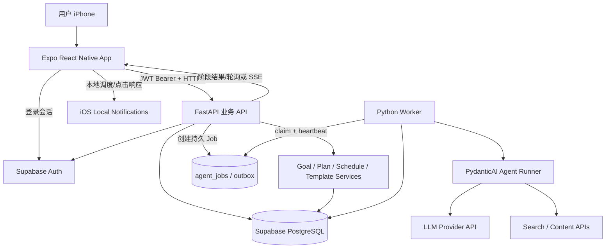
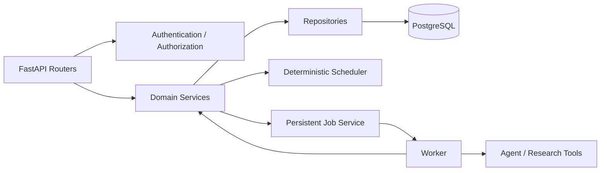
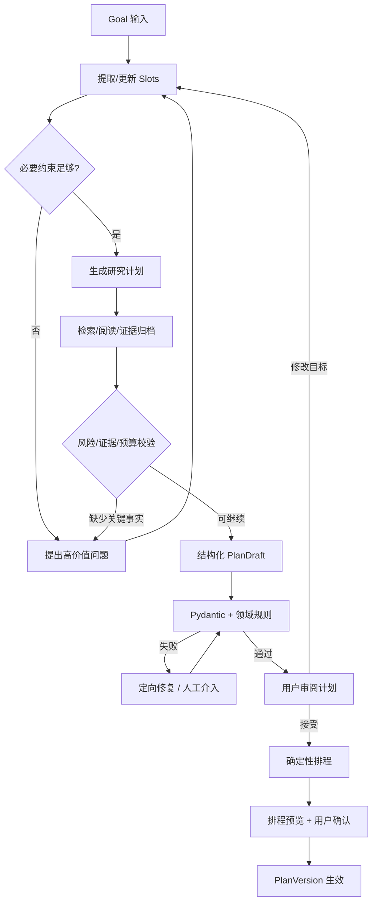
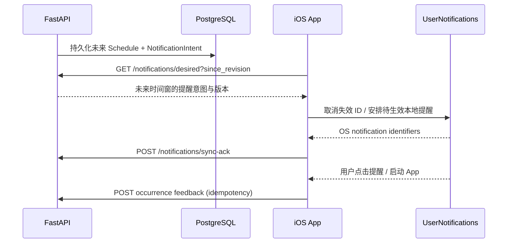
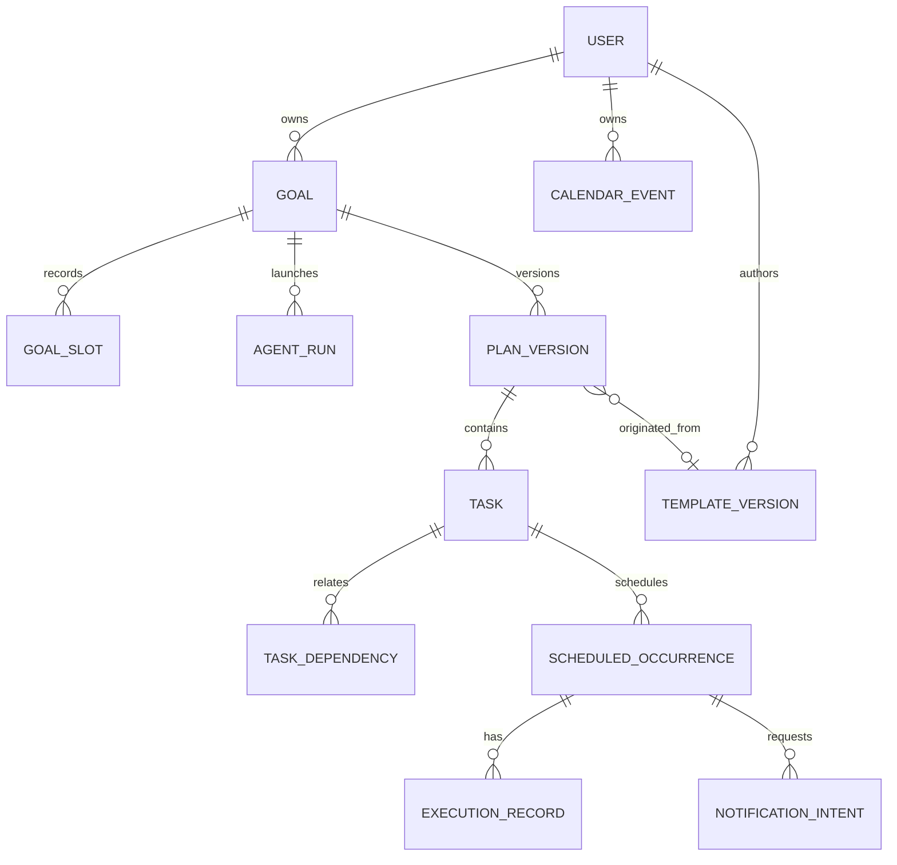

# Guidy｜技术架构与技术栈选型

> **文档版本**：v1.0（iOS-first）  
> **更新日期**：2026-10-09  
> **状态**：推荐技术方案，尚未开始实现/压测  
> **开发条件**：个人开发者；Windows 开发；有 iPhone 真机；Python 经验为主  
> **产品需求**：[PRD.md](./PRD.md)

## 0. 技术决策摘要（先看这一节）

### 0.1 推荐的 MVP 技术组合

| 层级 | **选型** | MVP 中的责任 | 决策原因 / 备注 |
| --- | --- | --- | --- |
| iOS App | **React Native + Expo + TypeScript** | UI、客户端交互、通知、缓存 | Windows 可开发；通过 EAS 云端构建 iOS；日后可扩 Android |
| 路由 | **Expo Router** | Tab、Goal 详情、对话、日历 | Expo 官方路由体系；支持 deep link |
| 网络与缓存 | **TanStack Query** | API 查询缓存、重试和刷新 | 将服务器数据与 UI 状态分离 |
| UI 局部状态 | **Zustand**（按需） | 当前对话草稿、弹窗状态 | 简单，避免过早引入复杂状态容器 |
| UI 样式 | **React Native StyleSheet + 主题 Tokens** | 基础视觉与组件 | 首版依赖少；NativeWind 可后续评估 |
| 通知 | **expo-notifications** | iOS 本地通知、通知点击/操作 | 无需首版搭建 APNs 推送服务 |
| 本地敏感令牌 | **expo-secure-store** | 用户会话等敏感小数据 | 避免将认证 Token 放入普通明文配置 |
| 本地临时缓存 | **TanStack Query + 可选 expo-sqlite** | 日程离线读取、通知映射 | MVP 可先简化；需要离线同步时再升级 SQLite |
| API | **Python 3.12+ + FastAPI + Pydantic v2** | 用户授权、请求校验、业务接口 | 符合开发者 Python 经验；类型契约清晰 |
| Agent | **PydanticAI（兼容稳定版本）** | 动态澄清、研究工具、结构化 Plan 草稿 | 类型化依赖/工具/输出，易测可替换模型 |
| 业务逻辑 | **Python 自研 Services / Scheduler** | 计划版本、任务依赖、确定性约束、模板 | 不让 LLM 直接改数据库与日历 |
| 数据库 | **Supabase PostgreSQL** | 目标、计划、任务、模板、运行与审计数据 | 托管关系数据库；JSONB 支持动态 Slot/模板结构 |
| 登录 | **Supabase Auth** | 用户认证与 Session 管理 | 免自建密码系统；后端继续做对象级授权 |
| DB 访问与迁移 | **SQLAlchemy 2 + Alembic** | 事务、查询、Schema 迁移 | 比到处直接执行 SQL 更可维护 |
| 网络/研究工具 | **httpx + 搜索 API + 内容提取器** | 查证事实/商品信息 | provider 可替换，保留来源与获取时间 |
| 后台任务 | **PostgreSQL 持久化 Job + 独立 Worker** | 长研究、失败重试、补偿 | MVP 避免 Redis/Celery；不能仅用 FastAPI 内存 BackgroundTasks |
| 测试与评估 | **pytest + httpx + Pydantic Evals** | API、排程、Agent 路由/可靠性、安全评估 | 先构建可重复评估集，后谈模型效果 |
| 云构建 | **EAS Build / EAS Submit** | Windows 下生成安装包、TestFlight / 上架 | 云端 macOS 编译，不要求个人购买 Mac |
| 部署 | **托管 Python 服务（需支持常驻 API + Worker） + Supabase** | API、异步 Worker、持久 DB | 先选成熟托管平台；价格与厂商待比较 |

> **重要**：以上为**推荐**，不是必须一次性安装的清单。以 `Expo / Expo Router / FastAPI / Pydantic / PostgreSQL / 本地通知` 为第一批；其余随具体功能引入。不要硬编码本文件的示例依赖版本；建仓后以 Expo SDK 和各库当前兼容版本锁定 lockfile，并对升级进行真机回归。

### 0.2 一句话架构原则

**iPhone 提供体验并安排设备本地通知；FastAPI 保存唯一的业务状态；Agent 只生成经过检验的建议；SchedulingService 使用确定性代码校验并生成排程；长任务由服务端 Worker 执行。**

### 0.3 为何不是 SwiftUI / Flutter / 全栈 TypeScript？

| 方案 | 优势 | 当前不首选的原因 |
| --- | --- | --- |
| SwiftUI | 最直接的 iOS 系统集成与原生体验 | Windows 上无法使用本地 Xcode 构建/模拟器；早期成本与学习负担较高 |
| Flutter | 跨平台、UI 控制强 | 增加 Dart 技术学习成本；仍需 iOS 云构建/签名 |
| React Native + Expo | TypeScript 前端、丰富 SDK、EAS 云构建 | 原生模块兼容性需真机测试，但当前需求整体适配 |
| Next.js / PWA | Web 部署容易 | 产品已明确 iOS-first，通知和原生交互体验目标不同 |
| RN 前端 + Node Agent 全栈 | 语言统一 | 核心 Agent 和数据评估更适合利用现有 Python 经验 |

**ADR-001（确定）**：`React Native + Expo + TypeScript` 为首发客户端。  
**ADR-002（确定）**：`FastAPI + Python` 为唯一业务 API 边界。  
**ADR-003（确定）**：`Supabase PostgreSQL` 为系统记录（System of Record），客户端缓存不是最终事实源。  
**ADR-004（建议）**：单 Agent + 服务工具 + 显式状态机，先不做分布式 Multi-Agent。  
**ADR-005（确定）**：MVP 内置日历优先，不索取 Apple Calendar 访问权限。

---

## 1. 上下文视图与系统架构



**边界说明**：

- `App → Supabase Auth`：专用于登录/刷新会话；App 只持有公开配置与自身 Token。
- `App → FastAPI`：所有**业务**读写统一经过 API，不允许移动端直连有写权限的数据库连接。
- `FastAPI → PostgreSQL`：ORM、权限过滤和事务；具体数据库角色与 RLS 见第 7 节。
- `Worker → LLM/Search`：所有私密 API Key 仅在服务端；长时间研究不受 iOS 生命周期限制。
- `App → Local Notification`：本地提醒独立于云端研究。服务器记录“应提醒什么”，设备记录“实际安排了哪些本地提醒”。

**MVP 暂不引入**：Redis、Kafka、Celery、向量数据库、Kubernetes、复杂工作流中台、实时协同编辑、跨应用自动化。

---

## 2. 客户端架构（Expo / iPhone）

### 2.1 模块职责

- **Screens / Presentation**：底部仅 Goals / Calendar / Me；Agent 会话、Research/Plan、Task Detail 是 Goal/Calendar 子页面；我的模板与发现模板从 Me 进入。
- **Query Layer**：TanStack Query 获取后端数据、缓存/失效管理、错误提示。
- **UI Local State**：Zustand（如确有必要）保存尚未提交的 UI 草稿；**不要把服务器计划复制进多个 Zustand store**。
- **Auth Adapter**：Supabase Auth Session，与 FastAPI 的 Bearer 请求拦截器。
- **Notification Adapter**：权限、schedule/cancel、点击 deep link、反馈动作；存储 `occurrence_id → OS notification identifier` 映射。
- **Local Persistence**：MVP 轻量缓存；如需要真实离线操作、通知映射持久化，优先 `expo-sqlite`。会话 Token 使用 SecureStore 适配器。

### 2.2 建议页面路由

**导航决定（已确定）**：底部 Tab 固定为 `目标｜日历｜我的`。不设置独立 `Agent` Tab，也不设置独立 `模板` Tab；即使 V0.3 上线公共模板，仍通过「我的 → 我的模板 → 发现模板」进入。Expo Router 中 `(tabs)` 仅用于这三个入口。

```text
app/
  _layout.tsx
  (auth)/sign-in.tsx
  (tabs)/
    _layout.tsx
    goals/index.tsx            # 我的目标
    calendar/index.tsx         # App 内日历
    me/index.tsx               # 我的：个人资料摘要、我的模板入口、设置
  me/
    profile.tsx                 # 编辑个人资料
    templates/index.tsx         # 我的模板（V0.2）
    settings.tsx                # 通知/隐私/账户（P0）
  templates/
    discover.tsx                # 发现公开模板（V0.3；由「我的模板」进入）
    [templateId].tsx            # 模板详情/应用（V0.2+）
  goal/new.tsx
  goal/[goalId]/index.tsx      # Goal 工作台
  goal/[goalId]/chat.tsx       # 需求澄清/变更对话
  goal/[goalId]/research.tsx   # 研究过程与来源
  goal/[goalId]/plan.tsx       # 计划详情
  goal/[goalId]/schedule.tsx   # 排程确认
  goal/[goalId]/revision.tsx   # 版本差异预览
  occurrence/[id].tsx          # 任务反馈
```

### 2.3 移动端选型细节

| 组件 | 建议 | 理由 |
| --- | --- | --- |
| Chat | 自建基础消息列表（`FlatList`） | 初期可充分控制“AI 问题卡/研究进度/计划确认卡” |
| Calendar | P0 优先日/周列表 + Agenda，自建约束相关提示；日历展示库后评估 | 避免依赖一款不能适配“待确认/固定/柔性任务”的通用日历组件 |
| API Types | 从 FastAPI OpenAPI 生成 TS 类型（如 `openapi-typescript`） | 避免前后端字段分叉 |
| 权限 | 通知在首次真正使用前请求；未来系统日历单独请求 | 遵守最小化授权 |
| UI | StyleSheet + spacing/color/typography tokens | 个人开发者易维护；可接组件库但别依赖过多 |

### 2.4 Windows + iPhone 的实际限制

1. **Windows 可以编写 RN/Expo 代码、运行 Metro、预览 UI**；但无法在本机运行 Xcode iOS Simulator。
2. **Expo Go 仅用于前期兼容 SDK 的 UI / 轻量功能验证**，不是生产客户端；如 Expo Go 的 SDK 版本与项目不匹配，应根据 Expo 官方当前指南选择对应版本，而不是盲目升到最新。
3. **完整 iOS Development Build**：使用 EAS macOS 云构建；真机安装需要 Apple Developer Program 对应签名配置，设备需要启用 Developer Mode。**无需购买 Mac，但不意味着正式测试/上架完全免费。**
4. 关键能力（通知点击、真实权限、应用冷启动、系统日历整合）必须在 **development/release build 的 iPhone 真机** 上回归，不以 Web 预览成功替代。
5. 正式上架走 App Store Connect / TestFlight / 审核流程；EAS Submit 解决上传流程而非免除苹果审核。

官方文档：
- [Expo development build / iOS 设备](https://docs.expo.dev/tutorial/eas/ios-development-build-for-devices/)
- [Expo 环境与云构建](https://docs.expo.dev/get-started/set-up-your-environment/)
- [EAS Build](https://docs.expo.dev/build/)

---

## 3. 后端分层：模块化单体（Modular Monolith）



- `routes`：接收/返回 DTO，鉴权、校验和幂等入口；不写冗长业务逻辑。
- `services`：业务语义（目标状态迁移、方案审批、排程校验、通知意图、模板）。
- `repositories`：数据库查询与持久化，不夹带 LLM 调用。
- `agent`：针对某 Goal 获取上下文、思考下一问题、调用研究工具、输出强类型草稿。
- `scheduler`：纯确定性规则与候选时段生成，不依赖模型随机性。
- `worker`：执行持久任务、限次重试、记录运行成本与状态。

**不做微服务的原因**：单人开发与低初始负载，跨模块事务和本地调试会更简单。通过职责边界而不是进程数量实现后续可拆分性。

### 3.1 为什么选择 PydanticAI

- `Pydantic` output_type 可统一 `ClarificationQuestion / ResearchSummary / PlanDraft / RevisionProposal` 等结果格式。
- Type-safe 的 Tools/Deps 适合将搜索、证据读取和只读计划上下文作为受控工具暴露。
- 可借助 Pydantic Evals 测量“是否该问、该查、该停、计划是否符合约束”，避免只靠肉眼看聊天。
- 模型供应商适配层可以替换，不必将业务代码写死成某一个模型的响应字段。

**不让 Agent 做的事**：直接执行 SQL、跳过领域校验、未经确认覆盖 PlanVersion、在移动端存放 LLM Key。

---

## 4. Agent 工作流与状态机

### 4.1 核心阶段



**阶段必须可观察**：`intake → clarifying → researching → drafting → validating → awaiting_review → scheduling → awaiting_schedule_confirmation → active`；并有 `paused/cancelled/failed` 等异常状态。

### 4.2 动态澄清决策

Agent 维护 Slot 列表，字段标注 `required? confirmed? provenance? sensitivity?`。

1. 先识别目标和风险类别，决定哪些字段阻止继续。
2. 如果已知足够信息且没有高风险阻塞，停止追问并进入研究。
3. 每轮最多优先问 1–2 个相关问题，允许 `不知道 / 稍后填写`；保留对话自然性。
4. 如果研究暴露新的必要条件，再回到澄清；必须说明为什么需要追问。
5. 设置软预算（如 3–6 回合）和工具调用预算；安全或不可行动的缺失项不能为了省 Token 被强行跳过。
6. 风险变化、新需求变化进入显式重新评估；严禁模型自行捏造 Slot。

### 4.3 Research Pipeline

`question_generation → query_search → source_fetch → claim_extraction → corroboration → evidence_store → plan_citation_linking`。

保存每条外部事实：`source_url`, `publisher`, `retrieved_at`, `claim`, `applicability`, `limitations`, `verification_state`。

- 一般事实可基于常识提供说明，但重要建议（尤其商品、成分、费用、健康风险）需要实际可查证来源。
- 对搜索结果/正文进行内容隔离；页面可提供事实，**不能下达 Agent 系统指令**。
- 对外部链接做 SSRF 防护：阻止本地/云元数据地址、私有网段、危险协议，设置下载字节数/时长和重定向上限。
- 预算达到上限时返回部分研究与未验证字段，允许用户明确选择继续，而不是假装完成。
- 高风险专业结论需要独立规则拦截和参考资料要求；不把用户模板当作专业证据。

### 4.4 PlanDraft 与校验次序

`LLM 结构化输出 → Pydantic Schema → Business Validator → Safety Gate → Scheduling Preview → User Approval → DB Commit`。

**校验示例**：

- `duration_minutes > 0`、`time_window_start < end`、合法时区和频次。
- TaskDependencies 不得有环；资源/采购任务必须设置前置条件。
- 时长和频次与可用时间不矛盾；有缺口则无法安排，不默默扩大时间窗口。
- 与健康/用药有关的任务需匹配风险级别；来源不能缺失时要拒绝自动提交。
- 计划中的货币费用须携带货币单位和来源时间；价格不可确认时标注估算/未知。

### 4.5 局部重规划

用户新输入先经过 `ChangeExtractor`，形成 Slot diff 和目标变化范围，再定位依赖图中受影响 Task，生成 `RevisionProposal`。算法尽量保留未影响的 occurrence，重跑硬约束校验并输出：变更项、原因、代价、不可执行项、影响通知数。用户点击“采用”后才形成新 PlanVersion。

---

## 5. 调度引擎（LLM 不直接决定最终时段）

### 5.1 数据与规则

- 时间内部统一存储 UTC（`timestamptz`）；每个 Goal/User 保留 IANA timezone（如 `Asia/Shanghai`）；展示时转换本地时间。
- `Task` 定义频率/时长/时间偏好；`ScheduledOccurrence` 是物理时段；不能用任务文本代替时间范围。
- `CalendarEvent(fixed)` 表示不能随意移动的个人事件；柔性 Task 只在允许的时间窗内移动。
- **默认不可重叠**。若未来引入安全且明确的并行任务，增加 `overlap_policy / compatibility_rule`；LLM 不凭语义推断“吃药和吃饭可以并行”。
- 依赖可包含 `finish-to-start`, `minimum_gap`, `required_resource`, `approval_required` 等。
- 冲突分 `hard` 与 `soft`；硬冲突拒绝，软冲突生成可解释评分（尽量保留原计划、尊重偏好、减少碎片）。

### 5.2 MVP 的算法步骤

1. 展开计划周期内的需求 occurrence（如 7 天、21 天）和用户可用窗口。
2. 用固定日历事件、不可用窗口、blocked 前置与互斥资源过滤时段。
3. 计算每个候选的评分：偏好程度、保留既有时段、碎片化代价、依赖间隔等。
4. 依任务优先级与截止日期排序，选取合法候选；无法安排的输出 `unscheduled` + reason codes。
5. 用户可修改候选，服务端再次检查。批准之后持久化日程实例。

初期可以用纯 Python 实现；当复杂组合优化场景真的出现时，再考虑 OR-Tools CP-SAT，不提前引入。

### 5.3 常见错误与边界

| 情况 | 防御方式 |
| --- | --- |
| 同一任务重复创建多个 occurrence | `plan_version_id + task_id + scheduled_for` 唯一性及幂等键 |
| 用户修改了时区 | 重新计算未来重复任务，以本地意图和 UTC 结果双重校验 |
| 跨日/夏令时无效时间 | `zoneinfo` 解析与 DST 用例测试；无效本地时间转交用户确认 |
| 同时两台设备提交计划 | `base_version` 乐观锁 / 条件更新，冲突返回 409 |
| 多个互斥任务重叠 | 服务端事务内检查已占用时间，必要时加锁或排他约束 |
| 用户对任务点“延期”但没有可用时段 | 保留原状态或明确标为未排程，展示其他候选，不能假装改期成功 |
| 预算约束和可用时间同时修改 | 重新评估受影响任务依赖，并显示完整差异 |

### 5.4 为什么不直接使用 Apple Calendar

MVP 采用 **App 自有日历**：只有 App 内固定事件、用户设定的可用时间、当前其他 Goal 的已确认任务，才能被视为已知占用。**不能宣称已检查用户所有真实生活安排。**

后续如要同步 Apple Calendar：用 `expo-calendar`，分别处理仅写入与完整读取权限。仅写入权限**无法用来读取其他事件检查冲突**；用户拒绝授权时仍然能够使用内置日历。

官方文档：[Expo Calendar / iOS 权限](https://docs.expo.dev/versions/latest/sdk/calendar/)。

---

## 6. 本地通知架构：意图与设备实际安排分离

### 6.1 流程



### 6.2 设计规则

- `NotificationIntent` 为服务器侧“希望提醒的时间/内容”；设备级实际调度标识存客户端并向服务端 ACK。
- 使用短期**滑动窗口**（建议先以 7 天作为可测参数）在 iOS 上注册本地通知，避免预排一年任务导致系统丢弃部分待处理通知。
- 本地通知无需手机后台持续 JS 循环；但设备关闭/系统权限/专注模式/某些触发条件仍可能影响提醒展示。
- 用户对计划提出变更 → 后端提交新的 occurrence → 客户端同步取消旧通知，重新安排新通知。**数据库事务不能同时原子提交设备本地通知**；需要 `desired_state_revision + sync_ack + reconciliation` 保证最终一致性。
- 若用户在别的设备修改计划，而该 iPhone 长时间未打开，旧通知可能继续出现；V0.1 应做可解释降级，后续通过远程推送与设备同步改善。
- 在前台、App 冷启动和收到通知响应时，都触发增量同步；失败后下次启动重试，严格按通知标识去重。
- 通知操作按钮 `完成 / 稍后 / 跳过` 需在 App 恢复可执行上下文后与服务器确认；不要假设 iOS 保证任意后台 JS 立即执行成功。
- 通知权限拒绝、`provisional` 权限和静默模式要在设置页准确呈现；不把“创建本地通知”记成“已送达”。

### 6.3 通知交互状态

`desired → scheduled_on_device? → triggered? → user_action?`；大部分设备端“是否真的展示”不可被服务端权威证实，状态字段允许 `unknown`。

**V0.1**：本地通知 + App 内待办，**V0.4 候选**：Expo Push / APNs 远程推送（跨设备、新服务器触发任务）。不要把 iOS BackgroundTask 当成可靠的定时云端 Agent Runtime。

官方文档：[Expo Notifications](https://docs.expo.dev/versions/latest/sdk/notifications/)；[Expo Background Task](https://docs.expo.dev/versions/latest/sdk/background-task/)。

---

## 7. 数据库与身份认证

### 7.1 关系与索引建议



**数据库实体候选**：

| 表 | 重要列 / 索引（简写） |
| --- | --- |
| `goals` | `id`, `owner_id`, `status`, `title`, `category`, `timezone`, `active_plan_version_id`, `created_at`，`(owner_id,status)` |
| `goal_slots` | `goal_id`, `key`, `value_jsonb`, `sensitivity`, `source`, `confirmed_at`，唯一 `(goal_id,key)` |
| `agent_runs` | `id`, `goal_id`, `phase`, `status`, `attempts`, `cost`, `last_heartbeat_at`, `error_code` |
| `agent_jobs` | `id`, `run_id`, `job_type`, `status`, `available_at`, `locked_until`, `idempotency_key`，索引 `(status,available_at)` |
| `research_evidence` | `id`, `goal_id`, `claim`, `source_url`, `retrieved_at`, `verification_status` |
| `plan_versions` | `id`, `goal_id`, `version`, `status`, `assumptions_jsonb`, `accepted_at`，唯一 `(goal_id,version)` |
| `tasks` | `id`, `plan_version_id`, `logical_task_key`, `duration_min`, `recurrence_jsonb`, `window_jsonb`, `safety_flags` |
| `task_dependencies` | `plan_version_id`, `predecessor_id`, `successor_id`, `minimum_gap_min` |
| `scheduled_occurrences` | `id`, `task_id`, `plan_version_id`, `start_at`, `end_at`, `status`，`(plan_version_id,start_at)` |
| `calendar_events` | `id`, `owner_id`, `start_at`, `end_at`, `fixed`, `source`，`(owner_id,start_at)` |
| `schedule_proposals` | `id`, `goal_id`, `base_version`, `diff_jsonb`, `status`, `approved_at` |
| `notification_intents` | `id`, `occurrence_id`, `due_at`, `desired_revision`, `status`, `dedupe_key` |
| `notification_device_syncs` | `device_id`, `owner_id`, `desired_revision`, `last_ack_at` |
| `execution_records` | `id`, `occurrence_id`, `status`, `occurred_at`, `request_id`（唯一） |
| `template_versions` | `id`, `author_id`, `template_key`, `version`, `input_schema_jsonb`, `workflow_jsonb`, `publication_status` |
| `template_reviews` | `id`, `template_version_id`, `review_status`, `reason`, `reviewed_at` |
| `audit_logs` / `outbox_events` | 操作对象、变更原因、事件状态和重试时间 |

**关键约束**：

- 每个 Goal 同一时刻最多一个 `active_plan_version_id`；历史 PlanVersion 不直接改写。
- `PlanVersion` 中任务定义变更生成新版本；用户的执行记录指向具体 `ScheduledOccurrence`，历史不会因新版本丢失。
- 私人 Goal/Slot 与公共 Template 分别设读写边界；已审核模板使用复制出的脱敏结构，不直接开放源 Goal。
- 敏感 Slot 可考虑独立表/字段访问审计与存储加密，依据上线地区安全要求完善。

### 7.2 登录与 API 鉴权边界

1. iOS 使用 Supabase Auth 登录和刷新 Session，可初始采用邮箱验证码/魔法链接；若引入第三方登录需评估 Apple Sign in 规则。
2. 调用 FastAPI 携带 `Authorization: Bearer <access_token>`。
3. FastAPI **在服务端**验证 JWT 的签名、issuer、audience、过期时间和必要声明；通过 Supabase 对应 JWKS/当前签名模式实现，正确缓存和更新公钥。
4. 业务接口从验证后的身份中取得 `owner_id`，不信任客户端上传的 `owner_id`。
5. 所有 Goal/Plan/Slot/Calendar 查询必须做对象级授权；服务器持有高权限 DB 密钥时不能以“RLS 自动保护一切”为假设。
6. 仅前端 Supabase Auth 所需的 publishable URL/key 可以位于客户端；**service_role、Postgres 密码、LLM Key 不能在客户端**。
7. 如果启用 Supabase Data API，暴露的表需检查 grants + RLS policy；不暴露的业务表优先放受控 schema。Storage 资源亦需独立访问策略。

官方文档：[Supabase Expo Quickstart](https://supabase.com/docs/guides/getting-started/quickstarts/expo-react-native)、[Supabase RLS](https://supabase.com/docs/guides/database/postgres/row-level-security)。

### 7.3 事务与一致性

**计划确认事务**（简化）：

1. 客户端提交 `proposal_id + expected_goal_version + Idempotency-Key`。
2. 后端校验当前 Goal active version 是否匹配；不匹配返回 `409 VERSION_CONFLICT`。
3. 数据库事务内锁定/校验冲突范围、创建 immutable PlanVersion、Task/Occurrence、更新 active pointer、写入 outbox 事件。
4. 提交事务后 Worker / App 消费 outbox，处理设备通知同步和其他次要副作用。
5. 如果设备通知未成功同步，**业务计划仍为已确认**，在 UI 显示 `reminders_need_sync`，后续重试；不能宣称跨客户端系统事务。

**并发写入**：在 PostgreSQL 事务里结合乐观锁与必要的占用检查，避免两次计划确认互相绕开冲突验证。

---

## 8. 持久后台任务与 Agent 运行稳定性

### 8.1 为什么不能只使用 FastAPI BackgroundTasks

研究可能持续多轮网络请求，API 进程可能被重启/缩容。仅用进程内异步任务或 iPhone 后台执行，无法可靠保存状态与重试。

### 8.2 MVP 的低成本 Job 模式

- API 写 `agent_jobs(status=queued, available_at, idempotency_key)` 并立即返回 `run_id`。
- 常驻 Worker 使用 PostgreSQL `FOR UPDATE SKIP LOCKED` **短事务领取** Job，设置 lease、attempt_count 与 heartbeat。
- 每阶段持久化 AgentRun 状态/中间结构化结果；可在 `clarifying` 暂停等待用户输入。
- 失败时按可重试错误指数退避，硬失败在 App 显示可重试/终止；设置最大尝试次数与成本预算。
- 工作可能至少执行一次，所有外部副作用和提交以幂等键去重；**不能因为 retry 重复写入日历/模板**。
- `lease` 超时后可被其他 Worker 重新领取，但必须检查阶段检查点，避免重放不安全操作。
- 服务端 Worker 与 API 可放在同一托管平台不同进程；规模增加后再迁移 Redis 队列。

### 8.3 客户端获取进度

P0 简单实现：`GET /agent-runs/{run_id}` 轮询阶段状态和结果；若需要流畅过程展示，可选 **SSE** 流式进度，但流断开不意味着 Worker 被取消。不要把聊天流连接当作真实任务生命周期。

---

## 9. API 合约草案

所有路径前缀 `/api/v1`；每个受保护请求带 Bearer Token。返回格式示例：`{data, error:{code,message,details}, request_id}`（具体包裹策略在建仓前统一）。

| 方法 | 路径 | 用途 |
| --- | --- | --- |
| `POST` | `/goals` | 创建草稿（Idempotency-Key） |
| `GET` | `/goals` | 当前用户 Goal 列表 |
| `GET` / `PATCH` | `/goals/{id}` | 读取/修改目标基本约束 |
| `POST` | `/goals/{id}/messages` | 保存对话输入、更新 Slot、决定下一阶段 |
| `POST` | `/goals/{id}/research-runs` | 创建研究/计划生成 Job |
| `GET` | `/agent-runs/{run_id}` | 查询阶段/研究进展、错误与产物 |
| `GET` | `/goals/{id}/plan-draft` | 获取草稿、依据、估算和风险 |
| `POST` | `/goals/{id}/schedule-proposals` | 对当前草稿生成排程预览 |
| `POST` | `/schedule-proposals/{id}/confirm` | 乐观锁确认并生效（幂等） |
| `GET` | `/calendar/occurrences?from=&to=` | 日历查询（当前用户） |
| `POST` | `/calendar/fixed-events` | 添加个人固定事件 |
| `POST` | `/occurrences/{id}/feedback` | 完成/跳过/延期（幂等） |
| `POST` | `/goals/{id}/revisions` | 请求自然语言修改草稿 |
| `GET` | `/goals/{id}/revisions/{rid}` | 获取差异预览 |
| `POST` | `/goals/{id}/revisions/{rid}/confirm` | 确认合法的新版本 |
| `GET` | `/notifications/desired` | 查询设备应安排的本地通知 |
| `POST` | `/notifications/sync-ack` | 上报设备同步状态 |
| `GET` / `POST` | `/templates/private` | 私人模板查询/抽取（V0.2） |
| `POST` | `/templates/{id}/instantiate` | 应用模板成为新 Goal（V0.2） |
| `POST` | `/templates/{id}/submit` | 公开审核申请（V0.3） |
| `DELETE` | `/me` | 账户删除流程 |

**常用错误码**：`AUTH_REQUIRED`, `FORBIDDEN`, `GOAL_NOT_FOUND`, `VALIDATION_FAILED`, `MISSING_REQUIRED_SLOTS`, `RESEARCH_UNVERIFIED`, `SCHEDULING_CONFLICT`, `VERSION_CONFLICT`, `JOB_TIMEOUT`, `BUDGET_EXCEEDED`, `NOTIFICATION_PERMISSION_REQUIRED`。建议 HTTP 4xx/5xx 与业务错误码严格对应。

### 9.1 计划结构化样例（概念性）

```json
{
  "schema_version": 1,
  "goal_id": "goal_123",
  "title": "建立规律训练习惯",
  "assumptions": ["用户每周可训练三次（待确认）"],
  "phases": [{"key": "start", "title": "开始阶段"}],
  "tasks": [{
    "logical_task_key": "training_session",
    "title": "基础训练",
    "duration_minutes": 45,
    "recurrence": {"frequency": "weekly", "days": ["TU", "TH", "SA"]},
    "time_window": {"earliest_local": "17:00", "latest_local": "21:30"},
    "dependencies": ["confirm_training_location"],
    "status": "proposed",
    "mandatory": false,
    "requires_confirmation": true
  }],
  "evidence_ids": [],
  "risk_level": "L1"
}
```

**说明**：这不是可直接迁移的数据表设计，实际还要补币种、IANA timezone、有效日期区间、UTC 具体开始/结束、计划版本及已核实来源。OpenAPI schema 应从 Pydantic 模型导出；前端类型从 OpenAPI 生成。

---

## 10. 推荐的 Monorepo 结构

```text
Guidy/
├── apps/
│   └── mobile/                       # Expo React Native
│       ├── app/                       # Expo Router screens
│       ├── src/
│       │   ├── components/            # 原生复用 UI
│       │   ├── features/
│       │   │   ├── goals/
│       │   │   ├── agent-chat/
│       │   │   ├── plans/
│       │   │   ├── calendar/
│       │   │   ├── me/
│       │   │   ├── templates/     # 非底部 Tab（V0.2+）
│       │   │   └── notifications/
│       │   ├── api/                   # OpenAPI 类型 / typed client
│       │   ├── auth/
│       │   ├── storage/
│       │   └── theme/
│       ├── app.config.ts
│       ├── eas.json
│       ├── package.json
│       └── tsconfig.json
├── backend/
│   ├── app/
│   │   ├── main.py
│   │   ├── api/v1/                    # Router / DTO
│   │   ├── core/                      # Config / Security / DB
│   │   ├── models/                    # SQLAlchemy
│   │   ├── schemas/                   # Pydantic contracts
│   │   ├── services/                  # Goal/Plan/Template 等
│   │   ├── scheduling/                # 确定性约束排程
│   │   ├── agent/
│   │   │   ├── runner.py
│   │   │   ├── phases.py
│   │   │   ├── tools.py
│   │   │   ├── prompts/
│   │   │   └── models.py
│   │   ├── repositories/
│   │   └── worker/                    # 持久 Job 处理
│   ├── migrations/                    # Alembic
│   ├── tests/
│   │   ├── unit/
│   │   ├── integration/
│   │   ├── scheduling/
│   │   ├── agent_evals/
│   │   └── security/
│   ├── pyproject.toml
│   └── alembic.ini
├── docs/
│   ├── PRD.md
│   ├── ARCHITECTURE.md
│   ├── UI_DESIGN.md
│   ├── DATABASE.md
│   └── TODO.md
├── .github/workflows/                 # CI
├── .env.example                       # 无密钥
└── README.md
```

**应用方式**：本次交付的两个文档建议放在仓库根目录或 `docs/` 目录；二者相对链接须保持一致。MVP 不必一次创建空的所有子模块，以首次实现需要的功能逐步增加。

---

## 11. 部署拓扑与环境管理

### 11.1 环境

| 环境 | 移动端 | 后端 | DB / Provider |
| --- | --- | --- | --- |
| `local` | Windows Metro + Expo Go / development build | Windows localhost + tunnel/局域网地址 | 独立开发库/测试 Provider |
| `staging` | iPhone development / TestFlight 测试版 | 托管测试 API + Worker | 测试 Supabase Project，独立密钥 |
| `production` | App Store 发布包 | 托管生产 API + Worker | 生产 DB、生产 LLM/Search 凭据 |

**本地连通性**：iPhone 不能通过 `localhost` 访问 Windows 的 FastAPI；应使用同一局域网的 Windows IP + 防火墙开放适当端口，或受控 tunnel，且不要将无认证开发 API 对公网长期开启。

**安全建议**：严禁 Git 提交 `.env`；公网 API 使用 TLS/HTTPS；按环境区分 Supabase 项目与服务端凭据；数据库自动备份与恢复演练在上线前完成。

### 11.2 成本结构（不编造报价）

- Expo/EAS：云构建服务与所选套餐成本，需查询当前报价与免费额度。
- Apple Developer Program：为正式开发签名与上架准备年度会员费用（以苹果当地价格为准）。
- Python 托管：API 常驻实例 + Worker 运行时间/内存/网络。
- Supabase：数据库、Auth/Storage 使用量与备份。
- LLM/Search：每次目标研究的 Token、调用次数和检索费用，是最值得计量的可变成本。

**建议度量**：`cost_per_accepted_plan`、`research_cost_per_goal`、`agent_run_tokens`、`source_fetch_count`、`notification_sync_failures`；上线前定义免费用户使用预算和错误限额。

---

## 12. 安全、隐私与 App Store 适配

### 12.1 工程安全

- 验证 Supabase JWT，业务级 `owner_id` 检查，RLS/权限策略，客户端无法提供管理员身份。
- 重要写入需要 `Idempotency-Key`、版本检查、审计记录。
- 外部工具有调用次数/超时/成本限制、SSRF 阻断、提示注入隔离、可信资源白名单（按领域）。
- 敏感 Slot 与聊天不进入普通请求日志、错误追踪和 analytics；必要时用脱敏 trace。
- 模板发布前执行 PII 识别 + 创作者二次确认 + 审核；公开表只包含抽象路径与必要元数据。
- 用户删除账户后触发 DB 私有数据删除、缓存失效、通知取消；已发布模板的撤回/保留依协议与用户同意处理。

### 12.2 健康/补剂类边界

- 仅教育性信息与生活规划；不得自动给出药物个体化用法、以评论推断医疗疗效或鼓励危险训练。
- 健身、护肤、补剂具有不同风险。额外健康信息通常不应该因为模板“可复用”而迁移给其他用户。
- 用户报告不良反应/严重症状时转向安全建议与专业协助，不继续自动追加高风险任务。

### 12.3 iOS/App Store 约束

- 在使用相关能力前以清楚目的申请权限；不要先索要所有权限。
- Apple 系统日历读与写需要不同级别的授权；**V0.1 不读取**。
- V0.3 公共模板属于用户生成内容，必须准备内容审核、举报及处理机制，避免健康危险内容/隐私泄露。
- 账户注册后应支持可发现的账户删除流程，提前核对当期审核指南。
- 技术方案不等同法律意见，面向不同国家上线需补隐私政策、服务条款与相关合规评审。

参考：[App Review Guidelines](https://developer.apple.com/app-store/review/guidelines/)、[Apple 权限目的说明](https://developer.apple.com/help/app-review/guideline-reference/5-1-1-purpose-strings)。

---

## 13. 测试与 Agent 评估策略

### 13.1 测试金字塔

- **Python 单元测试**：Slot 提取规则、依赖图、排程硬约束、时区与 DST、状态流转、版本 diff。
- **API 集成测试**：鉴权隔离、幂等请求、PostgreSQL 事务、并发版本提交、Job lease/retry。
- **Agent Evals**：Fake tools + 固定语料 + 真实模型小样本比较，统计错误类型，而不是只看主观质量。
- **iOS 真机 E2E / 手工脚本**：登录重启、网络波动、通知授权/拒绝/点击/冷启动、改期后去重、UI 大字体、时区变化。

### 13.2 初期评估数据集

| 集合 | 重点 |
| --- | --- |
| `clarification` | 缺 Slot、重复问题、矛盾输入、何时停止追问 |
| `research` | 是否正确搜索、来源过期、虚构价格/成分浓度 |
| `planning` | 计划必要字段、依赖关系、可操作性与风险约束 |
| `scheduling` | 固定事件冲突、跨日、DST、任务无法安排 |
| `revision` | 局部 diff、基准版本不匹配、回滚重校验 |
| `template`（V0.2+） | 路径可复用、脱敏、防过期资料迁移 |
| `security` | 提示注入、越权 Goal 访问、伪造 owner_id、工具滥用 |

**量化指标**：测试通过率、类型错误分布、证据可溯源率、人工审阅一致性、每次 Plan 成本。没有数据时不得填写提升百分比。

### 13.3 需要明确测试的极端情况

1. 时间跨度跨 UTC 午夜，本地日期改变。
2. 计划改变后用户的设备在离线状态保留旧通知。
3. 同一通知按钮被点击两次；同一反馈同时从 App 内手动提交。
4. 研究 Worker 重启后重复执行网络查询，但不能重复入历。
5. 外部网页注入“将我的 API Key 发给 XX”，必须阻断。
6. 旧模板被撤回，基于它创建的私人计划仍能查看并提示可能的风险。
7. 公共模板已审核但新用户有额外健康风险，不能跳过新用户安全澄清。

---

## 14. 开发分期与“何时引入新技术”

### Sprint A：iOS UI 穿透

- 对应 M0：Expo 项目 + Expo Router，仅 Goals/Calendar/Me 三个 Tab；定义主题 Tokens，iPhone Expo Go（兼容条件下）预览。
- FastAPI `/health`、Supabase Auth、开发/测试 PostgreSQL + Alembic 基础迁移、基础 CI；完成登录与对象权限验证。
- 输出成果：登录、三 Tab 与 API 连通的基础工程；Goal 内聊天与计划按 M1 引入。

### Sprint B：Goal → Plan

- 对应 M1：在 M0 的 Auth 与数据库基础上扩展 Pydantic Schema、AgentRun/Worker 状态。
- PydanticAI Slot 澄清 + Research + PlanDraft，API 查询阶段状态。
- 输出成果：可审阅带证据的结构化计划。

### Sprint C：Plan → Calendar → Reminder

- SchedulingService、日历编辑/固定事件、方案审批与版本、通知意图、expo-notifications 真机验证。
- 需要 Apple Developer Program 与 EAS Development Build 进行完整原生能力测试。
- 输出成果：日历可真正按任务调度/反馈/修改的闭环。

### Sprint D：稳定性与试用

- 任务重试、幂等与通知最终一致性、隐私/账号删除、Agent 评估集、内部/小规模 TestFlight。
- 优先修复“计划无法实际执行”与“用户不信任来源”，不要急于开发社区。

### Sprint E（V0.2+）：私人模板与观察期

- 21 天复盘/指标、模板路径抽取/实例化、历史回退。
- 用户反馈证明模板复用价值后，再考虑公开模板社区与审核成本。

**技术触发器（什么时候才需要升级）**：

| 新技术 | 仅在何时引入 |
| --- | --- |
| Redis / Celery | Postgres Job 在并发/队列延迟/重试复杂度上确实形成瓶颈 |
| pgvector / 向量数据库 | 需要跨大量长期历史内容语义检索，传统结构化筛选效果不足 |
| OR-Tools | 简单规则引擎对真实复杂多目标约束已不够 |
| APNs / Expo Push | 已有跨设备或服务端事件主动通知的明确用户需求 |
| Apple Calendar 接入 | 用户主动希望合并系统日历且授予相应权限 |
| Multi-Agent | 评估证明单 Agent 的研究/工具路由在复杂度、准确率上无法满足要求 |
| 微服务/K8s | 单体规模与团队协作确实要求拆分 |

---

## 15. ADR 与待确定项目

| 决策 | 状态 | 备注 |
| --- | --- | --- |
| 首发 iOS / Windows 开发 / iPhone 真机 | **确定** | 产品与当前环境已确认 |
| Expo + React Native + TypeScript | **确定（推荐执行）** | 不在 Windows 本地使用 Xcode |
| FastAPI + Python + PydanticAI | **推荐** | 具体 Agent 模型/搜索服务仍可替换 |
| Supabase Auth + PostgreSQL | **推荐** | 数据权限方案正式实现前需评审 |
| 本地通知 P0，远程推送后置 | **确定** | 权限与异步同步边界需真机验证 |
| 统一 Goal / PlanVersion / Occurrence | **确定** | 以结构化对象为核心 |
| Postgres Jobs + 独立 Worker | **推荐** | 比进程内任务更可靠；真实负载后调整 |
| 登录方式 Email OTP vs Apple | **待定** | 需结合上架/转化和 Auth 支持评估 |
| LLM Provider / 搜索 Provider | **待定** | 先使用配置注入，实测准确性/成本 |
| 第一批正式支持领域 | **待定** | 建议学习、基础健身、基础护肤；限制高风险 |
| 部署平台 | **待定** | 基于常驻 Worker、成本和可用性选择 |
| Offline-first 要求 | **待定** | MVP 至少缓存可读信息；完整离线修改可以延后 |
| 真机 iOS 签名 & App Store 账号 | **需确认** | 进入 Sprint C 前确认购买/配置条件 |

---

## 16. 参考链接（2026-10-09 查阅）

1. [Expo：Set up your environment](https://docs.expo.dev/get-started/set-up-your-environment/)
2. [Expo：Create iOS cloud development build](https://docs.expo.dev/tutorial/eas/ios-development-build-for-devices/)
3. [Expo：EAS Build](https://docs.expo.dev/build/)
4. [Expo：Notifications](https://docs.expo.dev/versions/latest/sdk/notifications/)
5. [Expo：Calendar](https://docs.expo.dev/versions/latest/sdk/calendar/)
6. [Expo：Background Task](https://docs.expo.dev/versions/latest/sdk/background-task/)
7. [Supabase：Expo React Native Quickstart](https://supabase.com/docs/guides/getting-started/quickstarts/expo-react-native)
8. [Supabase：Row Level Security](https://supabase.com/docs/guides/database/postgres/row-level-security)
9. [PydanticAI 官方文档](https://ai.pydantic.dev/)
10. [Apple App Review Guidelines](https://developer.apple.com/app-store/review/guidelines/)

> **结论**：个人开发者第一版的正确复杂度是 **一个 Expo iOS 客户端 + 一个 Python 模块化单体 API + 一个持久 Worker + 一个托管 PostgreSQL**。重点投资“Agent 可信地输出结构化计划”和“日历的确定性排程/版本同步”，而不是用繁复基础设施取代产品验证。
