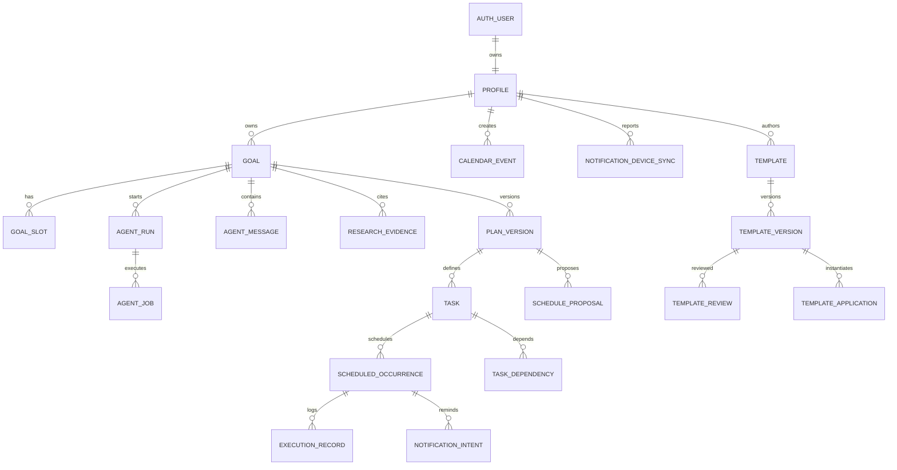

> **2026-10-09 架构切换说明**：本文件为 D1 适配后的模型；旧 PostgreSQL 文档保存在 [历史快照](../archive/architecture-before-cloudflare/DATABASE.md)。M0 已在独立本地开发/测试 D1 应用认证核心表与 profiles/goals、rateLimit/本地开发收件箱，接入本地 OTP/会话；另有独立云开发 D1 已应用迁移且未复制本地数据。正式邮件、云端认证与其他业务表尚未实现。

0003 增加库的 `rateLimit` 与仅限本地的 `dev_auth_inbox`。后者不属于生产邮件模型；没有公开读取接口，验证码仅由本地 CLI 查看，成功验证后删除，过期不再提供。认证 `verification` 的 OTP 使用哈希；部署基础配置未启用本地投递模式。业务账号的 profiles 按验证会话创建并查询，传入的 owner_id/X-User-ID 不作为身份依据。

# Guidy｜数据库设计与数据生命周期

迁移 `0006_goal_slots.sql` 实现第一批用户条件（outcome/available_time/constraints）：value_json 带 schema_version=1、state=confirmed/unknown、text；source 固定 user，sensitivity 固定 private。unknown 必须空文本且 confirmed_at=NULL，confirmed 必须有效文本与服务端确认时间；数据库与运行时双层校验。草稿阶段 PATCH /goals/{id}/slots 带 expected_revision/Idempotency-Key，原子更新三项条件、Goal revision 和命名空间化修改回执；暂停/已生效目标只读。GET 通过 D1 batch 读取一致的目标/条件快照并按 owner 过滤。此阶段不让模型写确认条件，不保存 Agent 回复或自动生成计划。

增量迁移 `0005_goal_mutations.sql` 新增账号范围的 `goal_mutations` 修改回执及 goals 最近修改标识。PATCH 仅允许没有生效计划的 draft/paused 目标，携带 expected_revision 和 Idempotency-Key；D1 batch 条件 UPDATE 与回执 INSERT 原子完成。标识确保条件 UPDATE 失败后不会给其他请求的修改创建错误回执；回执和同账号 Goal 通过复合外键关联。回执保存原始请求与当次结果，后续重复请求只重放历史结果，不重写当前目标。同键不同内容、旧版本或不可编辑状态返回 409。目标描述/期望时间为私人数据，不记录到请求日志；回执随目标删除级联清理，尚无目标删除 API。已在本地开发/测试及独立云开发 D1 应用；云端 API 部署于 api.guidy.fun，认证目标成功路径仍待验证。

2026-10-10 内部目标开发：增量迁移 `0004_goal_input.sql` 在现有 goals 增加 `description`（最多 300 字）、`timeframe_note`（最多 80 字）和 `creation_key`。期望时间为用户原始意图，不解析为截止日期或日历事件；旧目标默认空描述/时间说明。`owner_id + creation_key` 唯一索引保证并发创建去重，同键不同内容返回 409；键绑定账号，不接受客户端指定归属。创建返回 draft/revision=0；编辑与暂停/继续由 0005 阶段的 PATCH 提供。已在本地开发/测试及独立云开发 D1 应用。

> **版本**：v0.1 数据模型草案（2026-10-09）  
> **状态**：M0 本地基础迁移通过；完整模型仍待后续实现和生产验证  
> **数据库**：Cloudflare D1（SQLite 语义）；参数化 SQL + Wrangler migrations  
> **关联**：[PRD.md](./PRD.md) · [ARCHITECTURE.md](./ARCHITECTURE.md) · [UI_DESIGN.md](./UI_DESIGN.md) · [TODO.md](./TODO.md)

## 0. 核心决策与范围

- **Goal 为领域根对象**：一个 Goal 可有多个候选/历史计划，但只指向一个当前生效的 `plan_version`。
- **服务器是事实源**：客户端数据库仅作缓存、草稿或通知映射；手机实际注册的提醒状态需单独回传。
- **任务定义与执行实例分离**：每周训练三次是 Task；10 月 14 日的那次训练是 ScheduledOccurrence，实际完成情况是 ExecutionRecord。
- **计划版本不可覆盖**：用户修改条件先产生候选版本/变更提议，获授权后原子提交；历史记录继续可查。
- **模板是抽象后的新资产**：私人模板与 Goal/Plan 不共享行权限；公开模板不携带原作者身高、体重、日历、原始对话等私密值。
- **按版本引入**：本文件完整描绘 V0.1 基础模型、V0.2 启动期和私人模板、V0.3 公共模板；不意味着 MVP 全部建表。

## 1. 概念 ER 关系

**实现提示**：上图为概念关联，`task_dependencies` 通过两条指向 `tasks` 的外键连接前驱/后继；`goals.active_plan_version_id` 还需要指向同一 Goal 的版本，必须在服务层与数据库约束中共同验证。

## 2. 命名、身份与字段规范

- 数据库表名 `snake_case` 复数；主键优先 `TEXT`（业务 UUID；认证 ID 为不透明字符串）；`created_at/updated_at` 为 UTC epoch 毫秒 `INTEGER`。
- 外部输入的本地时间必须带 **IANA 时区**（如 `Asia/Shanghai`），计划具体实例的起止时间存 UTC 语义的 UTC epoch 毫秒 `INTEGER`；重复规则存本地时区语义，不能仅用 `UTC+8` 代替。
- 所有可版本化的动态结构必须带 `schema_version`；通过 json_valid CHECK 的 JSON `TEXT` 用于 Slot 值、模板参数模式、重复规则和计划差异，不代替具备强引用关系的任务表。
- 不信任前端传入的 `owner_id`；由验证后的 Better Auth 会话身份决定当前用户，不假定一定使用 JWT。
- 各类 `status` 使用受约束的文本或 enum；状态变化必须由 Service 定义合法转移。开发早期优先带 `CHECK` 的文本以降低 enum 迁移成本。
- 公共对象和个人私密记录物理/逻辑隔离；日志与埋点仅记录最小必要标识、状态和耗时，不记录健康数据或完整对话。

## 3. V0.1 表定义（建议）

### 3.1 账户与目标

| 表 | 核心字段 | 约束与说明 |
| --- | --- | --- |
| `profiles` | `user_id` PK/FK Better Auth 用户表 ID, `display_name`, `avatar_path?`, `locale`, `timezone`, `created_at`, `updated_at` | 「我的」个人资料；不强制姓名、性别、生日、身体信息 |
| `goals` | `id`, `owner_id`, `title`, `category?`, `status`, `deadline_at?`, `active_plan_version_id?`, `revision`, `created_at`, `updated_at` | `revision` 用于并发校验；`(owner_id,status)` 索引 |
| `goal_slots` | `id`, `goal_id`, `key`, `value_json`, `sensitivity`, `source`, `confirmed_at?`, `updated_at` | `UNIQUE(goal_id,key)`；必要时加密敏感字段；按目标隔离 |
| `agent_messages` | `id`, `goal_id`, `role`, `content`, `created_at` | 仅该 Goal 对话可见，默认不公开，也不作为模板原件 |

`goals.status` 建议：`draft / clarifying / researching / awaiting_approval / active / paused / completed / archived`。删除可先执行受控软删除流程，再依据策略进行不可恢复清除；删除策略需满足上线地区法规。

### 3.2 Agent 与研究

| 表 | 核心字段 | 约束与说明 |
| --- | --- | --- |
| `agent_runs` | `id`, `goal_id`, `phase`, `status`, `context_schema_version`, `checkpoint_json`, `cost?`, `started_at`, `updated_at` | `clarifying/researching/drafting/needs_input/...` 阶段；长任务断线可恢复 |
| `agent_jobs` | `id`, `run_id`, `job_type`, `status`, `available_at`, `lease_until?`, `attempt_count`, `idempotency_key`, `error_code?` | `UNIQUE(idempotency_key)`；领取索引 `(status,available_at)` |
| `research_evidence` | `id`, `goal_id`, `claim`, `source_url`, `retrieved_at`, `verification_status`, `applicability_json` | 追踪证据与适用性；不得存伪造的来源 |

外部网页是**不可信数据**，不得在 Worker 中把网页指令提升为系统权限；Agent Job 失败时要保存状态而不是丢失研究过程。原始网页全文如需缓存，应另设保留期限/版权和隐私策略。

### 3.3 计划、任务与排程

| 表 | 核心字段 | 约束与说明 |
| --- | --- | --- |
| `plan_versions` | `id`, `goal_id`, `version`, `status`, `schema_version`, `assumptions_json`, `estimated_cost_json?`, `created_at`, `accepted_at?` | `UNIQUE(goal_id,version)`；生效版本原则上不可变 |
| `tasks` | `id`, `plan_version_id`, `logical_task_key`, `title`, `duration_min`, `recurrence_json?`, `window_json?`, `priority`, `resource_needs_json?`, `safety_flags_json?` | `UNIQUE(plan_version_id,logical_task_key)`；可在版本间逻辑追踪同一任务 |
| `task_dependencies` | `id`, `plan_version_id`, `predecessor_task_id`, `successor_task_id`, `minimum_gap_min?`, `type` | 禁止自依赖与依赖环；两端任务必须属于同一计划版本 |
| `calendar_events` | `id`, `owner_id`, `source`, `title`, `start_at`, `end_at`, `fixed`, `created_at` | 用户固定事件不能被 AI 静默移动；`end_at > start_at` |
| `schedule_proposals` | `id`, `goal_id`, `plan_version_id`, `base_goal_revision`, `diff_json`, `status`, `expires_at`, `approved_at?` | 提交时检查版本及日期有效性，防止旧草稿覆盖新安排 |
| `scheduled_occurrences` | `id`, `task_id`, `plan_version_id`, `owner_id`, `start_at`, `end_at`, `status`, `superseded_at?` | 每一执行实例；旧实例标记替代，不删除历史反馈 |

**两级版本区分**：`plan_versions.version` 是计划内容版本，`goals.revision` 是 Goal 聚合的并发版本。客户端提交待确认草稿时必须携带当前 `revision`（例如 `If-Match` 或请求字段）。

**排程硬约束**：由 `SchedulingService` 检查时间重叠、前置依赖、互斥资源、最短间隔、截止日期、目标所属权。D1 CHECK/外键/唯一索引提供第二道保护；可并行与硬冲突仍须领域校验。

### 3.4 执行反馈与通知

| 表 | 核心字段 | 约束与说明 |
| --- | --- | --- |
| `execution_records` | `id`, `occurrence_id`, `owner_id`, `status`, `feedback_json?`, `recorded_at`, `request_id` | `UNIQUE(request_id)` 或用户域内组合唯一；重复提交不能双重计数 |
| `notification_intents` | `id`, `occurrence_id`, `owner_id`, `channel`, `due_at`, `desired_revision`, `status`, `dedupe_key` | `UNIQUE(dedupe_key)`；计划改期时作废旧意图 |
| `notification_device_syncs` | `device_id`, `owner_id`, `last_desired_revision`, `last_ack_at`, `sync_status` | 复合唯一设备关联；支持 App 恢复时增量对账 |
| `outbox_events` | `id`, `event_type`, `aggregate_id`, `payload_json`, `status`, `created_at`, `processed_at?` | 与计划确认同事务写入；异步通知、评估/事件处理 |
| `audit_logs` | `id`, `actor_id`, `action`, `entity_type`, `entity_id`, `summary_json`, `created_at` | 仅记录变更元数据与必要的解释，不存敏感原文 |

状态区别：通知 `scheduled/sync_pending/cancelled/unknown` 是**计划和设备同步状态**；`delivered/opened` 未必具有操作系统回执，不能因定时器成功注册就写“已送达”。执行 `completed/partial/postponed/skipped/unknown` 必须与通知状态严格分离。

## 4. V0.2：21 天启动期与私人模板

| 表 | 建议字段 | 关键规则 |
| --- | --- | --- |
| `kickstart_periods` | `id`, `goal_id`, `start_date`, `planned_days`, `timezone`, `paused_days`, `end_date?`, `review_state` | 21 天是可修改的默认观察期，不是习惯养成或达标保证 |
| `templates` | `id`, `author_id`, `title`, `visibility`, `current_version_id?`, `created_at` | 初期 `visibility=private`；与源计划隔离 |
| `template_versions` | `id`, `template_id`, `version`, `schema_version`, `input_schema_json`, `question_graph_json`, `research_policy_json`, `task_blueprint_json`, `status` | 不包含作者的身体数据、私聊或具体行程 |
| `template_applications` | `id`, `template_version_id`, `user_id`, `goal_id`, `applied_at` | 实例化必须新建目标与计划，记录来源版本但不共享所有权 |

个人计划完成 21 天之前允许创建**私人模板草稿**。公开分享资格是另外的业务状态，不应阻止个人复用自己的方法。

## 5. V0.3：公开模板审核与社区治理

| 表 | 建议字段 | 关键规则 |
| --- | --- | --- |
| `template_reviews` | `id`, `template_version_id`, `submitted_by`, `status`, `reviewer_id?`, `reason?`, `reviewed_at?` | 资格审查、脱敏、内容安全与申诉；日志可追溯 |
| `template_reports` | `id`, `template_version_id`, `reporter_id`, `reason_code`, `status`, `created_at` | 举报、下架和处理路径 |
| `template_feedback` | `id`, `template_version_id`, `user_id`, `feedback_type`, `consent_for_aggregation`, `created_at` | 匿名统计须独立同意，不上传任意用户原始对话 |

公开申请资格：持续性计划经过至少 **21 个自然日** 的执行观察，且满足单独设定的反馈覆盖和安全审核规则。此前 PRD 的“至少 14 个不同反馈日”为**待验证门槛建议**，不是成功率证明。短周期目标先限制为私人模板，不为凑 21 天伪造执行。

**公共读取方案**：后端向客户端输出经过白名单投影的 `PublicTemplateDetail`，不直接暴露数据库完整 `template_versions` 行；公开版本不可静默覆盖，撤回影响新实例化，不自动删除既有用户计划。

## 6. 关键事务与一致性

### 6.1 确认计划 / 排程

1. 以验证后的 `owner_id` 查 Goal，使用原子条件更新保护相应 Goal；核对 `expected_goal_revision`。
2. 验证 `schedule_proposal` 是否未过期、属于该用户的 Goal、匹配基线版本且排程硬约束仍成立。
3. 在同一经并发/回滚验证的 D1 原子批次中：插入已确定的计划版本/任务/未来执行实例，切换 active 指针，递增 Goal revision；替换受影响未来旧实例的生效状态；写 `notification_intents` 和 `outbox_events`。
4. 成功后返回 `commit_id` 与 `desired_notification_revision`，客户端显示“计划已保存，设备提醒可能待同步”。
5. 客户端撤销旧的本地通知并注册新通知，保存 OS notification id 映射并报告回执；失败可重试。

**跨手机/服务器不能做真正原子提交**：设备关机或 App 长时间未打开时，旧的本地通知可能仍会触发；后续需评估 APNs 远程推送、App 恢复对账与到达时确认机制。不可假称“改期后所有设备立即撤销旧通知”。

### 6.2 反馈幂等与历史保留

- 重复的反馈请求使用客户端稳定 `request_id`；服务器写入一条结果或返回先前结果。
- 如用户纠正历史反馈，保存变更审计/修订来源；不要在历史累计报表中静默重复统计。
- 已完成任务属于某次 `scheduled_occurrence`，即使未来计划换版，也不能丢失该条记录。

### 6.3 后台 Job 租约

后台消费者使用适配 D1 的条件 UPDATE/唯一去重标识领取 Job，并保存 lease/heartbeat/检查点。领取与确认必须具备原子条件测试；不使用 PostgreSQL 行锁或 SKIP LOCKED。持久编排/消息消费者在 M1 验证，API 请求中的内存任务不能代替可靠后台任务。

## 7. 索引、唯一性与校验建议

| 对象 | 建议索引 / 约束 | 原因 |
| --- | --- | --- |
| `goals` | `(owner_id,status,updated_at DESC)` | 首页按状态列出最近目标 |
| `goal_slots` | `UNIQUE(goal_id,key)` | 同一目标唯一当前信息 Slot |
| `plan_versions` | `UNIQUE(goal_id,version)` | 可审查的版本序列 |
| `tasks` | `UNIQUE(plan_version_id,logical_task_key)` | 单版本中任务稳定识别 |
| `scheduled_occurrences` | `(owner_id,start_at)`、`(task_id,start_at)` | 日历查询和实例检查 |
| `execution_records` | `UNIQUE(request_id)` | 避免重复点击/离线重放 |
| `agent_jobs` | `(status,available_at)`、`UNIQUE(idempotency_key)` | Worker 领取和重试 |
| `notification_intents` | `(owner_id,due_at)`、`UNIQUE(dedupe_key)` | 快速查询设备待同步意图 |
| `template_versions` | `UNIQUE(template_id,version)` | 模板版本不可混淆 |

外键、`NOT NULL`、`CHECK(duration_min > 0)`、`CHECK(end_at > start_at)` 和适当的 `ON DELETE` 行为写进 Wrangler SQL migrations。循环依赖、跨用户关联、同 Goal active 指针一致性等涉及多行状态的校验须由服务层或专门约束实现。

## 8. D1 迁移与权限

已应用的本地文件为 `backend/migrations/0001_auth_core.sql`（Better Auth 1.7.7 实际生成）与 `0002_profiles_goals.sql`（STRICT 业务表）。开发/测试配置、目录、绑定 ID 分开；没有真实云数据库。具体命令和验证边界见 [后端说明](../backend/README.md)。认证 ID 为库的不透明字符串，Goal ID 为规范小写 UUID；标题限制 1–200 个字符。当前没有公开 Goal CRUD，M0 active_plan_version_id 必须为 NULL；M2 的新迁移再添加计划版本关系。

首轮仅 Better Auth 必需表（按锁定版本生成）及 profiles/goals。D1 SQL 方言用 TEXT 主键、INTEGER UTC 毫秒、JSON TEXT；不直接使用旧 PostgreSQL SQL。为状态、revision、时长、结束晚于开始、同 Goal 计划指针及依赖所属添加 CHECK/外键/唯一约束，并在真实 D1 本地运行验证。

D1 batch 原子提交并不自动阻止陈旧版本写入；条件、幂等提交标记与全部派生写入必须由同一受验证方案保护。不把 UPDATE 的零影响行误认为自动回滚，也不跨 HTTP 请求伪称事务。M2 提交实现须覆盖并发与失败回滚。

D1 没有 PostgreSQL RLS。所有私有对象按已验证会话用户 ID 做服务端 owner 校验与关联校验；手机不直连 D1 管理 API、不持有 Cloudflare Token 或数据库/认证/模型服务端密钥。公开模板后续使用脱敏白名单投影。

字段加密、审计保留、删除策略和供应商数据地区要求发布前评审；日志不含完整对话与健康值。

## 10. 迁移策略、版本与测试

**建议迁移顺序**：

1. Better Auth 用户表 关联的 `profiles`、`goals`、`goal_slots`、`agent_messages`。
2. `agent_runs/agent_jobs/research_evidence`，实现中断恢复。
3. `plan_versions/tasks/task_dependencies/calendar_events/schedule_proposals`。
4. `scheduled_occurrences/execution_records/notification_intents/notification_device_syncs/outbox_events`。
5. V0.2 `kickstart_periods/templates/template_versions/template_applications`。
6. V0.3 `template_reviews/template_reports/template_feedback` 和公共模板投影。

**必须覆盖的数据库测试**：跨用户读取/修改拒绝；并发版本冲突；跨 Goal 的 active plan 外键失效；依赖成环禁止；重复提交不生成第二个执行记录；排程提交中断回滚；设备提醒未同步不回滚业务计划；模板脱敏及复制隔离；Goal 删除与数据保留策略。

### 尚待确认的决策

- 身体参数类 `goal_slots` 默认保留多久、用户是否可选择“完成目标后清除”。
- 账户删除所需宽限期与恢复策略、审计记录最长保留期限。
- 首版是否支持离线反馈队列，还是只提供离线查看并提示联网后操作。
- 多设备通知同步冲突策略（默认每个设备可独立注册提醒，需保证跨端一致状态）。
- 是否以及何时启用“公开模板”专用只读投影 Schema。

**本设计的交付边界**：这是数据与约束设计文档，不表示 SQL 已运行、迁移已生成，或远程 D1/Auth 已创建。正式开发仍需根据实际 API 契约完成字段精化和迁移验收。
