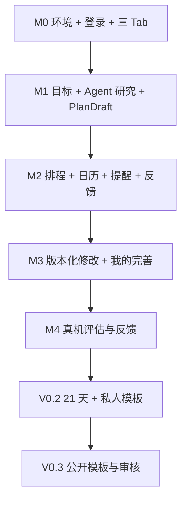

# Guidy｜独立开发任务清单与里程碑

> **版本**：v0.1 开发计划草案（2026-10-09）  
> **状态**：M0 基础工程开发中；本地 D1 迁移已通过，登录/远程资源/专项真机验收未完成  
> **人员与环境**：个人开发者；Windows + iPhone；Expo / React Native + Cloudflare Workers / TypeScript  
> **关联**：[PRD.md](./PRD.md) · [ARCHITECTURE.md](./ARCHITECTURE.md) · [UI_DESIGN.md](./UI_DESIGN.md) · [DATABASE.md](./DATABASE.md)

## 0. 当前已确定的产品与工程约束

- [x] iOS 为首发形态；Windows 开发 + iPhone 真机测试；Expo EAS 负责云端 iOS 构建。
- [x] 底部 Tab **固定为「目标｜日历｜我的」**；不设 Agent Tab，不设模板 Tab。
- [x] 「我的」包含个人资料、通知与隐私、账户等入口；「我的模板」为二级页面（V0.2），后续「发现模板」由它进入（V0.3）。
- [x] 采用模块化单体后端：TypeScript Workers + D1 + Better Auth；Agent 不直接操作计划/日历数据表。
- [x] V0.1 验证完整闭环；21 天启动期/私人模板进入 V0.2，公开模板社区进入 V0.3。
- [ ] 使用真实 iPhone 复核 UI 交互与通知权限路径。
- [ ] 确认开发者会员、EAS、托管 API、LLM 与检索费用预算（尚未定价或购买）。

> 复选框仅反映**讨论中已确认的架构决策**，不代表软件功能已上线。其余开发项一律从未完成状态开始。

## 1. 第一里程碑：项目基础可运行（M0）

**交付标准**：Windows 可运行 Expo、Wrangler 本地 Worker、独立开发/测试数据库；iPhone 能看到基础三 Tab 页面并请求 `/health`；GitHub Actions 能运行最基本检查。

### M0-A 环境和仓库

- [x] 初始化 Git 仓库并保存现行规格/品牌资源基线；统一 PRD、架构与 TODO 的里程碑编号。
- [x] 配置私人仓库 `origin`（Tosidxyy/Guidy），将每轮提交后的 Push 与远程 SHA 核验加入开发约定。
- [x] 初始化 monorepo `apps/mobile`、`backend`、`docs`；统一 README、环境变量模板和忽略规则。
- [ ] 在 Windows 安装 Node LTS、包管理器、Wrangler、VS Code，并记录已验证版本。
- [x] 使用 Expo Router 创建 iOS App；仅三个底部路由：`goals`、`calendar`、`me`。
- [x] 实现深色/浅色主题 Tokens、基础字体和 44 pt 以上可点击区域。
- [x] 前端登录 UI 演示：邮箱/验证码输入、错误/加载/取消、演示账号进入/退出；只用内存模拟，不请求认证后端。（不等于真实登录验收。）
- [x] 登录异常 UI 演示：验证码过期、重发冷却/限流、模拟失败保留输入与重试恢复；计时与状态边界经过验证。（不调用认证后端；新异常页真机/无障碍未验证。）
- [x] 登录演示输入与焦点：验证码接受空格/短横线和全角数字，拒绝非法后缀；补充错误边框与读屏提示，验证码页自动聚焦。（用户确认 iPhone 自动聚焦和按钮正常；VoiceOver/大字体未验证，不等于真实认证。）
- [x] iPhone 登录演示基础表单验证：用户确认验证码键盘展开时无遮挡，输入与按钮操作正常。（用户手动验证；不含真实认证、大字体或 VoiceOver。）
- [x] 「我的」实现真实 API 探活、检查中/失败/重试状态；完成浏览器联调（iPhone 验证仍待下项）。
- [ ] 在 iPhone 分别验证 Safari 本地 Worker `/health` 与 App「连接状态」成功，并记录失败/恢复路径。（Windows LAN/客户端真实 HTTP 已通过；手机结果待用户反馈。）
- [x] 在 Windows 启动 Metro，使用 iPhone Expo Go（仅兼容场景）预览。（用户确认此前基础预览可用；新 Worker 的手机 API 联调仍待复核。）
- [x] 准备 EAS Development Build 流程，记录苹果签名/TestFlight 前置条件；正式通知测试必须使用真机开发构建。（依赖、profiles、启动命令与指南已准备；尚无 Apple 付费会员，未生成签名包。）
- [ ] 在账号/标识/签名条件具备后，完成 EAS iOS 云构建、iPhone 安装与开发包专项验收。（用户已有 Expo 账号；Apple 付费会员、EAS 项目链接和 Bundle Identifier 待配置。）

### M0-B 后端/数据基础

- [x] 初始化 TypeScript Worker、Wrangler、类型/ESLint/格式检查与有效边界测试。（D1 与 Auth 仍在下方待办。）
- [x] 实现 `/health`、统一错误格式、request_id 和服务端日志脱敏。
- [ ] 创建 Cloudflare 开发 Worker/D1 资源，接入 Better Auth；验证会话、过期、撤销与受保护 API。
- [x] 建立开发/测试两套数据库连接与迁移流程；迁移先创建 Better Auth 必需表与 `profiles/goals`，通过 Wrangler SQL migrations 验证。（本地 D1；远程资源未创建。）
- [ ] 实现登录、登出、会话恢复、服务端对象所有权中间件。
- [x] 验证迁移后的 CI：后端 TypeScript/ESLint/格式/边界测试/dry-run，前端类型/lint/API 测试。（真实 GitHub jobs 已通过。）

**M0 验收**：iPhone 登录成功→浏览「目标/日历/我的」三 Tab→「我的」显示基础昵称/账号状态；断网能看到错误或缓存提示，不泄露后台密钥。

## 2. 第二里程碑：目标 → 计划的 Agent 链路（M1，P0）

**交付标准**：用户输入陌生目标，通过短对话澄清、资料研究得到可审阅的结构化计划草案；关闭 App 再打开后仍能恢复当前状态。

### M1-A 目标与澄清

- [ ] 创建 `goals/goal_slots/agent_messages/agent_runs/agent_jobs` 表及索引。
- [ ] 完成 `POST/GET/PATCH /goals`，支持草稿、暂停、继续和版本号。
- [ ] 实现首页 Goal 卡：状态、下一动作、未确认草稿提示。
- [ ] 实现创建目标与 Goal 内 Agent 对话页（不提供独立 Agent Tab）。
- [ ] 用运行时 Schema 校验的 TypeScript Slot 模型提取目标、时间、预算、资源、约束等字段，并标明用户确认状态。
- [ ] 实现动态问答策略：优先必要问题，允许“暂不确定”，避免重复问答。
- [ ] 明确高风险问题（药物、诊断、禁忌）的停止/转介规则，不能因为轮次预算而跳过。

### M1-B 可恢复研究与结构化计划

- [ ] 实现搜索/网页提取 Provider 抽象；保存来源 URL、获取时间、适用条件、未知项。
- [ ] 增加外部网页不可信输入隔离与 SSRF/超时/重定向限制。
- [ ] 使用 TypeScript Agent Provider 生成 `PlanDraft`，按运行时 Schema 与领域规则两次校验。
- [ ] 研究/计划生成改为D1 持久 Agent Job + 经验证的 Cloudflare 后台编排/消费者（lease、heartbeat、重试、检查点）。
- [ ] 实现 Job 状态轮询，恢复后能继续查看阶段进度而不重复扣费/重复生成副作用。
- [ ] 计划详情展示任务、阶段、依据、预算/时间投入、阻塞原因和未确认条件。
- [ ] 建立健身、学习、护肤各 1 套可重复的评估样例，避免把 LLM 无法验证的产品参数当事实。

**M1 验收**：输入“我想开始健身”可完成动态澄清、研究并输出 `PlanDraft`；必填信息缺失时不伪造，来源失败时可重试，Agent 关闭页面后 Worker 继续运行。

## 3. 第三里程碑：计划 → 日历 → 提醒 → 反馈（M2，P0）

**交付标准**：用户审批候选计划后，系统能确定性检查冲突、生成任务日历、安排本地提醒，并记录真实执行反馈。

### M2-A 领域模型与排程

- [ ] 建立 `plan_versions/tasks/task_dependencies/calendar_events/schedule_proposals/scheduled_occurrences` 表及迁移。
- [ ] 实现 Task 与 Occurrence 分离，支持重复规则、最短间隔、固定/柔性时间、前置条件。
- [ ] 实现确定性 `SchedulingService`：识别硬约束、筛选合法候选、返回冲突原因与 1–3 个备选（若有）。
- [ ] 跨日、时区、夏令时、重叠、依赖环、无可用窗口增加自动化测试。
- [ ] 完成 App 内日历 Agenda 与日/周视图的最小实现。
- [ ] 实现预览/确认事务：`expected_goal_revision + Idempotency-Key`；并发冲突返回 409，不能静默覆盖。
- [ ] 统一确认状态：计划已保存 ≠ 本地提醒已安排。

### M2-B 通知同步与执行状态

- [ ] 建立 `notification_intents/notification_device_syncs/execution_records/outbox_events`。
- [ ] 接入 `expo-notifications`：授权时机、静默时段、隐私通知内容、点击 deep link。
- [ ] 实现服务器 desired intents → iPhone 本地 schedule/cancel → sync ack 的对账流程。
- [ ] 对 App 退出、改期、权限拒绝、旧通知仍在手机中等情形显示真实同步状态。
- [ ] 实现一键 `完成/部分完成/跳过/延期`，反馈请求幂等；未反馈不自动等于跳过。
- [ ] 完成固定事件的用户手动录入与时间占用校验。

**M2 验收**：用户在现有固定事件冲突条件下确认计划，系统阻断非法安排；无冲突任务可入历；本地提醒触发后能记录反馈；重复请求不会重复生成任务或打卡。

## 4. 第四里程碑：自然语言修改 + 我的页面完善（M3，P0）

**交付标准**：用户只改变一个条件，Agent 给出有依据的局部修改和排程差异；「我的」能管理基本资料与设置。至此 V0.1 核心闭环成立。

- [ ] 自然语言修改 Slot，识别受影响的任务/预算/日期，不随意重写无关任务。
- [ ] 增加不可变 `PlanVersion` 和 `PlanRevision` 的增删改移 Diff 预览。
- [ ] 用户确认前旧计划继续生效；提交后旧未来 occurrence 被标记替代，真实历史反馈仍保留。
- [ ] 回退旧版本前重新校验当下日历和约束。
- [ ] 「我的」首页：头像/昵称/邮箱摘要、编辑个人资料、我的模板（V0.2 才启用）入口、通知、隐私、账户设置。
- [ ] 「我的」资料编辑、权限异常、断网、空状态、删除确认、退出登录都具备清晰反馈。
- [ ] V0.1「我的」固定显示“我的模板 · 即将开放”占位，但不提供无效点击；不增加模板底部 Tab。
- [ ] 数据删除和导出规则至少有明确实现路径与错误提示，发布前完成法律/隐私文案审查。

**M3 验收**：用户说“周一不再有空”→仅受影响任务产生可解释修改→确认后新日历可见、旧提醒进入撤销/待同步；底部仍只有「目标/日历/我的」。

## 5. 第五里程碑：V0.1 真实用户验证（M4）

- [ ] 在 iPhone Development Build 验证系统通知、冷启动、deep link 和基础权限。
- [ ] 至少覆盖一台实际 iPhone 的大字体、深色模式、安全区、键盘遮挡问题。
- [ ] 完成账号权限测试：A 不可读取/编辑 B 的任何 Goal、执行记录、通知意图和模板草稿。
- [ ] 使用学习、健身、护肤三类样例端到端测试，不把演示方案当个性化医疗结论。
- [ ] 对重复点击、网络中断、Worker 重试、超预算、错误搜索结果、提示注入建立回归测试。
- [ ] 记录研究成本、计划确认率、入历率、真实反馈比例；不预设或捏造改善幅度。
- [ ] 找 10–20 名早期体验者做探索性研究（样本规模仅为建议），核查是否真的愿意执行和回来调整。
- [ ] 根据实测决定继续打磨闭环，还是进入 V0.2；不要仅凭新功能数量判定成功。

## 6. V0.2：21 天启动期 + 我的模板（P1）

- [ ] 按目标类型提供 7 / 14 / 21 / 自定义启动观察期；短期一次性目标不强制 21 天。
- [ ] 明确区分经过日数、反馈天数、任务完成率、目标成果，不宣称“21 天保证习惯养成”。
- [ ] 设计第 7/14/21 天阶段复盘与调整选项；允许中途暂停，不惩罚性清空记录。
- [ ] 新建 `kickstart_periods/templates/template_versions/template_applications` 及隔离权限。
- [ ] Agent 从私人计划中提取输入字段、动态条件问题、研究方法与任务蓝图；执行脱敏与作者预览。
- [ ] 「我的 → 我的模板」：列表、创建、编辑、私人应用、版本详情、空状态。
- [ ] 新用户应用模板必须产生新的 Goal/Plan，依据用户实际输入动态补问，不复制原作者私人信息。
- [ ] 测试模板在两种不同用户条件下能得到不同且合理的计划。

## 7. V0.3：公开模板社区（P2）

- [ ] 「我的模板 → 发现模板」实现公开列表/搜索/详情/应用，不增加第四个底部 Tab。
- [ ] 公开申请资格：至少 21 天执行观察记录 + 反馈覆盖门槛（拟 14 个不同反馈日，需评估）+ 创作者授权。
- [ ] 实现自动脱敏 + 人工/规则内容审核；高风险健康模板设置额外限制。
- [ ] 实现发布、撤回、举报、申诉、版本更新、旧版本可追溯。
- [ ] 标记“有执行记录”，不标记“科学有效”或“保证达成目标”。
- [ ] 匿名聚合改进需单独征得同意；不能公开任何用户原始对话与健康资料。

## 8. 依赖关系与发布闸门



| 里程碑 | 不通过则不得进入下一阶段的检查 |
| --- | --- |
| M0 | iPhone 可验证前端基础导航；Auth 与 API 权限可靠 |
| M1 | Agent 结果符合结构化 Schema，来源可查，关键安全约束未绕过 |
| M2 | 排程硬冲突全部被拒绝；重复提交和设备通知同步有明确状态 |
| M3 | 局部修改不破坏已确认旧计划；三 Tab 导航一致；账户/隐私基本入口可用 |
| M4 | 真机通知、完整闭环和关键异常路径经过实际测试 |
| V0.2 | 不跨用户泄露私人模板内容，周期与完成率独立统计 |
| V0.3 | 资格审查、脱敏、下架和举报流程完成，否则不上线社区 |

## 9. 现在最先动手的三个任务

1. **初始化 Expo 项目**：在 iPhone 跑通「目标｜日历｜我的」三 Tab 静态导航，先不用真实 Agent。
2. **敲定 Schema 与 API 合同**：以 [DATABASE.md](./DATABASE.md) 的 Goal/Plan/Task 模型生成第一版 D1 SQL migrations 与 TypeScript/运行时 Schema DTO。
3. **用模拟数据跑通一个故事**：新建“我想学英语”→回答 2–3 个关键问题→看到计划草稿→排程预览→确认后日历显示→记录一次完成；随后再接真实 Agent。

> **不建议现在做的事**：复杂 Multi-Agent、Redis、向量数据库、Kubernetes、用户排名、跨应用持续监控、自动购买、完整模板社区。真实用户使用数据未证明必要前，不纳入 V0.1。


## 10. 每轮开发进度记录（开发中持续更新）

> 执行准则详见仓库根目录 `AGENTS.md`：**快速测试通过 → 提交本轮实现 → 更新本文件 → 单独提交 TODO → Push 到私人仓库**。此规则用于每一轮小任务，不表示下面列出的 M0–M4 任务已经完成。禁止未经验证就勾选复选框。

建议每次记录格式（只在真实完成一轮后填写，不要保留示例占位符当作事实）：

```md
### YYYY-MM-DD — Mx / 任务标题
- 完成内容：…
- 快速测试：`实际执行命令` → PASS / FAIL / 未运行（原因）
- 代码提交：`真实 Git Commit SHA`（如没有代码变更，说明）
- TODO 提交：本轮另行提交（其 SHA 在交付回复中报告；无需回写本条，避免循环提交）
- 已勾选任务：…（仅完成且通过验收的条目）
- 阻塞与未验证：…
- 下一轮：…
```

### 2026-10-09 — M0 / 文档分期统一与 Git 基线

- 完成内容：PRD 的 M0–M4 统一为 V0.1；V0.2/V0.3 单列。架构 Sprint A/B 与 M0/M1 对齐，目录名改为 Guidy；初始化 main 分支并保存已有文档和品牌资源。
- 快速测试：PowerShell 内联 Python 检查 → PASS（分期标题、原型路径、批准图标 SHA256、1024×1024 RGB、凭据扫描）；`git -c core.whitespace=-blank-at-eol show --check HEAD` → PASS（Markdown 原有两个行尾空格用于硬换行；默认 whitespace 检查对此产生提示）。
- 实现提交：`fbae8f1381d888b9919b5a989ba32c8762944958`（文档与资源基线，无应用代码）。
- TODO 提交：本轮另行提交，其 SHA 在交付回复中报告。
- 已勾选任务：新增的 Git 基线与文档分期统一前置项；其余 M0 开发项目保持未完成。
- 阻塞与未验证：默认 Python 3.11.0 未满足后端 3.12+ 要求；暂无应用源码、Supabase 配置或 iPhone 实测。MANIFEST.json 是原始资源包清单，包含本目录未提供的历史文件及原始文档哈希，不能用作当前工程完整性清单。
- 下一轮：初始化 Expo Router 三 Tab、接入锁定图标与主题 Tokens，执行类型/lint/打包检查；后端阶段准备 Python 3.12+。

### 2026-10-09 — M0 / Expo 三 Tab 与主题基础

- 完成内容：建立 apps/mobile、backend 预留目录和根脚本；Expo Router 仅 goals/calendar/me 三 Tab。接入批准图标与黑底启动屏、系统字体、浅深色 Tokens、44 pt+ 控件；演示数据明确标注，未接入功能禁用或静态说明。日期单选与临时主题切换可用；更新 README、环境模板与忽略规则。
- 快速测试：`npm run typecheck` → PASS；`npm run lint` → PASS；联网 `npx expo install --check` → PASS；`npm run export:ios` / `npm run export:web` → PASS。iOS 导出首次因沙箱临时目录写入受限失败，设置 TEMP/TMP 为项目 `.cache/expo-tmp` 后复测通过。
- 浏览器 Smoke Test：`node C:/Users/29035/.codex/visualizations/2026/10/09/01a11f51-bbc0-74b3-9200-ebe6276c1dc5/guidy-smoke.cjs` → PASS；Browser plugin not available，使用已捆绑 Playwright + 本机无头 Edge。验证 localhost:8082 的页面标题、非空、无错误覆盖层、三 Tab、禁用的未来入口、日期切换/空状态/恢复、44 pt 日期控件、手动与系统主题；393×852、320×740、1280×900 三视口截图，控制台 error/warning 均为 0。截图与临时测试脚本在仓库外，未提交。
- 资源/文档检查：PowerShell 内联 Python 校验 → PASS（三路由、精确版本与 lockfile 一致、批准原图哈希/复制资源字节、配置和修改文档链接）；`git diff --cached --check` 与暂存凭据/文件范围检查 → PASS。
- 代码提交：`5dc1061dbc8d6b8475032fd7c7ddabb0ec3f2e3b`。
- TODO 提交：本轮另行提交，其 SHA 在交付回复中报告。
- 已勾选任务：monorepo 基础目录/说明、Expo Router 三 Tab、基础主题/字体/触控区域。backend 目前仅 README，不代表 FastAPI 已初始化。
- 阻塞与未验证：iPhone、Expo Go 兼容性、原生安全区、Dynamic Type/VoiceOver、最终安装包图标/启动屏未验证；登录、API、数据库、CI、EAS 未实现。默认 Python 3.11.0 需在后端轮次选用或准备 3.12+。
- 依赖审计：在线 `npm audit` → 29 项（18 high、11 moderate）；兼容 `npm audit fix` 后仍存在，涉及构建工具/Metro 链及 Router URI 解码等。未执行跨 SDK 强制修复，发布前复核。离线 package-lock 安装的“0 vulnerabilities”不作为通过证据。
- 下一轮：初始化 FastAPI `/health`、统一错误/request_id 与后端 pytest/ruff；随后接入 Supabase Auth/基础迁移，并安排 iPhone 三 Tab 真机验证。M0 总体验收保持未完成，不进入 M1。

### 2026-10-09 — M0 / 私人仓库与每轮 Push 约定

- 完成内容：用户指定 `https://github.com/Tosidxyy/Guidy` 为私人远程；配置 origin，更新 AGENTS.md/README 的强制闭环，要求实现与 TODO 提交后推送全部提交，禁止 force push 并核验远程分支 SHA。
- 快速测试：PowerShell 内联 Python 文档校验 → PASS（仓库 URL、测试/提交/TODO/Push 顺序与禁止强推规则）；`git diff --check` → PASS。GitHub 仓库元数据确认 visibility=private、push=true；`git ls-remote https://github.com/Tosidxyy/Guidy.git` → PASS，远程无分支，首次推送不会覆盖已有远程提交。
- 实现提交：`54d8f43958f6768b9a175058e8b0f79c7ec53ba2`（仅文档约定，无应用代码变更）。
- TODO 提交：本轮另行提交，其 SHA 在交付回复中报告。
- Push：本轮 TODO 提交后将 main（含前两轮四个提交）一起推送至 origin/main；实际推送结果与远程 HEAD 核验在交付回复中报告。
- 已勾选任务：配置私人 origin 与每轮 Push 开发约定。
- 阻塞与未验证：本轮不改变 App 行为；未运行前端/后端测试，已有 iPhone/依赖审计限制继续保留。
- 下一轮：继续 M0 后端基础；每轮测试与提交后同步私人仓库。

### 2026-10-09 — M0 / FastAPI 探活、错误合同与日志基础

- 完成内容：使用可用的 Python 3.12.14 创建 backend/.venv，uv 0.11.32 管理 pyproject/uv.lock；锁定 FastAPI 0.143.0、Pydantic 2.14.0、SQLAlchemy 2.1.4、Alembic 1.20.0、pytest 9.1.1、ruff 0.16.10 等。当前 Starlette TestClient 使用其支持的 httpx2 2.13.1，未引入 Agent/数据库业务。
- API：公开 `/health` 仅为进程 liveness；JSON 成功/失败 envelope、合法 UUID 请求追踪及响应头、404/405/422/500 统一错误。生产关闭 debug/文档。日志只记录固定字段与路由模板，关闭原始 access log，抑制异常原文和 traceback。
- 快速测试：backend 中 `.venv/Scripts/python.exe -m ruff check .` → PASS；`-m ruff format --check .` → PASS（15 文件）；`-m pytest` → PASS（22 passed，0 warnings）。覆盖非法 JSON/参数、协议头、500、私密字段、请求 ID 并发隔离、OpenAPI 和生产设置。
- 环境故障与修正：沙箱内 pytest 在 asyncio socketpair 初始化卡住，诊断后终止，移到支持本机通信的环境运行；首次有效运行 20 passed / 2 failed（测试断言与新版框架不兼容），修正断言与当前 TestClient 依赖后全部通过。未将卡住/失败的运行记为通过。
- 功能 Smoke Test：`.venv/Scripts/python.exe C:/Users/29035/.codex/visualizations/2026/10/09/01a11f51-bbc0-74b3-9200-ebe6276c1dc5/guidy-backend-smoke.py` → PASS（真实 Uvicorn loopback HTTP 200/404/405，响应追踪头/JSON 一致，非法 ID 替换，stdout/stderr 不含合成私密字段、全为结构化日志）；临时服务已自动停止，脚本在仓库外。
- 其他检查：`uv lock --check --offline` → PASS；Python/四项基础工具 import → PASS；修改的 README/setup 文档链接、暂存文件/凭据扫描及 `git diff --cached --check` → PASS。前端没有改动，未重复运行前端测试。
- 代码提交：`4f2ec8115818ff9861a8ed426c5e2d64ad281e6f`。
- TODO 提交/Push：本轮单独提交 TODO 后推送 origin/main，实际 SHA 和远程同步核验在交付回复中报告。
- 已勾选任务：后端基础依赖/工具初始化；`/health`、统一错误、request_id 与日志脱敏。
- 阻塞与未验证：尚无 Supabase 项目配置、Auth/JWT、DB 连接/迁移、CI 或手机请求；SQLAlchemy/Alembic 仅安装并验证工具依赖，未执行 SQL。Windows 整体工具安装项仍未完成（VS Code/EAS 等未验证）。iPhone 实测和前轮前端依赖审计限制仍保留，M0 总体验收未通过。
- 下一轮：建立前后端基础 CI，并让手机端显示真实 API 连通/失败状态；随后接 Supabase Auth 和 profiles/goals 基础迁移。

### 2026-10-09 — M0 / 真实 API 连接状态与基础 CI

- 完成内容：「我的」新增真实 `/health` 检查、五秒超时、重复点击保护、取消/卸载清理、失败与重试恢复；校验 Guidy 服务/版本/request_id 和响应头，不回显原始错误。后端 CORS 默认关闭、仅按配置允许明确 origin/GET 并暴露请求 ID，不携带凭据。建立只读权限、官方 Action SHA 固定的 mobile/backend CI（Node 24.15.0、uv 0.11.32）。
- 快速测试：mobile 的 `npm run typecheck` / `npm run lint` / `npm run test:api` → PASS（9 项 API 边界测试，0 warning）；backend 的 `.venv/Scripts/python.exe -m ruff check .` / `-m ruff format --check .` / `-m pytest` → PASS（30 passed，0 warnings）。使用 Node 内置 TS 类型擦除和测试 runner，不新增测试依赖。
- 导出：`npm run export:ios` → PASS；`npm run export:web` → PASS（首轮因沙箱拒绝创建 dist/assets/node_modules 失败，项目内输出目录重试后通过）。
- 浏览器 Smoke Test：`node C:/Users/29035/.codex/visualizations/2026/10/09/01a11f51-bbc0-74b3-9200-ebe6276c1dc5/guidy-health-ui.cjs` → PASS。Browser plugin not available，使用捆绑 Playwright + 无头 Edge；真实 FastAPI 8000/Expo 8082 联调，验证三 Tab、未检查/加载/禁用、200 成功、模拟断网、错误响应、超时和重试恢复；393×852、320×740、1280×900 截图。4 个真实 200 响应；未预期控制台错误/警告为 0，断网模拟产生 1 个预期网络资源错误。
- CI/文档检查：js-yaml 解析、触发条件/只读权限/固定 SHA/job 命令检查 → PASS；UTF-8 文档链接、lockfile 依赖一致性、暂存凭据扫描和 `git diff --cached --check` → PASS。远程 GitHub CI 必须推送后才能验证，尚不勾选 CI 完成项。
- 代码提交：`c3a37b3824bfc96884a47e04fe6679b9ab63fc58`。
- TODO 提交/Push：本轮单独提交 TODO 后推送 origin/main，再检查 GitHub Actions 的实际执行；结果确认后追加文档记录，未通过则保持 CI 未完成。
- 已勾选任务：M0 API 连接状态实现与浏览器联调；iPhone 和 CI 远程验收保持未完成。
- 阻塞与未验证：iPhone 局域网请求/Expo Go、大字体/安全区仍未验证；Supabase Auth/DB 未接入；前轮依赖在线审计问题仍保留。本轮 CORS 仅用于浏览器探活，业务写方法应在后续 Auth API 实现时按需扩展。
- 下一轮：确认远程 CI 后继续 Supabase Auth 与 profiles/goals 迁移；需要开发项目公开配置和独立数据库连接，不将密钥提交到仓库。

### 2026-10-09 — M0 / 首次远程 CI 验收补记

- 验收结果：GitHub Actions [Guidy CI #37899646600](https://github.com/Tosidxyy/Guidy/actions/runs/37899646600) → completed / success，运行 SHA 为 `71578a2a0bf35a56f34d6335e05cd59578b9e659`（包含实现 `c3a37b3` 与首次 TODO 记录）。
- mobile job `113718946274`：npm ci、typecheck、lint、test:api 各步骤 success；backend job `113718945925`：uv sync --locked、ruff check、ruff format --check、pytest 各步骤 success。均为真实 ubuntu-latest runner 运行，非本地模拟。
- 快速检查：只读 GitHub Actions API 核对运行/两 job/各 step 结果 → PASS；本次 TODO 文档/SHA/链接与 `git diff --check` → PASS。
- 已勾选任务：基础 CI；其他 Auth/数据库/iPhone 待办不变。只补记远程结果，无应用代码变更，单独文档提交并再次 Push；workflow 的 paths 不会因纯文档更新重复运行。
- 下一轮：继续 M0 Supabase Auth 与基础数据库迁移；iPhone 局域网/API 实测仍待执行。


### 2026-10-09 — M0 / Cloudflare TypeScript 后端迁移

- 用户确认：改用 Cloudflare 并将后端语言改为 TypeScript；此前 iPhone Expo Go 基础预览已由用户确认可用。没有明确机型/API 成功/字体/通知细节，不扩大真机验收范围。
- 完成内容：TypeScript Workers 替代 Python 入口；保留 health 成功/错误/追踪合同、最小 CORS、白名单业务日志；新 Wrangler 默认 8787。旧实现可从 Git 历史恢复，旧架构/数据库/启动文档保存历史快照。现行 PRD/AGENTS/架构/数据库/README 统一到 Workers+D1+Better Auth；D1 原子批次、对象授权和后台 Job 语义明确不照搬 PostgreSQL。
- 依赖：Node 24.15.0；TypeScript 6.0.3、Wrangler 4.149.0、ESLint 10.12.0、typescript-eslint 8.71.1、Prettier 3.9.9，精确版本与 lockfile。最新 TS 7 超出 ESLint 插件兼容范围，安装失败后选兼容 TS 6；未使用 force/legacy-peer-deps。
- 快速检查：backend 的 `npm run typecheck`、`npm run lint`、`npm run format:check`、`npm test` → PASS（10 项）；`npm run build` → PASS（Wrangler dry-run，未部署）。首轮 lint 的测试 Web globals 未声明，改为 globalThis 引用后复测通过。
- 真实运行：Wrangler 本地 workerd `/health` 200、错误方法 405、未知路径 404 和请求 ID 合同 → PASS。`node C:/Users/29035/.codex/visualizations/2026/10/09/01a11f51-bbc0-74b3-9200-ebe6276c1dc5/guidy-worker-ui.cjs` → PASS；Expo 8082 → workerd 8787，三视口、加载/成功/断网/超时/异常响应/重试恢复，4 个真实 200，0 未预期错误与 1 预期断网资源错误。浏览器验证不替代 iPhone 验证。
- 文档/资源/CI 检查：现行链接、历史快照与前一提交内容比对、批准原图 SHA256、精确锁文件、YAML/SHA/检查步骤验证和暂存凭据扫描 → PASS；`git diff --cached --check` → PASS。Cloudflare 管理 Token、本地 .dev.vars、缓存、ignored 的旧 .venv 均不提交。
- 实现提交：`243f0c2b2f9424baffeeb6f2c626cf95c6cbdad4`。
- TODO 提交/Push：单独提交进度后 Push，再验证 GitHub 的 TS backend/mobile jobs；实际结果后补记，CI 暂未勾选。历史轮次仅说明当轮事实，不能作为当前技术栈依据。
- 已勾选任务：Worker 基础工具与 API 迁移；用户确认的此前 iPhone Expo Go 基础预览。Auth/DB/部署/迁移后手机 API 保持未完成。
- 未验证：远程 Cloudflare 账号/Worker/D1 尚未配置或创建，Better Auth/邮件/真实会话未接入，新 Worker iPhone API 未复核，通知/签名安装包/专项无障碍未测；移动端原有依赖审计限制继续保留。
- 下一轮：D1 本地开发/测试迁移与 Better Auth 接入，远程部署在资源/账号条件明确后实施；本轮不引入真实 Agent 或 M1 功能。

### 2026-10-09 — M0 / TypeScript Workers CI 远程验收

- GitHub [Guidy CI #37903890228](https://github.com/Tosidxyy/Guidy/actions/runs/37903890228) → completed/success，运行 SHA `96a3adc199c52a47003393d04a3d9b551d97823a`。
- mobile job `113732582426`：npm ci/typecheck/lint/test:api 均 success；backend job `113732582755`：npm ci/typecheck/lint/format:check/test/build（dry-run）均 success。运行环境为真实 ubuntu-latest；没有远程部署步骤。
- 快速检查：只读 Actions API job/step 核对 → PASS；本次进度文档/SHA/链接与 `git diff --check` → PASS。
- 已勾选：迁移后的 CI。无应用代码修改；单独文档提交后 Push 并核验远程 SHA。D1/Auth/部署和新 Worker 真机 API 未验证项不变。

### 2026-10-09 — M0 / D1 本地数据基础

- 完成内容：锁定 Better Auth 1.7.7，从实际核心 Schema 生成不可重写的 0001；0002 添加 STRICT profiles/goals、认证/所有者外键、规范 UUID、标题/状态/整数版本/时间/空计划指针约束与索引。本地开发/测试配置、数据库 ID 与持久目录分开；迁移 wrapper 强制 local，拒绝 remote/生产目标/额外参数。没有开放登录或 M1 Goal CRUD。
- 快速检查：backend `npm run typecheck`、`npm run lint`、`npm run format:check`、`npm run schema:check` → PASS；`npm test` → PASS（18 项：真实 D1/库 Schema 比对、约束、外键、失败批次回滚、去重、级联删除、隔离、wrapper 安全边界与 API 回归）。Miniflare 5.20261006.1-alpha 与 Wrangler 版本一致，使用其官方 V4 配置转换器。
- 迁移 Smoke Test：`npm run db:migrate` / `npm run db:migrate:test` → PASS（两条迁移分别应用到独立本地 D1）；重复 `db:migrate:test` → PASS（No migrations to apply）。不清空开发数据，不触碰远程资源。`npm run build` → PASS（dry-run；沙箱自身日志/metrics 写入受限后，在支持工具运行的环境复测）。
- 修正记录：首次 Miniflare 配置不兼容，采用库官方转换器后通过；测试 DDL 注释分段与 SQLite 错误码大小写断言失败，修正测试加载/断言后复测全通过。未将失败运行作为通过。
- 文档/提交检查：链接、固定依赖与 lockfile、CI Schema/local migration 步骤、暂存文件/凭据扫描、`git diff --cached --check` → PASS。真实本地数据库与 secrets 均未提交；前端没有修改，未重复浏览器/真机检查。
- 代码提交：`64a144dc4e4ff457e21936639056bd11545fb7b1`。
- TODO 提交/Push：本轮另行提交 TODO 后 Push；扩展后的远程 CI 结果实际运行后补记。
- 已勾选：本地开发/测试数据库连接与迁移流程。已有 CI 的上轮结果保留，但新 Schema/迁移步骤须本次 Push 后核验。
- 未验证：真实 Better Auth 登录/邮件/会话恢复/撤销、受保护 API/跨用户授权、远程 D1/部署、新 Worker 真机联调和专项无障碍/通知。数据库 schema 成功不代表 Auth 或对象权限验收完成。
- 下一轮：接入 Better Auth 受保护账号 API 与登录/会话；邮件发送和远程资源按实际账号条件配置，继续 M0。

### 2026-10-09 — M0 / SQL 行尾兼容补充

- 完成内容：SQL 文件固定 LF；Schema 比对接受 Windows CRLF，避免跨平台换行被误判为认证结构变化。未改变已应用 SQL 的含义。
- 快速检查：`npm run lint` / `format:check` / `schema:check` → PASS；`git check-attr eol -- backend/migrations/0001_auth_core.sql backend/migrations/0002_profiles_goals.sql` → 两文件均 lf；`git diff --cached --check` → PASS。
- 代码提交：`71f972fb0a04080158772f625fdede22fc1d9bd2`；本条单独文档提交后与前述 D1 基础提交一起 Push，再核对远程 CI。没有新增功能完成项。

### 2026-10-09 — M0 / D1 扩展 CI 远程验收

- GitHub [Guidy CI #37907072295](https://github.com/Tosidxyy/Guidy/actions/runs/37907072295) → completed/success，运行 SHA `7ab7e6c216396e50a78ecac2a5a231ad72075610`。
- mobile job `113742994247` 全部成功；backend job `113742994704` 的 npm ci、typecheck、lint、format:check、schema:check、db:migrate:test、test 与 dry-run build 全部 success。实际 ubuntu-latest D1/Schema/迁移运行，不是本地结果替代；无远程部署步骤。
- 快速检查：只读 Actions API 与步骤核对 → PASS；本次 TODO 文档、真实 SHA/链接和 `git diff --check` → PASS。单独文档提交后 Push 并核对远程 HEAD。
- 数据基础验收范围为本地开发/测试；真实账号登录、邮件、受保护 API、跨用户权限、远程 D1/生产部署和专项手机测试仍未完成。

### 2026-10-09 — M0 / 无后端登录 UI 演示

- 范围：仅前端 UI/mock；`/(auth)/sign-in` 二级页与「我的」演示账号状态。底部保持三个 Tab，沿用黑白 Tokens/批准图标/原型账号卡层级。没有后端、数据库、认证依赖或接口修改。
- 完成内容：公开演示邮箱 demo@example.invalid / 123456；输入校验、错误保留/重试、明确 500ms 模拟加载与重复点击保护、修改邮箱、取消计时器、演示进入/退出。DemoAccountProvider 只存内存布尔状态，不生成 Token/cookie、不保存凭据、不发送邮件、不作为权限依据；完全重载清除。
- 快速检查：mobile `npm run typecheck` / `npm run lint` → PASS；`npm run test:api` → PASS（已有 9 项客户端回归）；最终顺序执行 `npm run export:ios` / `npm run export:web` → PASS。没有修改后端，未重复本地后端测试。
- 浏览器 QA：`node C:/Users/29035/.codex/visualizations/2026/10/09/01a11f51-bbc0-74b3-9200-ebe6276c1dc5/guidy-login-ui.cjs` → PASS。Browser plugin not available，使用已捆绑 Playwright/无头 Edge；localhost:8084，「我的 → 登录演示 → 校验/加载 → 进入 → 退出」及取消、离线演示、重载清除、浅深色；393×852、320×740、1280×900 截图，44 pt+ 按钮，无横向页面溢出。认证/后端请求 0、未预期应用错误/警告 0；离线模拟造成 4 个预期开发资源错误，单独记录，不当作应用错误或网络调用成功。
- 修正与视觉检查：首轮返回时重复创建 Tabs，改为 SDK 的 dismissTo 返回已有「我的」后复测通过；截图检查卡片、按钮主次层级、窄屏与暗色可读性。最终文案/截图单独刷新确认。iPhone 键盘、安全区、字体/VoiceOver 未验证。
- 文档/提交检查：修改文档链接、登录模块无 fetch/存储/认证库调用、批准原图字节、暂存文件限定为前端/UI 文档及 `git diff --cached --check` → PASS；演示数据明确标记，不当成真实会话。
- 代码提交：`0ba8f363e5cb62c1ac2dbd76cd858189b2435aad`。
- TODO 提交/Push：单独提交本条后推送私人 origin/main，再核对 CI 与远程 SHA，实际结果后补记。
- 已勾选：新增的前端登录 UI 演示小项；真实登录/登出/会话恢复/对象授权、远程资源与专项真机验收保持未完成。
- 下一轮：继续 UI 评审/真机表单检查；真实 Better Auth 与邮件/会话接入单独实施，不将 demoSignedIn 接到受保护业务 API。

### 2026-10-09 — M0 / 登录 UI CI 远程验收

- GitHub [Guidy CI #37909793932](https://github.com/Tosidxyy/Guidy/actions/runs/37909793932) → completed/success，运行 SHA `0fa1d1aa35c20a12f65667ca4e7e90440c2e4826`。
- mobile job `113751923441` 的安装/类型/lint/客户端测试全部 success；既有 backend job `113751924011` 的所有回归步骤 success。后端本轮无改动，也没有新增认证 API。
- 快速检查：只读 Actions API 与步骤核对、本次 TODO 的真实 SHA/链接与 `git diff --check` → PASS。只补记远程结果，单独文档提交后 Push 并核验远程 HEAD。
- 完成项仍只为 UI mock；真实登录、邮件、Token/会话存储/恢复、受保护 API 和本轮原生表单真机验证保持未完成。

### 2026-10-09 — M0 / iPhone 登录演示基础表单验收

- 验证来源：用户在 iPhone Expo Go 体验「我的 → 体验登录 UI」后反馈“没有遮挡，一切正常”。针对本轮所问的验证码输入、键盘展开时主按钮可见/可点击，记录为用户手动真机验证通过；没有声称由 Codex 控制或测试手机。
- 对应界面：当前实现 `0ba8f363e5cb62c1ac2dbd76cd858189b2435aad`（进度/CI 文档随后已提交）。本轮未修改源代码、键盘布局或添加认证请求，只记录实际验收。
- 快速检查：本次 TODO 内容、真实界面 SHA、未完成项及 `git diff --check` → PASS；纯文档轮次未重复类型/lint/构建或后端测试，不触发代码 CI。
- 已勾选：新增的 iPhone 登录演示基础表单验证小项。机型/iOS 版本未提供；大字体、VoiceOver、真实认证/邮件、Token/会话存储/恢复、对象授权、通知与云部署仍未验证/未完成。
- 提交/Push：本轮只有文档提交；按约定推送 origin/main 并核验远程 SHA，结果在交付回复中报告。
- 后续范围：登录界面演示可继续评审；真实 Better Auth 接入需要单独实施，不能以 demoSignedIn 代替认证状态。

### 2026-10-09 — M0 / 无后端登录异常状态与恢复

- 完成内容：UI-only demoChallenge 模型，演示有效期 60 秒/重发冷却 5 秒/30 秒窗口最多准备 3 次；以截止时间判断过期。过期禁用旧码演示进入，重发限流不阻断仍有效的码提交。模拟失败保留输入并可重试；异常演示控件分组/可收起，准备与验证加载明确区分。所有数值是预览设置，不是正式认证策略。
- 快速检查：mobile `npm run typecheck` / `npm run lint` → PASS；`npm run test:ui-state` → PASS（3 项时间边界）；`npm run test:api` → PASS（9 项已有客户端回归）；最终顺序 `npm run export:ios` / `npm run export:web` → PASS。继续时重新执行类型/lint/两组测试，全部通过；无后端源代码修改。
- 浏览器 QA：`node C:/Users/29035/.codex/visualizations/2026/10/09/01a11f51-bbc0-74b3-9200-ebe6276c1dc5/guidy-login-states-ui.cjs` → PASS。已捆绑 Playwright + 无头 Edge/受控时钟，localhost:8086，393×852/320×740/1280×900；自然冷却/滚动限流、窗口恢复、手动/自动过期、重新获取、限流下有效码验证、失败保留输入与重试、修改/返回/重载清理、暗色与响应式截图。认证/后端请求 0，未预期控制台错误/警告 0。Browser plugin not available；截图/测试脚本在仓库外。
- 调整记录：开发服务器启动前首轮连接拒绝，待启动后复测；重载的 networkidle 等待超时，改为 DOM 完成/实际可交互状态验证后整个流程通过，未把失败运行记为通过。
- 文档/提交检查：链接、未变更依赖与 lockfile、UI 模块无 fetch/认证库/凭据存储、暂存范围与凭据扫描、`git diff --cached --check` → PASS。CI 增加 test:ui-state，实际远程运行待 Push 后核验。
- 代码提交：`f1da05362d894c0cd3c8987c79370bf57ae62a8e`。
- 提交阻塞记录：上轮自动审批因用量限制无法完成，Git 动作未执行；本轮用户请求继续后通过正常审批重新提交成功，未绕过审批或虚构 SHA。
- TODO 提交/Push：本条单独提交后 Push 私人 origin/main，再核验 CI 与远程 HEAD；结果实际确认后补记。
- 已勾选：新增异常 UI 演示小项。原先用户确认的 iPhone 基础表单仅适用于当时界面；本轮新增异常页、计时、大字体与 VoiceOver 未做真机验收。真实登录、邮件、会话/存储、受保护 API/对象授权仍保持未完成。
- 下一轮：评审/真机验证新增异常演示；真实认证接入单独实施，不将模拟倒计时/次数或 demoSignedIn 用于后端权限判断。

### 2026-10-09 — M0 / 登录异常 UI CI 远程验收

- GitHub [Guidy CI #37942777027](https://github.com/Tosidxyy/Guidy/actions/runs/37942777027) → completed/success，运行 SHA `7467f1cc577468e465bd8c157ad1b061cb4d297c`。
- mobile job `113861156127` 的安装/类型/lint/test:api/新增 test:ui-state 全部 success；既有 backend job `113861156412` 的全部回归步骤 success。本轮后端源代码未修改，也未接入真实登录接口。
- 快速检查：只读 Actions API/步骤核验、真实 SHA/链接及 `git diff --check` → PASS。本次仅补记进度，单独文档提交并 Push 后核对远程 HEAD。
- 范围仍为 UI mock；邮件、真实认证、凭据/会话存储/恢复、权限与新异常页真机/无障碍未完成。

### 2026-10-09 — M0 / 登录演示输入、焦点与错误反馈

- 完成内容：纯前端 demoInput 规范化空格/短横线和全角数字；非法字符/后缀保留并拒绝，避免 `123456x` 被误当作有效演示码。邮箱错误聚焦对应输入，验证码页自动聚焦；错误边框与 accessibilityHint 补充失败反馈，编辑后清除提示。没有邮件、剪贴板读取、认证 API 或凭据存储。
- 快速检查：mobile `npm run typecheck` / `npm run lint` → PASS；`npm run test:ui-state` → PASS（5 项）；`npm run test:api` → PASS（9 项既有回归）；最终顺序 `npm run export:ios` / `npm run export:web` → PASS。依赖未改变，后端源代码未修改。
- 浏览器 QA：`node C:/Users/29035/.codex/visualizations/2026/10/09/01a11f51-bbc0-74b3-9200-ebe6276c1dc5/guidy-login-input-ui.cjs` → PASS。Browser plugin not available，使用已捆绑 Playwright/无头 Edge，localhost:8087，393×852/320×740/1280×900；错误焦点/边框、邮箱 Enter、验证码自动聚焦、非法后缀/错误码拒绝、格式化有效码 Enter 成功、编辑清除提示、退出/返回、暗色/窄屏与 44 pt 按钮。认证请求 0、未预期控制台错误/警告 0；截图检查通过。
- 真机验证：用户在 iPhone 完全 Reload 后反馈“已测试，自动聚焦和按钮正常”，记录本轮新增自动聚焦/输入框和主按钮为用户手动验证通过。未提供机型/iOS；VoiceOver、大字体和异常计时专项仍未验证，不扩大验收范围。
- 文档/提交检查：修改文档链接、lockfile 一致性、批准图标原图哈希、暂存范围/凭据检查及 `git diff --cached --check` → PASS。
- 代码提交：`1828b49b188b426e5a82e16d35a371d7418f8c06`。
- TODO 提交/Push：本条单独提交后推送私人 origin/main，再核对实际 CI 与远程 SHA；结果随后补记。
- 已勾选：登录演示输入与焦点小项。真实登录/邮件、会话恢复/存储、对象授权与远程资源保持未完成。
- 下一轮：继续 M0 的专项真机/可访问性验收或开发构建准备；真实认证需单独实施，演示状态不可作为业务权限依据。

### 2026-10-09 — M0 / 登录输入与焦点 CI 远程验收

- GitHub [Guidy CI #37946405577](https://github.com/Tosidxyy/Guidy/actions/runs/37946405577) → completed/success，运行 SHA `6cb737d6eebfbe165153fb024e721e37b09e63ed`。
- mobile job `113873675868` 安装/typecheck/lint/test:api/test:ui-state 全部 success；backend job `113873676363` 安装/typecheck/lint/format:check/schema:check/db:migrate:test/test/dry-run build 全部 success。后端未改动，未接入真实认证。
- 快速检查：只读 Actions API 与全部步骤核验、实际 SHA/链接与 `git diff --check` → PASS。本条单独文档提交后 Push，并核对远程 HEAD；没有新增功能完成项。
- iPhone 自动聚焦与按钮已有用户手动验证；VoiceOver/大字体、真实认证/邮件/会话及云部署仍未完成。

### 2026-10-09 — M0 / iOS Development Build 流程准备

- 完成内容：Expo 官方 SDK 安装流程加入 expo-dev-client，最终精确锁定 57.0.19；新增 EAS development（internal/iPhone）与 production（store）profiles。保留默认 Expo Go 启动，新增明确的 start:go/start:dev-client，根目录 mobile 指向 Expo Go。添加签名文件忽略规则，构建指南记录项目/设备/签名/环境/TestFlight 与后续专项验收；无 UI/认证后端修改。
- 账号条件：用户确认已有 Expo 账号，尚无 Apple Developer 付费会员。没有登录外部账号、创建 EAS 项目、登记设备、购买会员、生成证书、云构建或提交 TestFlight；实际 Bundle Identifier/项目 ID 未虚构。
- 快速检查：mobile `npm run typecheck` / `npm run lint` → PASS；`npm run test:ui-state` → PASS（5 项），`npm run test:api` → PASS（9 项）；`npm run export:ios` / `npm run export:web` → PASS。在线 `npx expo install --check` → Dependencies are up to date；public/prebuild Expo 配置解析 PASS，实际插件为 expo-dev-client 57.0.19。
- 配置/文档检查：`node .cache/check-ios-build.mjs` → PASS（profiles 字段、固定依赖/lockfile、预览命令、文档相对链接、批准品牌原图哈希）；`git check-ignore` 的 credentials.json/p12/p8/mobileprovision/ipa 均命中；检查实现 diff/暂存范围和 `git diff --cached --check` → PASS。EAS CLI 24.12.1 为在线查询版本，未安装/执行 EAS 云命令或声称完整 EAS 服务器校验。
- 修正/限制：Expo 首次安装仍写版本范围，随后明确 npm install --save-exact 并确认 lockfile；沙箱离线缓存缺元数据的尝试失败，正常在线安装后通过。离线兼容检查提示不可靠，已追加真实在线检查；npm audit 仍有原先 29 项（18 high/11 moderate），未强制修改 SDK。Expo Go Metro 8088 启动至 Waiting on URL；沙箱 HTTP status 探测被套接字权限限制，未作为通过，未做本轮手机扫码。停止临时服务器后不影响已有预览。
- 代码提交：`1ebc626b7331eee11285ec2dc19644e174de34a6`。
- 已勾选：构建流程准备；新增实际云构建/安装待办保持未完成。JS 资源导出不代表 Xcode/CocoaPods、签名、云构建或真机安装通过；真实认证、通知、VoiceOver/大字体仍未完成。
- TODO 提交/Push：本条单独提交后推送 origin/main，核对远程 SHA/实际 CI，结果随后补记。
- 下一轮：没有会员期间继续 Expo Go 与 M0；具备签名条件后链接实际项目/标识，再执行开发包构建和专项真机验收。

### 2026-10-09 — M0 / iOS 构建准备 CI 远程验收

- GitHub [Guidy CI #37947897370](https://github.com/Tosidxyy/Guidy/actions/runs/37947897370) → completed/success，运行 SHA `c39c3d9c4b032f415e95c64d6cd055ce02641832`。
- mobile job `113878836461` 的 npm ci/typecheck/lint/test:api/test:ui-state 全部 success；backend job `113878836194` 全部既有检查/迁移/测试/dry-run success。CI 没有 EAS 原生构建或签名步骤，不能作为安装验收。
- 快速检查：只读 Actions API/全部步骤与本次 TODO 真实 SHA/链接、`git diff --check` → PASS；单独文档提交后 Push 并核对远程 HEAD。账号/签名与专项真机限制不变。

### 2026-10-09 — M0 / iPhone 本地 Worker 联通准备与 PC 验证

- 完成内容：新增 IPHONE_PREVIEW 指南和入口，说明 Worker LAN 启动、查找 Wi-Fi IPv4、Safari/App 两层检查、进程环境配置、旧 Metro/地址/权限/网络隔离排查及退出。没有修改业务 UI、登录、数据库或服务合同；没有调用认证接口或部署云端资源。
- 环境恢复：首次 dev:lan 因 Wrangler 不存在失败；npm ci 的 workerd 安装长时间无输出，中止后用 `npm ci --fetch-timeout=60000 --fetch-retries=1 --fetch-retry-mintimeout=1000 --fetch-retry-maxtimeout=3000` 正常重试 → PASS（153 包，audit 0）。未更改依赖/锁文件或删除数据库。
- 实际运行：`npm run dev:lan` → Ready，监听 0.0.0.0:8787；移动端当前进程配置实际 Wi-Fi origin 后 `npm run start:go -- --port 8089` → Metro 等待。电脑地址仅用于当前临时环境，不写入 tracked 配置，变化后须更新。
- Smoke Test：Node 类型擦除加载真实 `checkHealth` 客户端，分别请求实际回环与 Wi-Fi Worker origin → PASS，版本均 0.1.0；真实 POST /health → 405、未知 GET → 404，失败 envelope/request ID 一致性 → PASS。这些为 Windows HTTP 结果，不是 iPhone 测试；探活成功不代表 DB/认证就绪。
- 文档快速检查：Node 检查 README/mobile README/新指南相对链接及 dev:lan/start:go 命令与 package.json 一致 → PASS；`git diff --check` / `git diff --cached --check`、文件范围/凭据检查 → PASS。只有文档修改，未重复类型/lint/资源导出或数据库回归。
- 实现提交：`a63a06b55b9d15161d0e6aa140ccc942767adc95`。
- 真机状态：已向用户提供本轮 Safari 地址和 Expo Go 8089 入口；当前未收到手机结果，新增真机联通/失败恢复待办保持未完成。保留两个服务供用户测试，不把 PC 或历史手机预览结果扩大成 Worker 真机验收。
- TODO 提交/Push：单独提交本条后 Push origin/main 并核验 SHA；mobile README 路径可能触发 CI，实际结果随后核对。
- 下一步：取得 Safari 和 App 的实际手机反馈后定位问题/记录验收；真实认证、签名开发包、通知、VoiceOver/大字体仍未完成。

### 2026-10-09 — M0 / iPhone 联通指南 CI 核验

- GitHub [Guidy CI #37949909983](https://github.com/Tosidxyy/Guidy/actions/runs/37949909983) → completed/success，运行 SHA `b3d170b5cd4a18f3020a35bcf7ab2add952d79a4`；mobile job `113885691548` 和 backend job `113885691823` 的全部既有检查均 success。
- 快速检查：只读 Actions API/步骤、本条 SHA/链接与 `git diff --check` → PASS；单独文档提交后 Push 并核对远程 HEAD。手机反馈仍待用户确认，CI 不替代 iPhone 联通或失败恢复验收。

### 2026-10-09 — M0 / Expo Go 登录提示与预览恢复

- 用户反馈：8089 入口提示 Expo CLI 未登录。只读 whoami 确认电脑已有登录；核对 Expo 官方当前 iOS 要求两端同一账号，发现本轮启动携带 EXPO_OFFLINE，取消后正常在线重启同一端口。用户随后反馈“ok，可以了”，记录为本轮 Expo Go 预览打开恢复；未据此声称手机 Worker 探活成功。
- 文档修正：联通指南/mobile README 补充两端登录检查、取消离线模式和重启步骤。登录信息/密码/Token 未写入仓库；未改 App 登录演示或调用认证后端，也未创建/链接 EAS 项目或上传构建。额外 EAS 只读诊断在预览恢复后中止，未作为验证结果。
- 快速检查：在线 Metro 启动至 Waiting；真实 iOS manifest 请求 → HTTP 200，launchAsset 存在（未声明签名检查通过）；文档相对链接/启动步骤与 `git diff --check` → PASS。纯文档轮次未重复类型/lint/资源导出；无应用代码变化。
- 提交/Push：本轮按纯文档规则一次提交，推送 origin/main 并核对远程 SHA；如触发既有 CI，再核对实际结果。
- 未完成：iPhone Safari health/App 连接状态与失败恢复仍待明确反馈；真实认证/签名包/通知与专项无障碍未完成。

### 2026-10-09 — M0 / Expo 登录指南 CI 核验

- GitHub [Guidy CI #37950849932](https://github.com/Tosidxyy/Guidy/actions/runs/37950849932) → completed/success，运行 SHA `3437c6b45bd0cb98274b23851a9f44c56fbec35a`；mobile job `113888922209` 与 backend job `113888922522` 全部既有步骤 success。
- 快速检查：只读 Actions API/步骤、实际 SHA/链接和 `git diff --check` → PASS；单独文档提交后推送并核验远程 HEAD。没有扩展手机验收范围。
