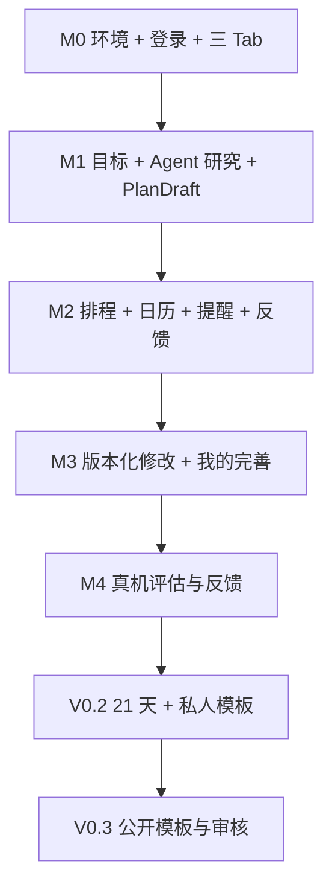

# Guidy｜独立开发任务清单与里程碑

> **版本**：v0.1 开发计划草案（2026-10-09）  
> **状态**：M0 基础工程开发中；已完成基础三 Tab，登录/后端/真机验收未完成  
> **人员与环境**：个人开发者；Windows + iPhone；Expo / React Native + FastAPI  
> **关联**：[PRD.md](./PRD.md) · [ARCHITECTURE.md](./ARCHITECTURE.md) · [UI_DESIGN.md](./UI_DESIGN.md) · [DATABASE.md](./DATABASE.md)

## 0. 当前已确定的产品与工程约束

- [x] iOS 为首发形态；Windows 开发 + iPhone 真机测试；Expo EAS 负责云端 iOS 构建。
- [x] 底部 Tab **固定为「目标｜日历｜我的」**；不设 Agent Tab，不设模板 Tab。
- [x] 「我的」包含个人资料、通知与隐私、账户等入口；「我的模板」为二级页面（V0.2），后续「发现模板」由它进入（V0.3）。
- [x] 采用模块化单体后端：FastAPI + PydanticAI + PostgreSQL；Agent 不直接操作计划/日历数据表。
- [x] V0.1 验证完整闭环；21 天启动期/私人模板进入 V0.2，公开模板社区进入 V0.3。
- [ ] 使用真实 iPhone 复核 UI 交互与通知权限路径。
- [ ] 确认开发者会员、EAS、托管 API、LLM 与检索费用预算（尚未定价或购买）。

> 复选框仅反映**讨论中已确认的架构决策**，不代表软件功能已上线。其余开发项一律从未完成状态开始。

## 1. 第一里程碑：项目基础可运行（M0）

**交付标准**：Windows 可运行 Expo、FastAPI、独立开发数据库；iPhone 能看到基础三 Tab 页面并请求 `/health`；GitHub Actions 能运行最基本检查。

### M0-A 环境和仓库

- [x] 初始化 Git 仓库并保存现行规格/品牌资源基线；统一 PRD、架构与 TODO 的里程碑编号。
- [x] 配置私人仓库 `origin`（Tosidxyy/Guidy），将每轮提交后的 Push 与远程 SHA 核验加入开发约定。
- [x] 初始化 monorepo `apps/mobile`、`backend`、`docs`；统一 README、环境变量模板和忽略规则。
- [ ] 在 Windows 安装 Node LTS、包管理器、Python、VS Code，并记录已验证版本。
- [x] 使用 Expo Router 创建 iOS App；仅三个底部路由：`goals`、`calendar`、`me`。
- [x] 实现深色/浅色主题 Tokens、基础字体和 44 pt 以上可点击区域。
- [ ] 在 Windows 启动 Metro，使用 iPhone Expo Go（仅兼容场景）预览。
- [ ] 准备 EAS Development Build 流程，记录苹果签名/TestFlight 前置条件；正式通知测试必须使用真机开发构建。

### M0-B 后端/数据基础

- [ ] 初始化 FastAPI、Pydantic v2、SQLAlchemy、Alembic、pytest、ruff。
- [ ] 实现 `/health`、统一错误格式、request_id 和服务端日志脱敏。
- [ ] 创建 Supabase 开发项目，配置 Supabase Auth；配置 API JWT 验证（签名、issuer、audience、过期等）。
- [ ] 建立开发/测试两套数据库连接与迁移流程；迁移先只创建 `profiles/goals`。
- [ ] 实现登录、登出、会话恢复、服务端对象所有权中间件。
- [ ] 建立 CI：后端格式化/静态检查/单测，前端 TypeScript 类型检查/基础 lint。

**M0 验收**：iPhone 登录成功→浏览「目标/日历/我的」三 Tab→「我的」显示基础昵称/账号状态；断网能看到错误或缓存提示，不泄露后台密钥。

## 2. 第二里程碑：目标 → 计划的 Agent 链路（M1，P0）

**交付标准**：用户输入陌生目标，通过短对话澄清、资料研究得到可审阅的结构化计划草案；关闭 App 再打开后仍能恢复当前状态。

### M1-A 目标与澄清

- [ ] 创建 `goals/goal_slots/agent_messages/agent_runs/agent_jobs` 表及索引。
- [ ] 完成 `POST/GET/PATCH /goals`，支持草稿、暂停、继续和版本号。
- [ ] 实现首页 Goal 卡：状态、下一动作、未确认草稿提示。
- [ ] 实现创建目标与 Goal 内 Agent 对话页（不提供独立 Agent Tab）。
- [ ] 用 Pydantic Slot 模型提取目标、时间、预算、资源、约束等字段，并标明用户确认状态。
- [ ] 实现动态问答策略：优先必要问题，允许“暂不确定”，避免重复问答。
- [ ] 明确高风险问题（药物、诊断、禁忌）的停止/转介规则，不能因为轮次预算而跳过。

### M1-B 可恢复研究与结构化计划

- [ ] 实现搜索/网页提取 Provider 抽象；保存来源 URL、获取时间、适用条件、未知项。
- [ ] 增加外部网页不可信输入隔离与 SSRF/超时/重定向限制。
- [ ] 使用 PydanticAI 生成 `PlanDraft`，按 Pydantic Schema 与领域规则两次校验。
- [ ] 研究/计划生成改为数据库持久 Agent Job + 独立 Worker（lease、heartbeat、重试、检查点）。
- [ ] 实现 Job 状态轮询，恢复后能继续查看阶段进度而不重复扣费/重复生成副作用。
- [ ] 计划详情展示任务、阶段、依据、预算/时间投入、阻塞原因和未确认条件。
- [ ] 建立健身、学习、护肤各 1 套可重复的评估样例，避免把 LLM 无法验证的产品参数当事实。

**M1 验收**：输入“我想开始健身”可完成动态澄清、研究并输出 `PlanDraft`；必填信息缺失时不伪造，来源失败时可重试，Agent 关闭页面后 Worker 继续运行。

## 3. 第三里程碑：计划 → 日历 → 提醒 → 反馈（M2，P0）

**交付标准**：用户审批候选计划后，系统能确定性检查冲突、生成任务日历、安排本地提醒，并记录真实执行反馈。

### M2-A 领域模型与排程

- [ ] 建立 `plan_versions/tasks/task_dependencies/calendar_events/schedule_proposals/scheduled_occurrences` 表及迁移。
- [ ] 实现 Task 与 Occurrence 分离，支持重复规则、最短间隔、固定/柔性时间、前置条件。
- [ ] 实现确定性 `SchedulingService`：识别硬约束、筛选合法候选、返回冲突原因与 1–3 个备选（若有）。
- [ ] 跨日、时区、夏令时、重叠、依赖环、无可用窗口增加自动化测试。
- [ ] 完成 App 内日历 Agenda 与日/周视图的最小实现。
- [ ] 实现预览/确认事务：`expected_goal_revision + Idempotency-Key`；并发冲突返回 409，不能静默覆盖。
- [ ] 统一确认状态：计划已保存 ≠ 本地提醒已安排。

### M2-B 通知同步与执行状态

- [ ] 建立 `notification_intents/notification_device_syncs/execution_records/outbox_events`。
- [ ] 接入 `expo-notifications`：授权时机、静默时段、隐私通知内容、点击 deep link。
- [ ] 实现服务器 desired intents → iPhone 本地 schedule/cancel → sync ack 的对账流程。
- [ ] 对 App 退出、改期、权限拒绝、旧通知仍在手机中等情形显示真实同步状态。
- [ ] 实现一键 `完成/部分完成/跳过/延期`，反馈请求幂等；未反馈不自动等于跳过。
- [ ] 完成固定事件的用户手动录入与时间占用校验。

**M2 验收**：用户在现有固定事件冲突条件下确认计划，系统阻断非法安排；无冲突任务可入历；本地提醒触发后能记录反馈；重复请求不会重复生成任务或打卡。

## 4. 第四里程碑：自然语言修改 + 我的页面完善（M3，P0）

**交付标准**：用户只改变一个条件，Agent 给出有依据的局部修改和排程差异；「我的」能管理基本资料与设置。至此 V0.1 核心闭环成立。

- [ ] 自然语言修改 Slot，识别受影响的任务/预算/日期，不随意重写无关任务。
- [ ] 增加不可变 `PlanVersion` 和 `PlanRevision` 的增删改移 Diff 预览。
- [ ] 用户确认前旧计划继续生效；提交后旧未来 occurrence 被标记替代，真实历史反馈仍保留。
- [ ] 回退旧版本前重新校验当下日历和约束。
- [ ] 「我的」首页：头像/昵称/邮箱摘要、编辑个人资料、我的模板（V0.2 才启用）入口、通知、隐私、账户设置。
- [ ] 「我的」资料编辑、权限异常、断网、空状态、删除确认、退出登录都具备清晰反馈。
- [ ] V0.1「我的」固定显示“我的模板 · 即将开放”占位，但不提供无效点击；不增加模板底部 Tab。
- [ ] 数据删除和导出规则至少有明确实现路径与错误提示，发布前完成法律/隐私文案审查。

**M3 验收**：用户说“周一不再有空”→仅受影响任务产生可解释修改→确认后新日历可见、旧提醒进入撤销/待同步；底部仍只有「目标/日历/我的」。

## 5. 第五里程碑：V0.1 真实用户验证（M4）

- [ ] 在 iPhone Development Build 验证系统通知、冷启动、deep link 和基础权限。
- [ ] 至少覆盖一台实际 iPhone 的大字体、深色模式、安全区、键盘遮挡问题。
- [ ] 完成账号权限测试：A 不可读取/编辑 B 的任何 Goal、执行记录、通知意图和模板草稿。
- [ ] 使用学习、健身、护肤三类样例端到端测试，不把演示方案当个性化医疗结论。
- [ ] 对重复点击、网络中断、Worker 重试、超预算、错误搜索结果、提示注入建立回归测试。
- [ ] 记录研究成本、计划确认率、入历率、真实反馈比例；不预设或捏造改善幅度。
- [ ] 找 10–20 名早期体验者做探索性研究（样本规模仅为建议），核查是否真的愿意执行和回来调整。
- [ ] 根据实测决定继续打磨闭环，还是进入 V0.2；不要仅凭新功能数量判定成功。

## 6. V0.2：21 天启动期 + 我的模板（P1）

- [ ] 按目标类型提供 7 / 14 / 21 / 自定义启动观察期；短期一次性目标不强制 21 天。
- [ ] 明确区分经过日数、反馈天数、任务完成率、目标成果，不宣称“21 天保证习惯养成”。
- [ ] 设计第 7/14/21 天阶段复盘与调整选项；允许中途暂停，不惩罚性清空记录。
- [ ] 新建 `kickstart_periods/templates/template_versions/template_applications` 及隔离权限。
- [ ] Agent 从私人计划中提取输入字段、动态条件问题、研究方法与任务蓝图；执行脱敏与作者预览。
- [ ] 「我的 → 我的模板」：列表、创建、编辑、私人应用、版本详情、空状态。
- [ ] 新用户应用模板必须产生新的 Goal/Plan，依据用户实际输入动态补问，不复制原作者私人信息。
- [ ] 测试模板在两种不同用户条件下能得到不同且合理的计划。

## 7. V0.3：公开模板社区（P2）

- [ ] 「我的模板 → 发现模板」实现公开列表/搜索/详情/应用，不增加第四个底部 Tab。
- [ ] 公开申请资格：至少 21 天执行观察记录 + 反馈覆盖门槛（拟 14 个不同反馈日，需评估）+ 创作者授权。
- [ ] 实现自动脱敏 + 人工/规则内容审核；高风险健康模板设置额外限制。
- [ ] 实现发布、撤回、举报、申诉、版本更新、旧版本可追溯。
- [ ] 标记“有执行记录”，不标记“科学有效”或“保证达成目标”。
- [ ] 匿名聚合改进需单独征得同意；不能公开任何用户原始对话与健康资料。

## 8. 依赖关系与发布闸门



| 里程碑 | 不通过则不得进入下一阶段的检查 |
| --- | --- |
| M0 | iPhone 可验证前端基础导航；Auth 与 API 权限可靠 |
| M1 | Agent 结果符合结构化 Schema，来源可查，关键安全约束未绕过 |
| M2 | 排程硬冲突全部被拒绝；重复提交和设备通知同步有明确状态 |
| M3 | 局部修改不破坏已确认旧计划；三 Tab 导航一致；账户/隐私基本入口可用 |
| M4 | 真机通知、完整闭环和关键异常路径经过实际测试 |
| V0.2 | 不跨用户泄露私人模板内容，周期与完成率独立统计 |
| V0.3 | 资格审查、脱敏、下架和举报流程完成，否则不上线社区 |

## 9. 现在最先动手的三个任务

1. **初始化 Expo 项目**：在 iPhone 跑通「目标｜日历｜我的」三 Tab 静态导航，先不用真实 Agent。
2. **敲定 Schema 与 API 合同**：以 [DATABASE.md](./DATABASE.md) 的 Goal/Plan/Task 模型生成第一版 Alembic 与 Pydantic DTO。
3. **用模拟数据跑通一个故事**：新建“我想学英语”→回答 2–3 个关键问题→看到计划草稿→排程预览→确认后日历显示→记录一次完成；随后再接真实 Agent。

> **不建议现在做的事**：复杂 Multi-Agent、Redis、向量数据库、Kubernetes、用户排名、跨应用持续监控、自动购买、完整模板社区。真实用户使用数据未证明必要前，不纳入 V0.1。


## 10. 每轮开发进度记录（开发中持续更新）

> 执行准则详见仓库根目录 `AGENTS.md`：**快速测试通过 → 提交本轮实现 → 更新本文件 → 单独提交 TODO → Push 到私人仓库**。此规则用于每一轮小任务，不表示下面列出的 M0–M4 任务已经完成。禁止未经验证就勾选复选框。

建议每次记录格式（只在真实完成一轮后填写，不要保留示例占位符当作事实）：

```md
### YYYY-MM-DD — Mx / 任务标题
- 完成内容：…
- 快速测试：`实际执行命令` → PASS / FAIL / 未运行（原因）
- 代码提交：`真实 Git Commit SHA`（如没有代码变更，说明）
- TODO 提交：本轮另行提交（其 SHA 在交付回复中报告；无需回写本条，避免循环提交）
- 已勾选任务：…（仅完成且通过验收的条目）
- 阻塞与未验证：…
- 下一轮：…
```

### 2026-10-09 — M0 / 文档分期统一与 Git 基线

- 完成内容：PRD 的 M0–M4 统一为 V0.1；V0.2/V0.3 单列。架构 Sprint A/B 与 M0/M1 对齐，目录名改为 Guidy；初始化 main 分支并保存已有文档和品牌资源。
- 快速测试：PowerShell 内联 Python 检查 → PASS（分期标题、原型路径、批准图标 SHA256、1024×1024 RGB、凭据扫描）；`git -c core.whitespace=-blank-at-eol show --check HEAD` → PASS（Markdown 原有两个行尾空格用于硬换行；默认 whitespace 检查对此产生提示）。
- 实现提交：`fbae8f1381d888b9919b5a989ba32c8762944958`（文档与资源基线，无应用代码）。
- TODO 提交：本轮另行提交，其 SHA 在交付回复中报告。
- 已勾选任务：新增的 Git 基线与文档分期统一前置项；其余 M0 开发项目保持未完成。
- 阻塞与未验证：默认 Python 3.11.0 未满足后端 3.12+ 要求；暂无应用源码、Supabase 配置或 iPhone 实测。MANIFEST.json 是原始资源包清单，包含本目录未提供的历史文件及原始文档哈希，不能用作当前工程完整性清单。
- 下一轮：初始化 Expo Router 三 Tab、接入锁定图标与主题 Tokens，执行类型/lint/打包检查；后端阶段准备 Python 3.12+。

### 2026-10-09 — M0 / Expo 三 Tab 与主题基础

- 完成内容：建立 apps/mobile、backend 预留目录和根脚本；Expo Router 仅 goals/calendar/me 三 Tab。接入批准图标与黑底启动屏、系统字体、浅深色 Tokens、44 pt+ 控件；演示数据明确标注，未接入功能禁用或静态说明。日期单选与临时主题切换可用；更新 README、环境模板与忽略规则。
- 快速测试：`npm run typecheck` → PASS；`npm run lint` → PASS；联网 `npx expo install --check` → PASS；`npm run export:ios` / `npm run export:web` → PASS。iOS 导出首次因沙箱临时目录写入受限失败，设置 TEMP/TMP 为项目 `.cache/expo-tmp` 后复测通过。
- 浏览器 Smoke Test：`node C:/Users/29035/.codex/visualizations/2026/10/09/01a11f51-bbc0-74b3-9200-ebe6276c1dc5/guidy-smoke.cjs` → PASS；Browser plugin not available，使用已捆绑 Playwright + 本机无头 Edge。验证 localhost:8082 的页面标题、非空、无错误覆盖层、三 Tab、禁用的未来入口、日期切换/空状态/恢复、44 pt 日期控件、手动与系统主题；393×852、320×740、1280×900 三视口截图，控制台 error/warning 均为 0。截图与临时测试脚本在仓库外，未提交。
- 资源/文档检查：PowerShell 内联 Python 校验 → PASS（三路由、精确版本与 lockfile 一致、批准原图哈希/复制资源字节、配置和修改文档链接）；`git diff --cached --check` 与暂存凭据/文件范围检查 → PASS。
- 代码提交：`5dc1061dbc8d6b8475032fd7c7ddabb0ec3f2e3b`。
- TODO 提交：本轮另行提交，其 SHA 在交付回复中报告。
- 已勾选任务：monorepo 基础目录/说明、Expo Router 三 Tab、基础主题/字体/触控区域。backend 目前仅 README，不代表 FastAPI 已初始化。
- 阻塞与未验证：iPhone、Expo Go 兼容性、原生安全区、Dynamic Type/VoiceOver、最终安装包图标/启动屏未验证；登录、API、数据库、CI、EAS 未实现。默认 Python 3.11.0 需在后端轮次选用或准备 3.12+。
- 依赖审计：在线 `npm audit` → 29 项（18 high、11 moderate）；兼容 `npm audit fix` 后仍存在，涉及构建工具/Metro 链及 Router URI 解码等。未执行跨 SDK 强制修复，发布前复核。离线 package-lock 安装的“0 vulnerabilities”不作为通过证据。
- 下一轮：初始化 FastAPI `/health`、统一错误/request_id 与后端 pytest/ruff；随后接入 Supabase Auth/基础迁移，并安排 iPhone 三 Tab 真机验证。M0 总体验收保持未完成，不进入 M1。

### 2026-10-09 — M0 / 私人仓库与每轮 Push 约定

- 完成内容：用户指定 `https://github.com/Tosidxyy/Guidy` 为私人远程；配置 origin，更新 AGENTS.md/README 的强制闭环，要求实现与 TODO 提交后推送全部提交，禁止 force push 并核验远程分支 SHA。
- 快速测试：PowerShell 内联 Python 文档校验 → PASS（仓库 URL、测试/提交/TODO/Push 顺序与禁止强推规则）；`git diff --check` → PASS。GitHub 仓库元数据确认 visibility=private、push=true；`git ls-remote https://github.com/Tosidxyy/Guidy.git` → PASS，远程无分支，首次推送不会覆盖已有远程提交。
- 实现提交：`54d8f43958f6768b9a175058e8b0f79c7ec53ba2`（仅文档约定，无应用代码变更）。
- TODO 提交：本轮另行提交，其 SHA 在交付回复中报告。
- Push：本轮 TODO 提交后将 main（含前两轮四个提交）一起推送至 origin/main；实际推送结果与远程 HEAD 核验在交付回复中报告。
- 已勾选任务：配置私人 origin 与每轮 Push 开发约定。
- 阻塞与未验证：本轮不改变 App 行为；未运行前端/后端测试，已有 iPhone/依赖审计限制继续保留。
- 下一轮：继续 M0 后端基础；每轮测试与提交后同步私人仓库。
