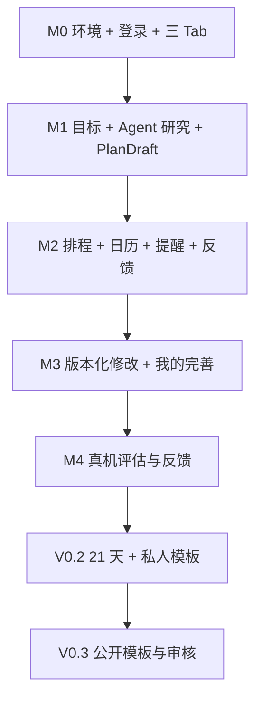

# Guidy｜独立开发任务清单与里程碑

> **版本**：v0.1 开发计划草案（2026-10-09）  
> **状态**：邮箱云登录、卡片问答、自动研究/制订、确认日历与方案修订已接通；旧手工流程已退役，最新完整iPhone验收和V0.1通知/反馈闭环仍未完成。逐轮真实证据见文末及[改造验收](REDESIGN_ACCEPTANCE.md)。
> **人员与环境**：个人开发者；Windows + iPhone；Expo / React Native + Cloudflare Workers / TypeScript  
> **关联**：[PRD.md](./PRD.md) · [ARCHITECTURE.md](./ARCHITECTURE.md) · [UI_DESIGN.md](./UI_DESIGN.md) · [DATABASE.md](./DATABASE.md)

## 0. 当前已确定的产品与工程约束

- [x] iOS 为首发形态；Windows 开发 + iPhone 真机测试；Expo EAS 负责云端 iOS 构建。
- [x] 底部 Tab **固定为「目标｜日历｜我的」**；不设 Agent Tab，不设模板 Tab。
- [x] 「我的」包含个人资料、通知与隐私、账户等入口；「我的模板」为二级页面（V0.2），后续「发现模板」由它进入（V0.3）。
- [x] 采用模块化单体后端：TypeScript Workers + D1 + Better Auth；Agent 不直接操作计划/日历数据表。
- [x] V0.1 验证完整闭环；21 天启动期/私人模板进入 V0.2，公开模板社区进入 V0.3。
- [ ] 使用真实 iPhone 复核 UI 交互与通知权限路径。
- [ ] 确认开发者会员、EAS、托管 API、LLM 与检索费用预算（尚未定价或购买）。

> 复选框仅反映**讨论中已确认的架构决策**，不代表软件功能已上线。其余开发项一律从未完成状态开始。

## 1. 第一里程碑：项目基础可运行（M0）

**交付标准**：Windows 可运行 Expo、Wrangler 本地 Worker、独立开发/测试数据库；iPhone 能看到基础三 Tab 页面并请求 `/health`；GitHub Actions 能运行最基本检查。

### M0-A 环境和仓库

- [x] 初始化 Git 仓库并保存现行规格/品牌资源基线；统一 PRD、架构与 TODO 的里程碑编号。
- [x] 配置私人仓库 `origin`（Tosidxyy/Guidy），将每轮提交后的 Push 与远程 SHA 核验加入开发约定。
- [x] 初始化 monorepo `apps/mobile`、`backend`、`docs`；统一 README、环境变量模板和忽略规则。
- [ ] 在 Windows 安装 Node LTS、包管理器、Wrangler、VS Code，并记录已验证版本。
- [x] 使用 Expo Router 创建 iOS App；仅三个底部路由：`goals`、`calendar`、`me`。
- [x] 实现深色/浅色主题 Tokens、基础字体和 44 pt 以上可点击区域。
- [x] 前端登录 UI 演示：邮箱/验证码输入、错误/加载/取消、演示账号进入/退出；只用内存模拟，不请求认证后端。（不等于真实登录验收。）
- [x] 登录异常 UI 演示：验证码过期、重发冷却/限流、模拟失败保留输入与重试恢复；计时与状态边界经过验证。（不调用认证后端；新异常页真机/无障碍未验证。）
- [x] 登录演示输入与焦点：验证码接受空格/短横线和全角数字，拒绝非法后缀；补充错误边框与读屏提示，验证码页自动聚焦。（用户确认 iPhone 自动聚焦和按钮正常；VoiceOver/大字体未验证，不等于真实认证。）
- [x] iPhone 登录演示基础表单验证：用户确认验证码键盘展开时无遮挡，输入与按钮操作正常。（用户手动验证；不含真实认证、大字体或 VoiceOver。）
- [x] 「我的」实现真实 API 探活、检查中/失败/重试状态；完成浏览器联调（iPhone 验证仍待下项）。
- [x] iPhone App 本地 Worker 探活成功：用户确认「我的 → 连接状态」显示服务可用。（用户手动验证；不代表认证/DB/云部署就绪。）
- [ ] 在 iPhone 独立记录 Safari 本地 Worker `/health` 与失败/恢复路径。（App 成功已确认；这些独立路径尚未明确反馈。）
- [x] 连接检查生命周期：离开「我的」/后台时取消当前请求、可重试、旧响应不覆盖新结果。（浏览器与 Web 事件验证通过；iPhone 新增后台行为待验证。）
- [x] 在 Windows 启动 Metro，使用 iPhone Expo Go（仅兼容场景）预览。（用户确认此前基础预览可用；新 Worker 的手机 API 联调仍待复核。）
- [x] 准备 EAS Development Build 流程，记录苹果签名/TestFlight 前置条件；正式通知测试必须使用真机开发构建。（依赖、profiles、启动命令与指南已准备；尚无 Apple 付费会员，未生成签名包。）
- [ ] 在账号/标识/签名条件具备后，完成 EAS iOS 云构建、iPhone 安装与开发包专项验收。（用户已有 Expo 账号；Apple 付费会员、EAS 项目链接和 Bundle Identifier 待配置。）

### M0-B 后端/数据基础

- [x] 用户确认 iPhone 云端验证码登录可用。（此前收信已确认；仅首次登录成功，不包括重启恢复/退出与目标写入。）
- [x] 开放邮箱注册准备：Resend 创建 auth.guidy.fun，保存实际公开 DNS 记录；已验证正式 sender 模式接受新邮箱并在开发环境保留精确 Expo Go 白名单。（代码/真实 D1 测试通过；后续 DNS 验证与云部署见下项。）
- [x] 在 Cloudflare 添加 [auth.guidy.fun 发信 DNS](RESEND_DOMAIN_DNS.md)，Resend 验证通过后切换 noreply@auth.guidy.fun / resend，并验证非测试邮箱收码注册。（用户添加 DNS，Resend 四项 verified；已部署，用户确认新邮箱收码并登录成功。）
- [x] 修复 Expo Go 云登录来源与 workerd 发信参数，真实云端验证码请求 200/email，用户确认测试邮件收到。（精确私网预览白名单、非 2xx 拒绝、安全错误分类；App 输入验证码/登录恢复仍未验收，正式自有域名邮件未配置。）
- [x] 绑定自有 API 域名 api.guidy.fun，云开发 D1 升级到 0005 并部署目标创建/详情编辑服务，App 默认 origin 切换。（电脑 HTTPS/匿名拒绝验证通过；用户确认 iPhone Safari /health 显示 ok，App 收码登录/目标写入仍未验证。）
- [x] 初始化 TypeScript Worker、Wrangler、类型/ESLint/格式检查与有效边界测试。（D1 与 Auth 仍在下方待办。）
- [x] 实现 `/health`、统一错误格式、request_id 和服务端日志脱敏。
- [ ] 创建 Cloudflare 开发 Worker/D1 资源，接入 Better Auth；验证会话、过期、撤销与受保护 API。
- [x] 创建并部署独立 Cloudflare 云开发 Worker/D1，应用 0001–0003，校验真实 HTTPS 成功/失败合同。（云端认证关闭；总体云认证仍待原项，手机云端连接未验收。）
- [x] 建立开发/测试两套数据库连接与迁移流程；迁移先创建 Better Auth 必需表与 `profiles/goals`，通过 Wrangler SQL migrations 验证。（本地 D1；远程资源未创建。）
- [ ] 实现登录、登出、会话恢复、服务端对象所有权中间件。
- [x] 本地真实认证链路：Better Auth/D1 OTP、登录/退出/恢复、受保护当前账号接口与身份隔离；前端替换演示账号，接官方 Expo/SecureStore。（开发收件箱由用户确认；浏览器/真实 Worker 已验收，原生新登录待确认，后续业务对象授权仍待原项。）
- [ ] 验收新 iPhone 真实登录、完全 Reload/重启恢复、正常/断网退出与 SecureStore 行为；接入正式邮件与云端资源后完成总体认证验收。
- [x] 实现 Resend 验证码发送适配、注册邮箱受限测试模式和动态投递提示。（模拟邮件 API + 真实临时 D1/浏览器验证通过；真实 Key/收信和云端登录未验收。）
- [x] 配置并开启云端 resend-test，核对必需 secret 名称，验证实际匿名会话/账号拒绝，手机预览使用云 HTTPS origin。（真实收码/登录未验收。）
- [ ] 有自有域名后配置 Cloudflare Email Routing 收信与 Resend 发信域名验证，完成真实收发与云端登录验收。（api.guidy.fun 与 auth.guidy.fun 发信已完成，多邮箱收码登录已确认；Cloudflare 根域收信/转发尚未配置，不将该组合项标为完成。）
- [x] 验证迁移后的 CI：后端 TypeScript/ESLint/格式/边界测试/dry-run，前端类型/lint/API 测试。（真实 GitHub jobs 已通过。）

**M0 验收**：iPhone 登录成功→浏览「目标/日历/我的」三 Tab→「我的」显示基础昵称/账号状态；断网能看到错误或缓存提示，不泄露后台密钥。

## 2. 第二里程碑：目标 → 计划的 Agent 链路（M1，P0）

**交付标准**：用户在Goal内只通过聊天提供条件，后台按需研究并给出方案草稿；不要求填写Slot/搜索/数字表单，关闭App重进恢复状态。

### 用户确认的主流程改造（2026-10-11，后续优先）

- [x] 纠正产品事实源为聊天→最终方案（含拟安排）→一次批准自动入历；内部Slot不变成必填UI。详见[对话主流程](CHAT_FIRST_FLOW.md)，此项仅文档决策，未完成应用改造。
- [ ] 聊天内受控保存用户明确回答、来源证据/未知/冲突/版本，接通下一问与研究准备，用户无需进入条件页。
- [x] 首批聊天采集：新问题绑定成果/可投入时间/限制，完整明确原文答案受控保存、未知保留，Goal版本/依据与回复原子完成；聊天隐藏逐项条件确认入口。（真实本地D1/受控浏览器、隔离云DeepSeek两轮通过并部署，新增iPhone体验待反馈。非完整语义采集、既有条件更正、预算/时间窗或自动研究/入历。）
- [x] 修正委托时间与未知的重复澄清：用户「你来安排吧」触发待接受投入建议，同意才记录；未知转其他未问信息或暂停完善。（韩语合成样例/真实D1/隔离真实云模型通过，新增iPhone待体验；不证明实际空闲或全部语义识别。）
- [x] 至少三个不同核心信息后可停止提问：成果、投入时间、基础/资源与关键限制去重；持久停止意图、免费幂等、不清未发送输入、主动继续完善。（相关测试/浏览器及云端通过；中止后自动研究/出草稿仍未接通，不能勾选完整端到端。）
- [ ] harness按需组织查询/选证据/生成草稿的持久编排，状态与失败回聊天，防重复付费调用；支持不需要搜索的目标。
- [x] 首批停止后自动方案：持久Job、研究判断/固定通用查询、正文/摘要筛选、strict草稿与未知假设，聊天恢复进度及结果。（真实D1/受控浏览器/真实云Workflow+豆包+DeepSeek通过并部署；新增iPhone待体验。非完整语义检索、事实/领域验证、自然语言改稿或批准入历。）
- [x] 开发澄清额度修正：开发个人24/全局60、其他环境8/20；显示本人剩余额度及三主题进度、发送额度不足时保留输入、中止独立可用且位于历史上方。（真实D1/浏览器/云只读额度验证通过；新版iPhone待体验。未重置旧记录，生成/搜索额度不变。）
- [ ] 自然语言修改草稿，具体时间窗/时区采集与确定性拟排程合并到最终草稿。
- [x] 首批聊天定量改稿：单项时长/每周频次、前后差异、明确采用、新审阅及重进恢复；原稿/任务身份/依据保留，旧来源/并发建议禁用。（真实D1/浏览器/云API通过并部署，新增iPhone待体验；不是任意步骤AI改写、增删任务或排程批准。）
- [ ] M2一次批准当前方案及拟安排后原子自动入历，版本/日历改变拒绝旧批准，提醒同步独立确认。
- [ ] 聊天链路接通后，将条件页/手动搜索和选资料/数字审阅退出普通主流程，保留历史数据与受限开发诊断能力；不能只隐藏未替代能力。

### M1-A 目标与澄清

- [x] 首批确定性澄清进度：已确认期望结果/可投入时间作为基础研究资料，限制条件可未知并保留提示；目标详情显示缺项/研究准备/待核对/暂停/只读。（一致 D1 快照与10个合成规则样例通过并部署；仅资料进度，完整领域安全、研究执行与计划闸门仍未实现，iPhone 新显示待验收。）
- [x] harness 条件建议首批：提取本轮原文中的 outcome/available_time/constraints，运行时 Schema/唯一键/原文依据校验；Goal 内建议审阅，用户逐项填入后显式确认保存。（真实临时 D1/受控 UI 已验证并部署；分类仍需用户核对，完整时间/预算/资源 Slot 和新 iPhone 提取交互仍待验收。）
- [x] iPhone 聊天输入区键盘避让：输入/发送底栏独立于历史，多行内部滚动；用户 Reload 后明确确认“可以了”。（仅这项基础键盘反馈，不代表大字体/VoiceOver/所有输入页通过。）
- [x] DeepSeek 澄清 harness 实现与测试入口：可替换 Provider、owner/版本/上下文一致快照、持久 run/message、幂等/并发/限额、Schema/执行声称边界、失效恢复；Goal 内对话页。（真实 D1 + 模拟 Provider、受控 UI 通过并已部署；真实 DeepSeek 回复和新 iPhone 交互待下项，不代表研究/计划已完成。）
- [ ] 验收真实 DeepSeek API：iPhone 出现目标相关问题、多轮输入/重载恢复、真实用量/超时失败与模型质量；扩大评估集后完善语义重复/高风险路由。（用户已配置服务端 Key；模型真实回复待反馈。）
- [x] 目标内用户条件确认：三步填写期望结果/可投入时间/限制条件，允许暂不确定；goal_slots 用户来源/确认时间/版本保存，详情摘要、重载恢复与冲突保留输入。（本地浏览器/真实 D1 通过并部署云端；固定输入准备，未接 AI 动态问答，iPhone 新交互尚未验证。）
- [x] 草稿目标详情/编辑/暂停继续：PATCH /api/v1/goals/{id}、expected_revision 条件写入、原子修改回执与幂等重放；首页进入详情、冲突保留输入并显式重新读取。（本地 D1/浏览器通过；只支持未有生效计划的 draft/paused，研究/执行中状态的暂停继续仍待后续，iPhone/云端未验证。）
- [x] 账号目标创建/列表/单项读取：POST/GET /api/v1/goals、GET /api/v1/goals/{id}，真实会话归属、创建幂等、revision=0；App 从本机草稿提交、展示/恢复账号目标。（本地 Worker/D1 浏览器端到端通过；PATCH/暂停继续、云部署及 iPhone 真机待完成，原完整 API 项保持未完成。）
- [x] 离线目标输入准备：一份本机草稿的创建、编辑、持久保存、首页展示和确认删除。（用户要求域名等待期间先开发内部功能；原生 SecureStore、Web localStorage，不属于账号 Goal，不自动上传；浏览器验证通过，iPhone 持久保存/键盘未验证。）
- [ ] 创建 `goals/goal_slots/agent_messages/agent_runs/agent_jobs` 表及索引。
- [ ] 完成 `POST/GET/PATCH /goals`，支持草稿、暂停、继续和版本号。
- [ ] 实现首页 Goal 卡：状态、下一动作、未确认草稿提示。
- [ ] 实现创建目标与 Goal 内 Agent 对话页（不提供独立 Agent Tab）。
- [ ] 用运行时 Schema 校验的 TypeScript Slot 模型提取目标、时间、预算、资源、约束等字段，并标明用户确认状态。
- [ ] 实现动态问答策略：优先必要问题，允许“暂不确定”，避免重复问答。
- [ ] 明确高风险问题（药物、诊断、禁忌）的停止/转介规则，不能因为轮次预算而跳过。

### M1-B 可恢复研究与结构化计划

- [x] 来源页阅读区域修复：添加表单默认收起、主动展开、收起保留/成功自动收起、失败保留；来源/任务安全错误码保留，全部失败明确显示。（浏览器/类型/lint/状态/iOS导出通过；新iPhone布局待确认，British Council云端HTTP520未恢复。）
- [x] 首批持久后台来源任务：Cloudflare Workflows、D1 agent_jobs/逐项快照、同实例派发恢复、lease/检查点/版本保护；最多3份来源，页面离开后可恢复进度。（真实Workers Workflow+受控UI通过并部署，云空任务2步成功；实际iPhone来源任务待验收，不代表搜索/事实研究/计划生成完成。）
- [x] 首批来源准备：独立网页 ResearchProvider、精确官网HTTPS白名单、大小/超时/跳转/类型限制；用户指定来源与待核对问题，D1保存短摘录/访问时间/限制/unverified，Goal内恢复/失败明确重试。（本地真实D1+受控UI、电脑实际公开网页读取通过并部署；不是自动搜索/事实核验或后台研究Job，iPhone云端来源读取仍待验收。）
- [x] 首批搜索后端：豆包Custom SearchProvider、安全来源DTO、私有搜索尝试/结果、原子预算/幂等/owner/版本保护、unknown不自动重搜；已部署。受控供应商+真实临时D1验证通过；不代表手机入口、真实Key/搜索效果或完整研究流程验收。
- [x] Goal内主动搜索入口与来源审阅：通用查询、可收起输入、正文/摘要/片段标识、结果/旧版本恢复、同键重放及另开搜索确认。（类型/lint/20项状态测试/iOS导出/受控供应商浏览器验证PASS；用户确认iPhone已出现真实搜索结果；来源质量、键盘/VO/大字及完整异常恢复真机验收未完成。）
- [ ] 实现搜索/网页提取 Provider 抽象；保存来源 URL、获取时间、适用条件、未知项。
- [ ] 增加外部网页不可信输入隔离与 SSRF/超时/重定向限制。
- [x] 首批PlanDraft后端：冻结确认条件/当前搜索证据、独立DeepSeek计划提示、私人草稿保存、结构/引用/依赖/部分风险校验及费用/幂等/版本保护。（受控模型+真实临时D1检查通过并部署；手机审阅、真实生成质量、完整领域/预算/时间校验仍未验证或实现。）
- [ ] 使用 TypeScript Agent Provider 生成 `PlanDraft`，按运行时 Schema 与领域规则两次校验。
- [ ] 研究/计划生成改为D1 持久 Agent Job + 经验证的 Cloudflare 后台编排/消费者（lease、heartbeat、重试、检查点）。
- [ ] 实现 Job 状态轮询，恢复后能继续查看阶段进度而不重复扣费/重复生成副作用。
- [x] 首批手动数字审阅：任务时长/每周次数、实时投入、独立不可变审阅版本、原稿/Task IDs/依赖/引用保留、版本冲突保留输入。（真实本地API/D1/浏览器及类型/lint/iOS导出通过；云已部署，用户确认iPhone保存后重进恢复数值、数字键盘输入和保存按钮正常。不等于完整任务编辑、领域/时间校验或计划批准。）
- [ ] 计划详情展示任务、阶段、依据、预算/时间投入、阻塞原因和未确认条件。
- [x] 首批每周时间总量预检：用户填写0–10080分钟或未知，随不可变审阅保存；显示全部任务投入的超出/刚好/剩余，保留版本/幂等/冲突输入。（本地真实API/D1/浏览器、类型/lint/iOS导出通过，云已部署，用户确认iPhone恢复和提示正常；保留为过渡能力。不是时间窗排程、金钱预算或计划批准。）
- [x] 手机基础真实生成与草稿展示：strict输出修正后用户确认iPhone「已出现草稿」。（仅基础生成/展示；内容质量、引用语义、时间适配、异常恢复/VO/大字及确认入历未验收。旧失败与用量保留。）
- [ ] 建立健身、学习、护肤各 1 套可重复的评估样例，避免把 LLM 无法验证的产品参数当事实。

**M1 验收**：输入“我想开始健身”可完成动态澄清、研究并输出 `PlanDraft`；必填信息缺失时不伪造，来源失败时可重试，Agent 关闭页面后 Worker 继续运行。

## 3. 第三里程碑：计划 → 日历 → 提醒 → 反馈（M2，P0）

**交付标准**：用户审批候选计划后，系统能确定性检查冲突、生成任务日历、安排本地提醒，并记录真实执行反馈。

### M2-A 领域模型与排程

- [ ] 建立 `plan_versions/tasks/task_dependencies/calendar_events/schedule_proposals/scheduled_occurrences` 表及迁移。
- [ ] 实现 Task 与 Occurrence 分离，支持重复规则、最短间隔、固定/柔性时间、前置条件。
- [ ] 实现确定性 `SchedulingService`：识别硬约束、筛选合法候选、返回冲突原因与 1–3 个备选（若有）。
- [x] 首批纯排程预览内核：明确 UTC 实例/时间窗及 IANA 时区，检查占用、依赖/环、固定时间、截止及系列休息间隔，返回拟安排/未安排原因。（9项自动测试及构建通过；有界贪心非最优，未接聊天/API/真实日历，无批准写入，完整服务项保持未完成；见 [排程预览说明](SCHEDULING_PREVIEW.md)。）
- [x] 聊天首批时段核对/试排：明确北京时间或UTC日期窗口，确认后首阶段各项一次，冻结草稿/审阅版本、解释未安排、原文/确认/预览恢复；旧来源/条件/审阅/过期拒绝，配额耗尽仍可零模型试排。（真实D1/浏览器/隔离云API通过并部署；iPhone新版未验证。未展开完整周频次/阶段周期、通用自然日期/全时区、真实日历占用或批准入历。）
- [x] 首阶段一周频次试排：从首个时段本地日期起连续7天，展开独立重复实例、同项每天最多一次、依赖顺序、已排/未排次数；显式一周确认，旧一次协议兼容。（28项后端/33项前端状态及浏览器/隔离云API通过并部署，iPhone新版未验证；仍非多阶段/多周完整计划，领域休息要求、真实日历占用及批准入历未完成。）
- [x] 账号固定占用首批：聊天具体日期提议/明确保存，calendar_events/calendar_states迁移、原子确认/回执/版本、本人范围读取及真实占用列表；一次/一周预览冻结交叠占用并避让，日历改变拒绝旧提议、旧预览标失效。（真实D1/38项相关回归/34项前端状态/浏览器/隔离云API通过并部署；iPhone新版未验证。仅具体日期创建/读取，重复/修改取消、独立schedule_proposals/目标任务批准/通知仍未实现；[合同](CALENDAR_OCCUPANCY.md)。）
- [x] 排程聊天提示修正：单一一周入口、等待回答防重复、短问句/普通字号/折叠示例、旧协议仅展示映射；状态读取失败保留草稿并GET恢复，未读取成功禁止另生成。（21项后端/35项前端状态、模拟网络失败浏览器及云端协议通过并部署；新增iPhone未验证，不代表原手机网络超时根因已确认或任意自然语言时间已支持。）
- [x] Guidy！主流程首批：全页问题卡/箭头下一问/滑动回看、三个核心问题后开始或继续、后台研究与生成完成自动附假设明确的一周建议、日期选择/当天任务步骤；普通来源/条件/排程操作退出入口，旧数据保留。（42项后端/35项前端状态、浏览器及真实云Workflow通过；新原生键盘待验证。仅首阶段一周，通用自然时间纠错、完整周期/最终批准入历未完成。）
- [ ] 跨日、时区、夏令时、重叠、依赖环、无可用窗口增加自动化测试。
- [ ] 完成 App 内日历 Agenda 与日/周视图的最小实现。
- [ ] 实现预览/确认事务：`expected_goal_revision + Idempotency-Key`；并发冲突返回 409，不能静默覆盖。
- [ ] 统一确认状态：计划已保存 ≠ 本地提醒已安排。

### M2-B 通知同步与执行状态

- [ ] 建立 `notification_intents/notification_device_syncs/execution_records/outbox_events`。
- [ ] 接入 `expo-notifications`：授权时机、静默时段、隐私通知内容、点击 deep link。
- [ ] 实现服务器 desired intents → iPhone 本地 schedule/cancel → sync ack 的对账流程。
- [ ] 对 App 退出、改期、权限拒绝、旧通知仍在手机中等情形显示真实同步状态。
- [ ] 实现一键 `完成/部分完成/跳过/延期`，反馈请求幂等；未反馈不自动等于跳过。
- [ ] 完成固定事件的用户手动录入与时间占用校验。

**M2 验收**：用户在现有固定事件冲突条件下确认计划，系统阻断非法安排；无冲突任务可入历；本地提醒触发后能记录反馈；重复请求不会重复生成任务或打卡。

## 4. 第四里程碑：自然语言修改 + 我的页面完善（M3，P0）

**交付标准**：用户只改变一个条件，Agent 给出有依据的局部修改和排程差异；「我的」能管理基本资料与设置。至此 V0.1 核心闭环成立。

- [ ] 自然语言修改 Slot，识别受影响的任务/预算/日期，不随意重写无关任务。
- [ ] 增加不可变 `PlanVersion` 和 `PlanRevision` 的增删改移 Diff 预览。
- [ ] 用户确认前旧计划继续生效；提交后旧未来 occurrence 被标记替代，真实历史反馈仍保留。
- [ ] 回退旧版本前重新校验当下日历和约束。
- [ ] 「我的」首页：头像/昵称/邮箱摘要、编辑个人资料、我的模板（V0.2 才启用）入口、通知、隐私、账户设置。
- [ ] 「我的」资料编辑、权限异常、断网、空状态、删除确认、退出登录都具备清晰反馈。
- [ ] V0.1「我的」固定显示“我的模板 · 即将开放”占位，但不提供无效点击；不增加模板底部 Tab。
- [ ] 数据删除和导出规则至少有明确实现路径与错误提示，发布前完成法律/隐私文案审查。

**M3 验收**：用户说“周一不再有空”→仅受影响任务产生可解释修改→确认后新日历可见、旧提醒进入撤销/待同步；底部仍只有「目标/日历/我的」。

## 5. 第五里程碑：V0.1 真实用户验证（M4）

- [ ] 在 iPhone Development Build 验证系统通知、冷启动、deep link 和基础权限。
- [ ] 至少覆盖一台实际 iPhone 的大字体、深色模式、安全区、键盘遮挡问题。
- [ ] 完成账号权限测试：A 不可读取/编辑 B 的任何 Goal、执行记录、通知意图和模板草稿。
- [ ] 使用学习、健身、护肤三类样例端到端测试，不把演示方案当个性化医疗结论。
- [ ] 对重复点击、网络中断、Worker 重试、超预算、错误搜索结果、提示注入建立回归测试。
- [ ] 记录研究成本、计划确认率、入历率、真实反馈比例；不预设或捏造改善幅度。
- [ ] 找 10–20 名早期体验者做探索性研究（样本规模仅为建议），核查是否真的愿意执行和回来调整。
- [ ] 根据实测决定继续打磨闭环，还是进入 V0.2；不要仅凭新功能数量判定成功。

## 6. V0.2：21 天启动期 + 我的模板（P1）

- [ ] 按目标类型提供 7 / 14 / 21 / 自定义启动观察期；短期一次性目标不强制 21 天。
- [ ] 明确区分经过日数、反馈天数、任务完成率、目标成果，不宣称“21 天保证习惯养成”。
- [ ] 设计第 7/14/21 天阶段复盘与调整选项；允许中途暂停，不惩罚性清空记录。
- [ ] 新建 `kickstart_periods/templates/template_versions/template_applications` 及隔离权限。
- [ ] Agent 从私人计划中提取输入字段、动态条件问题、研究方法与任务蓝图；执行脱敏与作者预览。
- [ ] 「我的 → 我的模板」：列表、创建、编辑、私人应用、版本详情、空状态。
- [ ] 新用户应用模板必须产生新的 Goal/Plan，依据用户实际输入动态补问，不复制原作者私人信息。
- [ ] 测试模板在两种不同用户条件下能得到不同且合理的计划。

## 7. V0.3：公开模板社区（P2）

- [ ] 「我的模板 → 发现模板」实现公开列表/搜索/详情/应用，不增加第四个底部 Tab。
- [ ] 公开申请资格：至少 21 天执行观察记录 + 反馈覆盖门槛（拟 14 个不同反馈日，需评估）+ 创作者授权。
- [ ] 实现自动脱敏 + 人工/规则内容审核；高风险健康模板设置额外限制。
- [ ] 实现发布、撤回、举报、申诉、版本更新、旧版本可追溯。
- [ ] 标记“有执行记录”，不标记“科学有效”或“保证达成目标”。
- [ ] 匿名聚合改进需单独征得同意；不能公开任何用户原始对话与健康资料。

## 8. 依赖关系与发布闸门



| 里程碑 | 不通过则不得进入下一阶段的检查 |
| --- | --- |
| M0 | iPhone 可验证前端基础导航；Auth 与 API 权限可靠 |
| M1 | Agent 结果符合结构化 Schema，来源可查，关键安全约束未绕过 |
| M2 | 排程硬冲突全部被拒绝；重复提交和设备通知同步有明确状态 |
| M3 | 局部修改不破坏已确认旧计划；三 Tab 导航一致；账户/隐私基本入口可用 |
| M4 | 真机通知、完整闭环和关键异常路径经过实际测试 |
| V0.2 | 不跨用户泄露私人模板内容，周期与完成率独立统计 |
| V0.3 | 资格审查、脱敏、下架和举报流程完成，否则不上线社区 |

## 9. 现在最先动手的三个任务

1. **初始化 Expo 项目**：在 iPhone 跑通「目标｜日历｜我的」三 Tab 静态导航，先不用真实 Agent。
2. **敲定 Schema 与 API 合同**：以 [DATABASE.md](./DATABASE.md) 的 Goal/Plan/Task 模型生成第一版 D1 SQL migrations 与 TypeScript/运行时 Schema DTO。
3. **用模拟数据跑通一个故事**：新建“我想学英语”→回答 2–3 个关键问题→看到计划草稿→排程预览→确认后日历显示→记录一次完成；随后再接真实 Agent。

> **不建议现在做的事**：复杂 Multi-Agent、Redis、向量数据库、Kubernetes、用户排名、跨应用持续监控、自动购买、完整模板社区。真实用户使用数据未证明必要前，不纳入 V0.1。


## 10. 每轮开发进度记录（开发中持续更新）

> 执行准则详见仓库根目录 `AGENTS.md`：**快速测试通过 → 提交本轮实现 → 更新本文件 → 单独提交 TODO → Push 到私人仓库**。此规则用于每一轮小任务，不表示下面列出的 M0–M4 任务已经完成。禁止未经验证就勾选复选框。

建议每次记录格式（只在真实完成一轮后填写，不要保留示例占位符当作事实）：

```md
### YYYY-MM-DD — Mx / 任务标题
- 完成内容：…
- 快速测试：`实际执行命令` → PASS / FAIL / 未运行（原因）
- 代码提交：`真实 Git Commit SHA`（如没有代码变更，说明）
- TODO 提交：本轮另行提交（其 SHA 在交付回复中报告；无需回写本条，避免循环提交）
- 已勾选任务：…（仅完成且通过验收的条目）
- 阻塞与未验证：…
- 下一轮：…
```

### 2026-10-09 — M0 / 文档分期统一与 Git 基线

- 完成内容：PRD 的 M0–M4 统一为 V0.1；V0.2/V0.3 单列。架构 Sprint A/B 与 M0/M1 对齐，目录名改为 Guidy；初始化 main 分支并保存已有文档和品牌资源。
- 快速测试：PowerShell 内联 Python 检查 → PASS（分期标题、原型路径、批准图标 SHA256、1024×1024 RGB、凭据扫描）；`git -c core.whitespace=-blank-at-eol show --check HEAD` → PASS（Markdown 原有两个行尾空格用于硬换行；默认 whitespace 检查对此产生提示）。
- 实现提交：`fbae8f1381d888b9919b5a989ba32c8762944958`（文档与资源基线，无应用代码）。
- TODO 提交：本轮另行提交，其 SHA 在交付回复中报告。
- 已勾选任务：新增的 Git 基线与文档分期统一前置项；其余 M0 开发项目保持未完成。
- 阻塞与未验证：默认 Python 3.11.0 未满足后端 3.12+ 要求；暂无应用源码、Supabase 配置或 iPhone 实测。MANIFEST.json 是原始资源包清单，包含本目录未提供的历史文件及原始文档哈希，不能用作当前工程完整性清单。
- 下一轮：初始化 Expo Router 三 Tab、接入锁定图标与主题 Tokens，执行类型/lint/打包检查；后端阶段准备 Python 3.12+。

### 2026-10-09 — M0 / Expo 三 Tab 与主题基础

- 完成内容：建立 apps/mobile、backend 预留目录和根脚本；Expo Router 仅 goals/calendar/me 三 Tab。接入批准图标与黑底启动屏、系统字体、浅深色 Tokens、44 pt+ 控件；演示数据明确标注，未接入功能禁用或静态说明。日期单选与临时主题切换可用；更新 README、环境模板与忽略规则。
- 快速测试：`npm run typecheck` → PASS；`npm run lint` → PASS；联网 `npx expo install --check` → PASS；`npm run export:ios` / `npm run export:web` → PASS。iOS 导出首次因沙箱临时目录写入受限失败，设置 TEMP/TMP 为项目 `.cache/expo-tmp` 后复测通过。
- 浏览器 Smoke Test：`node C:/Users/29035/.codex/visualizations/2026/10/09/01a11f51-bbc0-74b3-9200-ebe6276c1dc5/guidy-smoke.cjs` → PASS；Browser plugin not available，使用已捆绑 Playwright + 本机无头 Edge。验证 localhost:8082 的页面标题、非空、无错误覆盖层、三 Tab、禁用的未来入口、日期切换/空状态/恢复、44 pt 日期控件、手动与系统主题；393×852、320×740、1280×900 三视口截图，控制台 error/warning 均为 0。截图与临时测试脚本在仓库外，未提交。
- 资源/文档检查：PowerShell 内联 Python 校验 → PASS（三路由、精确版本与 lockfile 一致、批准原图哈希/复制资源字节、配置和修改文档链接）；`git diff --cached --check` 与暂存凭据/文件范围检查 → PASS。
- 代码提交：`5dc1061dbc8d6b8475032fd7c7ddabb0ec3f2e3b`。
- TODO 提交：本轮另行提交，其 SHA 在交付回复中报告。
- 已勾选任务：monorepo 基础目录/说明、Expo Router 三 Tab、基础主题/字体/触控区域。backend 目前仅 README，不代表 FastAPI 已初始化。
- 阻塞与未验证：iPhone、Expo Go 兼容性、原生安全区、Dynamic Type/VoiceOver、最终安装包图标/启动屏未验证；登录、API、数据库、CI、EAS 未实现。默认 Python 3.11.0 需在后端轮次选用或准备 3.12+。
- 依赖审计：在线 `npm audit` → 29 项（18 high、11 moderate）；兼容 `npm audit fix` 后仍存在，涉及构建工具/Metro 链及 Router URI 解码等。未执行跨 SDK 强制修复，发布前复核。离线 package-lock 安装的“0 vulnerabilities”不作为通过证据。
- 下一轮：初始化 FastAPI `/health`、统一错误/request_id 与后端 pytest/ruff；随后接入 Supabase Auth/基础迁移，并安排 iPhone 三 Tab 真机验证。M0 总体验收保持未完成，不进入 M1。

### 2026-10-09 — M0 / 私人仓库与每轮 Push 约定

- 完成内容：用户指定 `https://github.com/Tosidxyy/Guidy` 为私人远程；配置 origin，更新 AGENTS.md/README 的强制闭环，要求实现与 TODO 提交后推送全部提交，禁止 force push 并核验远程分支 SHA。
- 快速测试：PowerShell 内联 Python 文档校验 → PASS（仓库 URL、测试/提交/TODO/Push 顺序与禁止强推规则）；`git diff --check` → PASS。GitHub 仓库元数据确认 visibility=private、push=true；`git ls-remote https://github.com/Tosidxyy/Guidy.git` → PASS，远程无分支，首次推送不会覆盖已有远程提交。
- 实现提交：`54d8f43958f6768b9a175058e8b0f79c7ec53ba2`（仅文档约定，无应用代码变更）。
- TODO 提交：本轮另行提交，其 SHA 在交付回复中报告。
- Push：本轮 TODO 提交后将 main（含前两轮四个提交）一起推送至 origin/main；实际推送结果与远程 HEAD 核验在交付回复中报告。
- 已勾选任务：配置私人 origin 与每轮 Push 开发约定。
- 阻塞与未验证：本轮不改变 App 行为；未运行前端/后端测试，已有 iPhone/依赖审计限制继续保留。
- 下一轮：继续 M0 后端基础；每轮测试与提交后同步私人仓库。

### 2026-10-09 — M0 / FastAPI 探活、错误合同与日志基础

- 完成内容：使用可用的 Python 3.12.14 创建 backend/.venv，uv 0.11.32 管理 pyproject/uv.lock；锁定 FastAPI 0.143.0、Pydantic 2.14.0、SQLAlchemy 2.1.4、Alembic 1.20.0、pytest 9.1.1、ruff 0.16.10 等。当前 Starlette TestClient 使用其支持的 httpx2 2.13.1，未引入 Agent/数据库业务。
- API：公开 `/health` 仅为进程 liveness；JSON 成功/失败 envelope、合法 UUID 请求追踪及响应头、404/405/422/500 统一错误。生产关闭 debug/文档。日志只记录固定字段与路由模板，关闭原始 access log，抑制异常原文和 traceback。
- 快速测试：backend 中 `.venv/Scripts/python.exe -m ruff check .` → PASS；`-m ruff format --check .` → PASS（15 文件）；`-m pytest` → PASS（22 passed，0 warnings）。覆盖非法 JSON/参数、协议头、500、私密字段、请求 ID 并发隔离、OpenAPI 和生产设置。
- 环境故障与修正：沙箱内 pytest 在 asyncio socketpair 初始化卡住，诊断后终止，移到支持本机通信的环境运行；首次有效运行 20 passed / 2 failed（测试断言与新版框架不兼容），修正断言与当前 TestClient 依赖后全部通过。未将卡住/失败的运行记为通过。
- 功能 Smoke Test：`.venv/Scripts/python.exe C:/Users/29035/.codex/visualizations/2026/10/09/01a11f51-bbc0-74b3-9200-ebe6276c1dc5/guidy-backend-smoke.py` → PASS（真实 Uvicorn loopback HTTP 200/404/405，响应追踪头/JSON 一致，非法 ID 替换，stdout/stderr 不含合成私密字段、全为结构化日志）；临时服务已自动停止，脚本在仓库外。
- 其他检查：`uv lock --check --offline` → PASS；Python/四项基础工具 import → PASS；修改的 README/setup 文档链接、暂存文件/凭据扫描及 `git diff --cached --check` → PASS。前端没有改动，未重复运行前端测试。
- 代码提交：`4f2ec8115818ff9861a8ed426c5e2d64ad281e6f`。
- TODO 提交/Push：本轮单独提交 TODO 后推送 origin/main，实际 SHA 和远程同步核验在交付回复中报告。
- 已勾选任务：后端基础依赖/工具初始化；`/health`、统一错误、request_id 与日志脱敏。
- 阻塞与未验证：尚无 Supabase 项目配置、Auth/JWT、DB 连接/迁移、CI 或手机请求；SQLAlchemy/Alembic 仅安装并验证工具依赖，未执行 SQL。Windows 整体工具安装项仍未完成（VS Code/EAS 等未验证）。iPhone 实测和前轮前端依赖审计限制仍保留，M0 总体验收未通过。
- 下一轮：建立前后端基础 CI，并让手机端显示真实 API 连通/失败状态；随后接 Supabase Auth 和 profiles/goals 基础迁移。

### 2026-10-09 — M0 / 真实 API 连接状态与基础 CI

- 完成内容：「我的」新增真实 `/health` 检查、五秒超时、重复点击保护、取消/卸载清理、失败与重试恢复；校验 Guidy 服务/版本/request_id 和响应头，不回显原始错误。后端 CORS 默认关闭、仅按配置允许明确 origin/GET 并暴露请求 ID，不携带凭据。建立只读权限、官方 Action SHA 固定的 mobile/backend CI（Node 24.15.0、uv 0.11.32）。
- 快速测试：mobile 的 `npm run typecheck` / `npm run lint` / `npm run test:api` → PASS（9 项 API 边界测试，0 warning）；backend 的 `.venv/Scripts/python.exe -m ruff check .` / `-m ruff format --check .` / `-m pytest` → PASS（30 passed，0 warnings）。使用 Node 内置 TS 类型擦除和测试 runner，不新增测试依赖。
- 导出：`npm run export:ios` → PASS；`npm run export:web` → PASS（首轮因沙箱拒绝创建 dist/assets/node_modules 失败，项目内输出目录重试后通过）。
- 浏览器 Smoke Test：`node C:/Users/29035/.codex/visualizations/2026/10/09/01a11f51-bbc0-74b3-9200-ebe6276c1dc5/guidy-health-ui.cjs` → PASS。Browser plugin not available，使用捆绑 Playwright + 无头 Edge；真实 FastAPI 8000/Expo 8082 联调，验证三 Tab、未检查/加载/禁用、200 成功、模拟断网、错误响应、超时和重试恢复；393×852、320×740、1280×900 截图。4 个真实 200 响应；未预期控制台错误/警告为 0，断网模拟产生 1 个预期网络资源错误。
- CI/文档检查：js-yaml 解析、触发条件/只读权限/固定 SHA/job 命令检查 → PASS；UTF-8 文档链接、lockfile 依赖一致性、暂存凭据扫描和 `git diff --cached --check` → PASS。远程 GitHub CI 必须推送后才能验证，尚不勾选 CI 完成项。
- 代码提交：`c3a37b3824bfc96884a47e04fe6679b9ab63fc58`。
- TODO 提交/Push：本轮单独提交 TODO 后推送 origin/main，再检查 GitHub Actions 的实际执行；结果确认后追加文档记录，未通过则保持 CI 未完成。
- 已勾选任务：M0 API 连接状态实现与浏览器联调；iPhone 和 CI 远程验收保持未完成。
- 阻塞与未验证：iPhone 局域网请求/Expo Go、大字体/安全区仍未验证；Supabase Auth/DB 未接入；前轮依赖在线审计问题仍保留。本轮 CORS 仅用于浏览器探活，业务写方法应在后续 Auth API 实现时按需扩展。
- 下一轮：确认远程 CI 后继续 Supabase Auth 与 profiles/goals 迁移；需要开发项目公开配置和独立数据库连接，不将密钥提交到仓库。

### 2026-10-09 — M0 / 首次远程 CI 验收补记

- 验收结果：GitHub Actions [Guidy CI #37899646600](https://github.com/Tosidxyy/Guidy/actions/runs/37899646600) → completed / success，运行 SHA 为 `71578a2a0bf35a56f34d6335e05cd59578b9e659`（包含实现 `c3a37b3` 与首次 TODO 记录）。
- mobile job `113718946274`：npm ci、typecheck、lint、test:api 各步骤 success；backend job `113718945925`：uv sync --locked、ruff check、ruff format --check、pytest 各步骤 success。均为真实 ubuntu-latest runner 运行，非本地模拟。
- 快速检查：只读 GitHub Actions API 核对运行/两 job/各 step 结果 → PASS；本次 TODO 文档/SHA/链接与 `git diff --check` → PASS。
- 已勾选任务：基础 CI；其他 Auth/数据库/iPhone 待办不变。只补记远程结果，无应用代码变更，单独文档提交并再次 Push；workflow 的 paths 不会因纯文档更新重复运行。
- 下一轮：继续 M0 Supabase Auth 与基础数据库迁移；iPhone 局域网/API 实测仍待执行。


### 2026-10-09 — M0 / Cloudflare TypeScript 后端迁移

- 用户确认：改用 Cloudflare 并将后端语言改为 TypeScript；此前 iPhone Expo Go 基础预览已由用户确认可用。没有明确机型/API 成功/字体/通知细节，不扩大真机验收范围。
- 完成内容：TypeScript Workers 替代 Python 入口；保留 health 成功/错误/追踪合同、最小 CORS、白名单业务日志；新 Wrangler 默认 8787。旧实现可从 Git 历史恢复，旧架构/数据库/启动文档保存历史快照。现行 PRD/AGENTS/架构/数据库/README 统一到 Workers+D1+Better Auth；D1 原子批次、对象授权和后台 Job 语义明确不照搬 PostgreSQL。
- 依赖：Node 24.15.0；TypeScript 6.0.3、Wrangler 4.149.0、ESLint 10.12.0、typescript-eslint 8.71.1、Prettier 3.9.9，精确版本与 lockfile。最新 TS 7 超出 ESLint 插件兼容范围，安装失败后选兼容 TS 6；未使用 force/legacy-peer-deps。
- 快速检查：backend 的 `npm run typecheck`、`npm run lint`、`npm run format:check`、`npm test` → PASS（10 项）；`npm run build` → PASS（Wrangler dry-run，未部署）。首轮 lint 的测试 Web globals 未声明，改为 globalThis 引用后复测通过。
- 真实运行：Wrangler 本地 workerd `/health` 200、错误方法 405、未知路径 404 和请求 ID 合同 → PASS。`node C:/Users/29035/.codex/visualizations/2026/10/09/01a11f51-bbc0-74b3-9200-ebe6276c1dc5/guidy-worker-ui.cjs` → PASS；Expo 8082 → workerd 8787，三视口、加载/成功/断网/超时/异常响应/重试恢复，4 个真实 200，0 未预期错误与 1 预期断网资源错误。浏览器验证不替代 iPhone 验证。
- 文档/资源/CI 检查：现行链接、历史快照与前一提交内容比对、批准原图 SHA256、精确锁文件、YAML/SHA/检查步骤验证和暂存凭据扫描 → PASS；`git diff --cached --check` → PASS。Cloudflare 管理 Token、本地 .dev.vars、缓存、ignored 的旧 .venv 均不提交。
- 实现提交：`243f0c2b2f9424baffeeb6f2c626cf95c6cbdad4`。
- TODO 提交/Push：单独提交进度后 Push，再验证 GitHub 的 TS backend/mobile jobs；实际结果后补记，CI 暂未勾选。历史轮次仅说明当轮事实，不能作为当前技术栈依据。
- 已勾选任务：Worker 基础工具与 API 迁移；用户确认的此前 iPhone Expo Go 基础预览。Auth/DB/部署/迁移后手机 API 保持未完成。
- 未验证：远程 Cloudflare 账号/Worker/D1 尚未配置或创建，Better Auth/邮件/真实会话未接入，新 Worker iPhone API 未复核，通知/签名安装包/专项无障碍未测；移动端原有依赖审计限制继续保留。
- 下一轮：D1 本地开发/测试迁移与 Better Auth 接入，远程部署在资源/账号条件明确后实施；本轮不引入真实 Agent 或 M1 功能。

### 2026-10-09 — M0 / TypeScript Workers CI 远程验收

- GitHub [Guidy CI #37903890228](https://github.com/Tosidxyy/Guidy/actions/runs/37903890228) → completed/success，运行 SHA `96a3adc199c52a47003393d04a3d9b551d97823a`。
- mobile job `113732582426`：npm ci/typecheck/lint/test:api 均 success；backend job `113732582755`：npm ci/typecheck/lint/format:check/test/build（dry-run）均 success。运行环境为真实 ubuntu-latest；没有远程部署步骤。
- 快速检查：只读 Actions API job/step 核对 → PASS；本次进度文档/SHA/链接与 `git diff --check` → PASS。
- 已勾选：迁移后的 CI。无应用代码修改；单独文档提交后 Push 并核验远程 SHA。D1/Auth/部署和新 Worker 真机 API 未验证项不变。

### 2026-10-09 — M0 / D1 本地数据基础

- 完成内容：锁定 Better Auth 1.7.7，从实际核心 Schema 生成不可重写的 0001；0002 添加 STRICT profiles/goals、认证/所有者外键、规范 UUID、标题/状态/整数版本/时间/空计划指针约束与索引。本地开发/测试配置、数据库 ID 与持久目录分开；迁移 wrapper 强制 local，拒绝 remote/生产目标/额外参数。没有开放登录或 M1 Goal CRUD。
- 快速检查：backend `npm run typecheck`、`npm run lint`、`npm run format:check`、`npm run schema:check` → PASS；`npm test` → PASS（18 项：真实 D1/库 Schema 比对、约束、外键、失败批次回滚、去重、级联删除、隔离、wrapper 安全边界与 API 回归）。Miniflare 5.20261006.1-alpha 与 Wrangler 版本一致，使用其官方 V4 配置转换器。
- 迁移 Smoke Test：`npm run db:migrate` / `npm run db:migrate:test` → PASS（两条迁移分别应用到独立本地 D1）；重复 `db:migrate:test` → PASS（No migrations to apply）。不清空开发数据，不触碰远程资源。`npm run build` → PASS（dry-run；沙箱自身日志/metrics 写入受限后，在支持工具运行的环境复测）。
- 修正记录：首次 Miniflare 配置不兼容，采用库官方转换器后通过；测试 DDL 注释分段与 SQLite 错误码大小写断言失败，修正测试加载/断言后复测全通过。未将失败运行作为通过。
- 文档/提交检查：链接、固定依赖与 lockfile、CI Schema/local migration 步骤、暂存文件/凭据扫描、`git diff --cached --check` → PASS。真实本地数据库与 secrets 均未提交；前端没有修改，未重复浏览器/真机检查。
- 代码提交：`64a144dc4e4ff457e21936639056bd11545fb7b1`。
- TODO 提交/Push：本轮另行提交 TODO 后 Push；扩展后的远程 CI 结果实际运行后补记。
- 已勾选：本地开发/测试数据库连接与迁移流程。已有 CI 的上轮结果保留，但新 Schema/迁移步骤须本次 Push 后核验。
- 未验证：真实 Better Auth 登录/邮件/会话恢复/撤销、受保护 API/跨用户授权、远程 D1/部署、新 Worker 真机联调和专项无障碍/通知。数据库 schema 成功不代表 Auth 或对象权限验收完成。
- 下一轮：接入 Better Auth 受保护账号 API 与登录/会话；邮件发送和远程资源按实际账号条件配置，继续 M0。

### 2026-10-09 — M0 / SQL 行尾兼容补充

- 完成内容：SQL 文件固定 LF；Schema 比对接受 Windows CRLF，避免跨平台换行被误判为认证结构变化。未改变已应用 SQL 的含义。
- 快速检查：`npm run lint` / `format:check` / `schema:check` → PASS；`git check-attr eol -- backend/migrations/0001_auth_core.sql backend/migrations/0002_profiles_goals.sql` → 两文件均 lf；`git diff --cached --check` → PASS。
- 代码提交：`71f972fb0a04080158772f625fdede22fc1d9bd2`；本条单独文档提交后与前述 D1 基础提交一起 Push，再核对远程 CI。没有新增功能完成项。

### 2026-10-09 — M0 / D1 扩展 CI 远程验收

- GitHub [Guidy CI #37907072295](https://github.com/Tosidxyy/Guidy/actions/runs/37907072295) → completed/success，运行 SHA `7ab7e6c216396e50a78ecac2a5a231ad72075610`。
- mobile job `113742994247` 全部成功；backend job `113742994704` 的 npm ci、typecheck、lint、format:check、schema:check、db:migrate:test、test 与 dry-run build 全部 success。实际 ubuntu-latest D1/Schema/迁移运行，不是本地结果替代；无远程部署步骤。
- 快速检查：只读 Actions API 与步骤核对 → PASS；本次 TODO 文档、真实 SHA/链接和 `git diff --check` → PASS。单独文档提交后 Push 并核对远程 HEAD。
- 数据基础验收范围为本地开发/测试；真实账号登录、邮件、受保护 API、跨用户权限、远程 D1/生产部署和专项手机测试仍未完成。

### 2026-10-09 — M0 / 无后端登录 UI 演示

- 范围：仅前端 UI/mock；`/(auth)/sign-in` 二级页与「我的」演示账号状态。底部保持三个 Tab，沿用黑白 Tokens/批准图标/原型账号卡层级。没有后端、数据库、认证依赖或接口修改。
- 完成内容：公开演示邮箱 demo@example.invalid / 123456；输入校验、错误保留/重试、明确 500ms 模拟加载与重复点击保护、修改邮箱、取消计时器、演示进入/退出。DemoAccountProvider 只存内存布尔状态，不生成 Token/cookie、不保存凭据、不发送邮件、不作为权限依据；完全重载清除。
- 快速检查：mobile `npm run typecheck` / `npm run lint` → PASS；`npm run test:api` → PASS（已有 9 项客户端回归）；最终顺序执行 `npm run export:ios` / `npm run export:web` → PASS。没有修改后端，未重复本地后端测试。
- 浏览器 QA：`node C:/Users/29035/.codex/visualizations/2026/10/09/01a11f51-bbc0-74b3-9200-ebe6276c1dc5/guidy-login-ui.cjs` → PASS。Browser plugin not available，使用已捆绑 Playwright/无头 Edge；localhost:8084，「我的 → 登录演示 → 校验/加载 → 进入 → 退出」及取消、离线演示、重载清除、浅深色；393×852、320×740、1280×900 截图，44 pt+ 按钮，无横向页面溢出。认证/后端请求 0、未预期应用错误/警告 0；离线模拟造成 4 个预期开发资源错误，单独记录，不当作应用错误或网络调用成功。
- 修正与视觉检查：首轮返回时重复创建 Tabs，改为 SDK 的 dismissTo 返回已有「我的」后复测通过；截图检查卡片、按钮主次层级、窄屏与暗色可读性。最终文案/截图单独刷新确认。iPhone 键盘、安全区、字体/VoiceOver 未验证。
- 文档/提交检查：修改文档链接、登录模块无 fetch/存储/认证库调用、批准原图字节、暂存文件限定为前端/UI 文档及 `git diff --cached --check` → PASS；演示数据明确标记，不当成真实会话。
- 代码提交：`0ba8f363e5cb62c1ac2dbd76cd858189b2435aad`。
- TODO 提交/Push：单独提交本条后推送私人 origin/main，再核对 CI 与远程 SHA，实际结果后补记。
- 已勾选：新增的前端登录 UI 演示小项；真实登录/登出/会话恢复/对象授权、远程资源与专项真机验收保持未完成。
- 下一轮：继续 UI 评审/真机表单检查；真实 Better Auth 与邮件/会话接入单独实施，不将 demoSignedIn 接到受保护业务 API。

### 2026-10-09 — M0 / 登录 UI CI 远程验收

- GitHub [Guidy CI #37909793932](https://github.com/Tosidxyy/Guidy/actions/runs/37909793932) → completed/success，运行 SHA `0fa1d1aa35c20a12f65667ca4e7e90440c2e4826`。
- mobile job `113751923441` 的安装/类型/lint/客户端测试全部 success；既有 backend job `113751924011` 的所有回归步骤 success。后端本轮无改动，也没有新增认证 API。
- 快速检查：只读 Actions API 与步骤核对、本次 TODO 的真实 SHA/链接与 `git diff --check` → PASS。只补记远程结果，单独文档提交后 Push 并核验远程 HEAD。
- 完成项仍只为 UI mock；真实登录、邮件、Token/会话存储/恢复、受保护 API 和本轮原生表单真机验证保持未完成。

### 2026-10-09 — M0 / iPhone 登录演示基础表单验收

- 验证来源：用户在 iPhone Expo Go 体验「我的 → 体验登录 UI」后反馈“没有遮挡，一切正常”。针对本轮所问的验证码输入、键盘展开时主按钮可见/可点击，记录为用户手动真机验证通过；没有声称由 Codex 控制或测试手机。
- 对应界面：当前实现 `0ba8f363e5cb62c1ac2dbd76cd858189b2435aad`（进度/CI 文档随后已提交）。本轮未修改源代码、键盘布局或添加认证请求，只记录实际验收。
- 快速检查：本次 TODO 内容、真实界面 SHA、未完成项及 `git diff --check` → PASS；纯文档轮次未重复类型/lint/构建或后端测试，不触发代码 CI。
- 已勾选：新增的 iPhone 登录演示基础表单验证小项。机型/iOS 版本未提供；大字体、VoiceOver、真实认证/邮件、Token/会话存储/恢复、对象授权、通知与云部署仍未验证/未完成。
- 提交/Push：本轮只有文档提交；按约定推送 origin/main 并核验远程 SHA，结果在交付回复中报告。
- 后续范围：登录界面演示可继续评审；真实 Better Auth 接入需要单独实施，不能以 demoSignedIn 代替认证状态。

### 2026-10-09 — M0 / 无后端登录异常状态与恢复

- 完成内容：UI-only demoChallenge 模型，演示有效期 60 秒/重发冷却 5 秒/30 秒窗口最多准备 3 次；以截止时间判断过期。过期禁用旧码演示进入，重发限流不阻断仍有效的码提交。模拟失败保留输入并可重试；异常演示控件分组/可收起，准备与验证加载明确区分。所有数值是预览设置，不是正式认证策略。
- 快速检查：mobile `npm run typecheck` / `npm run lint` → PASS；`npm run test:ui-state` → PASS（3 项时间边界）；`npm run test:api` → PASS（9 项已有客户端回归）；最终顺序 `npm run export:ios` / `npm run export:web` → PASS。继续时重新执行类型/lint/两组测试，全部通过；无后端源代码修改。
- 浏览器 QA：`node C:/Users/29035/.codex/visualizations/2026/10/09/01a11f51-bbc0-74b3-9200-ebe6276c1dc5/guidy-login-states-ui.cjs` → PASS。已捆绑 Playwright + 无头 Edge/受控时钟，localhost:8086，393×852/320×740/1280×900；自然冷却/滚动限流、窗口恢复、手动/自动过期、重新获取、限流下有效码验证、失败保留输入与重试、修改/返回/重载清理、暗色与响应式截图。认证/后端请求 0，未预期控制台错误/警告 0。Browser plugin not available；截图/测试脚本在仓库外。
- 调整记录：开发服务器启动前首轮连接拒绝，待启动后复测；重载的 networkidle 等待超时，改为 DOM 完成/实际可交互状态验证后整个流程通过，未把失败运行记为通过。
- 文档/提交检查：链接、未变更依赖与 lockfile、UI 模块无 fetch/认证库/凭据存储、暂存范围与凭据扫描、`git diff --cached --check` → PASS。CI 增加 test:ui-state，实际远程运行待 Push 后核验。
- 代码提交：`f1da05362d894c0cd3c8987c79370bf57ae62a8e`。
- 提交阻塞记录：上轮自动审批因用量限制无法完成，Git 动作未执行；本轮用户请求继续后通过正常审批重新提交成功，未绕过审批或虚构 SHA。
- TODO 提交/Push：本条单独提交后 Push 私人 origin/main，再核验 CI 与远程 HEAD；结果实际确认后补记。
- 已勾选：新增异常 UI 演示小项。原先用户确认的 iPhone 基础表单仅适用于当时界面；本轮新增异常页、计时、大字体与 VoiceOver 未做真机验收。真实登录、邮件、会话/存储、受保护 API/对象授权仍保持未完成。
- 下一轮：评审/真机验证新增异常演示；真实认证接入单独实施，不将模拟倒计时/次数或 demoSignedIn 用于后端权限判断。

### 2026-10-09 — M0 / 登录异常 UI CI 远程验收

- GitHub [Guidy CI #37942777027](https://github.com/Tosidxyy/Guidy/actions/runs/37942777027) → completed/success，运行 SHA `7467f1cc577468e465bd8c157ad1b061cb4d297c`。
- mobile job `113861156127` 的安装/类型/lint/test:api/新增 test:ui-state 全部 success；既有 backend job `113861156412` 的全部回归步骤 success。本轮后端源代码未修改，也未接入真实登录接口。
- 快速检查：只读 Actions API/步骤核验、真实 SHA/链接及 `git diff --check` → PASS。本次仅补记进度，单独文档提交并 Push 后核对远程 HEAD。
- 范围仍为 UI mock；邮件、真实认证、凭据/会话存储/恢复、权限与新异常页真机/无障碍未完成。

### 2026-10-09 — M0 / 登录演示输入、焦点与错误反馈

- 完成内容：纯前端 demoInput 规范化空格/短横线和全角数字；非法字符/后缀保留并拒绝，避免 `123456x` 被误当作有效演示码。邮箱错误聚焦对应输入，验证码页自动聚焦；错误边框与 accessibilityHint 补充失败反馈，编辑后清除提示。没有邮件、剪贴板读取、认证 API 或凭据存储。
- 快速检查：mobile `npm run typecheck` / `npm run lint` → PASS；`npm run test:ui-state` → PASS（5 项）；`npm run test:api` → PASS（9 项既有回归）；最终顺序 `npm run export:ios` / `npm run export:web` → PASS。依赖未改变，后端源代码未修改。
- 浏览器 QA：`node C:/Users/29035/.codex/visualizations/2026/10/09/01a11f51-bbc0-74b3-9200-ebe6276c1dc5/guidy-login-input-ui.cjs` → PASS。Browser plugin not available，使用已捆绑 Playwright/无头 Edge，localhost:8087，393×852/320×740/1280×900；错误焦点/边框、邮箱 Enter、验证码自动聚焦、非法后缀/错误码拒绝、格式化有效码 Enter 成功、编辑清除提示、退出/返回、暗色/窄屏与 44 pt 按钮。认证请求 0、未预期控制台错误/警告 0；截图检查通过。
- 真机验证：用户在 iPhone 完全 Reload 后反馈“已测试，自动聚焦和按钮正常”，记录本轮新增自动聚焦/输入框和主按钮为用户手动验证通过。未提供机型/iOS；VoiceOver、大字体和异常计时专项仍未验证，不扩大验收范围。
- 文档/提交检查：修改文档链接、lockfile 一致性、批准图标原图哈希、暂存范围/凭据检查及 `git diff --cached --check` → PASS。
- 代码提交：`1828b49b188b426e5a82e16d35a371d7418f8c06`。
- TODO 提交/Push：本条单独提交后推送私人 origin/main，再核对实际 CI 与远程 SHA；结果随后补记。
- 已勾选：登录演示输入与焦点小项。真实登录/邮件、会话恢复/存储、对象授权与远程资源保持未完成。
- 下一轮：继续 M0 的专项真机/可访问性验收或开发构建准备；真实认证需单独实施，演示状态不可作为业务权限依据。

### 2026-10-09 — M0 / 登录输入与焦点 CI 远程验收

- GitHub [Guidy CI #37946405577](https://github.com/Tosidxyy/Guidy/actions/runs/37946405577) → completed/success，运行 SHA `6cb737d6eebfbe165153fb024e721e37b09e63ed`。
- mobile job `113873675868` 安装/typecheck/lint/test:api/test:ui-state 全部 success；backend job `113873676363` 安装/typecheck/lint/format:check/schema:check/db:migrate:test/test/dry-run build 全部 success。后端未改动，未接入真实认证。
- 快速检查：只读 Actions API 与全部步骤核验、实际 SHA/链接与 `git diff --check` → PASS。本条单独文档提交后 Push，并核对远程 HEAD；没有新增功能完成项。
- iPhone 自动聚焦与按钮已有用户手动验证；VoiceOver/大字体、真实认证/邮件/会话及云部署仍未完成。

### 2026-10-09 — M0 / iOS Development Build 流程准备

- 完成内容：Expo 官方 SDK 安装流程加入 expo-dev-client，最终精确锁定 57.0.19；新增 EAS development（internal/iPhone）与 production（store）profiles。保留默认 Expo Go 启动，新增明确的 start:go/start:dev-client，根目录 mobile 指向 Expo Go。添加签名文件忽略规则，构建指南记录项目/设备/签名/环境/TestFlight 与后续专项验收；无 UI/认证后端修改。
- 账号条件：用户确认已有 Expo 账号，尚无 Apple Developer 付费会员。没有登录外部账号、创建 EAS 项目、登记设备、购买会员、生成证书、云构建或提交 TestFlight；实际 Bundle Identifier/项目 ID 未虚构。
- 快速检查：mobile `npm run typecheck` / `npm run lint` → PASS；`npm run test:ui-state` → PASS（5 项），`npm run test:api` → PASS（9 项）；`npm run export:ios` / `npm run export:web` → PASS。在线 `npx expo install --check` → Dependencies are up to date；public/prebuild Expo 配置解析 PASS，实际插件为 expo-dev-client 57.0.19。
- 配置/文档检查：`node .cache/check-ios-build.mjs` → PASS（profiles 字段、固定依赖/lockfile、预览命令、文档相对链接、批准品牌原图哈希）；`git check-ignore` 的 credentials.json/p12/p8/mobileprovision/ipa 均命中；检查实现 diff/暂存范围和 `git diff --cached --check` → PASS。EAS CLI 24.12.1 为在线查询版本，未安装/执行 EAS 云命令或声称完整 EAS 服务器校验。
- 修正/限制：Expo 首次安装仍写版本范围，随后明确 npm install --save-exact 并确认 lockfile；沙箱离线缓存缺元数据的尝试失败，正常在线安装后通过。离线兼容检查提示不可靠，已追加真实在线检查；npm audit 仍有原先 29 项（18 high/11 moderate），未强制修改 SDK。Expo Go Metro 8088 启动至 Waiting on URL；沙箱 HTTP status 探测被套接字权限限制，未作为通过，未做本轮手机扫码。停止临时服务器后不影响已有预览。
- 代码提交：`1ebc626b7331eee11285ec2dc19644e174de34a6`。
- 已勾选：构建流程准备；新增实际云构建/安装待办保持未完成。JS 资源导出不代表 Xcode/CocoaPods、签名、云构建或真机安装通过；真实认证、通知、VoiceOver/大字体仍未完成。
- TODO 提交/Push：本条单独提交后推送 origin/main，核对远程 SHA/实际 CI，结果随后补记。
- 下一轮：没有会员期间继续 Expo Go 与 M0；具备签名条件后链接实际项目/标识，再执行开发包构建和专项真机验收。

### 2026-10-09 — M0 / iOS 构建准备 CI 远程验收

- GitHub [Guidy CI #37947897370](https://github.com/Tosidxyy/Guidy/actions/runs/37947897370) → completed/success，运行 SHA `c39c3d9c4b032f415e95c64d6cd055ce02641832`。
- mobile job `113878836461` 的 npm ci/typecheck/lint/test:api/test:ui-state 全部 success；backend job `113878836194` 全部既有检查/迁移/测试/dry-run success。CI 没有 EAS 原生构建或签名步骤，不能作为安装验收。
- 快速检查：只读 Actions API/全部步骤与本次 TODO 真实 SHA/链接、`git diff --check` → PASS；单独文档提交后 Push 并核对远程 HEAD。账号/签名与专项真机限制不变。

### 2026-10-09 — M0 / iPhone 本地 Worker 联通准备与 PC 验证

- 完成内容：新增 IPHONE_PREVIEW 指南和入口，说明 Worker LAN 启动、查找 Wi-Fi IPv4、Safari/App 两层检查、进程环境配置、旧 Metro/地址/权限/网络隔离排查及退出。没有修改业务 UI、登录、数据库或服务合同；没有调用认证接口或部署云端资源。
- 环境恢复：首次 dev:lan 因 Wrangler 不存在失败；npm ci 的 workerd 安装长时间无输出，中止后用 `npm ci --fetch-timeout=60000 --fetch-retries=1 --fetch-retry-mintimeout=1000 --fetch-retry-maxtimeout=3000` 正常重试 → PASS（153 包，audit 0）。未更改依赖/锁文件或删除数据库。
- 实际运行：`npm run dev:lan` → Ready，监听 0.0.0.0:8787；移动端当前进程配置实际 Wi-Fi origin 后 `npm run start:go -- --port 8089` → Metro 等待。电脑地址仅用于当前临时环境，不写入 tracked 配置，变化后须更新。
- Smoke Test：Node 类型擦除加载真实 `checkHealth` 客户端，分别请求实际回环与 Wi-Fi Worker origin → PASS，版本均 0.1.0；真实 POST /health → 405、未知 GET → 404，失败 envelope/request ID 一致性 → PASS。这些为 Windows HTTP 结果，不是 iPhone 测试；探活成功不代表 DB/认证就绪。
- 文档快速检查：Node 检查 README/mobile README/新指南相对链接及 dev:lan/start:go 命令与 package.json 一致 → PASS；`git diff --check` / `git diff --cached --check`、文件范围/凭据检查 → PASS。只有文档修改，未重复类型/lint/资源导出或数据库回归。
- 实现提交：`a63a06b55b9d15161d0e6aa140ccc942767adc95`。
- 真机状态：已向用户提供本轮 Safari 地址和 Expo Go 8089 入口；当前未收到手机结果，新增真机联通/失败恢复待办保持未完成。保留两个服务供用户测试，不把 PC 或历史手机预览结果扩大成 Worker 真机验收。
- TODO 提交/Push：单独提交本条后 Push origin/main 并核验 SHA；mobile README 路径可能触发 CI，实际结果随后核对。
- 下一步：取得 Safari 和 App 的实际手机反馈后定位问题/记录验收；真实认证、签名开发包、通知、VoiceOver/大字体仍未完成。

### 2026-10-09 — M0 / iPhone 联通指南 CI 核验

- GitHub [Guidy CI #37949909983](https://github.com/Tosidxyy/Guidy/actions/runs/37949909983) → completed/success，运行 SHA `b3d170b5cd4a18f3020a35bcf7ab2add952d79a4`；mobile job `113885691548` 和 backend job `113885691823` 的全部既有检查均 success。
- 快速检查：只读 Actions API/步骤、本条 SHA/链接与 `git diff --check` → PASS；单独文档提交后 Push 并核对远程 HEAD。手机反馈仍待用户确认，CI 不替代 iPhone 联通或失败恢复验收。

### 2026-10-09 — M0 / Expo Go 登录提示与预览恢复

- 用户反馈：8089 入口提示 Expo CLI 未登录。只读 whoami 确认电脑已有登录；核对 Expo 官方当前 iOS 要求两端同一账号，发现本轮启动携带 EXPO_OFFLINE，取消后正常在线重启同一端口。用户随后反馈“ok，可以了”，记录为本轮 Expo Go 预览打开恢复；未据此声称手机 Worker 探活成功。
- 文档修正：联通指南/mobile README 补充两端登录检查、取消离线模式和重启步骤。登录信息/密码/Token 未写入仓库；未改 App 登录演示或调用认证后端，也未创建/链接 EAS 项目或上传构建。额外 EAS 只读诊断在预览恢复后中止，未作为验证结果。
- 快速检查：在线 Metro 启动至 Waiting；真实 iOS manifest 请求 → HTTP 200，launchAsset 存在（未声明签名检查通过）；文档相对链接/启动步骤与 `git diff --check` → PASS。纯文档轮次未重复类型/lint/资源导出；无应用代码变化。
- 提交/Push：本轮按纯文档规则一次提交，推送 origin/main 并核对远程 SHA；如触发既有 CI，再核对实际结果。
- 未完成：iPhone Safari health/App 连接状态与失败恢复仍待明确反馈；真实认证/签名包/通知与专项无障碍未完成。

### 2026-10-09 — M0 / Expo 登录指南 CI 核验

- GitHub [Guidy CI #37950849932](https://github.com/Tosidxyy/Guidy/actions/runs/37950849932) → completed/success，运行 SHA `3437c6b45bd0cb98274b23851a9f44c56fbec35a`；mobile job `113888922209` 与 backend job `113888922522` 全部既有步骤 success。
- 快速检查：只读 Actions API/步骤、实际 SHA/链接和 `git diff --check` → PASS；单独文档提交后推送并核验远程 HEAD。没有扩展手机验收范围。

### 2026-10-09 — M0 / iPhone App 探活确认与连接检查生命周期

- 真机结果：用户在要求检查 App「连接状态」后反馈“可用，下一步”，记录为本地 Worker 的 iPhone App 探活成功。Safari 独立结果、失败恢复和本轮新增后台取消行为未明确反馈，保持未验证；没有假称 Codex 操作手机。
- 完成内容：ConnectionStatus 使用路由焦点清理与 AppState，切页/后台中止当前请求并释放重复点击锁，显示可重试的取消状态；信号和请求实例双重检查，旧 finally/响应不影响新请求。保留历史成功时间，不在后台或返回页面时自动探活；无后端、认证、导航或品牌变更。
- 快速检查：mobile `npm run typecheck` / `npm run lint` → PASS；`npm run test:api` → PASS（9 项含取消/超时），`npm run test:ui-state` → PASS（5 项既有回归）；顺序 `npm run export:ios` / `npm run export:web` → PASS。打包 EXPO_OFFLINE 仅限独立导出进程，手机预览继续在线。
- 浏览器 QA：`node C:/Users/29035/.codex/visualizations/2026/10/09/01a11f51-bbc0-74b3-9200-ebe6276c1dc5/guidy-health-lifecycle.cjs` → PASS。Browser plugin not available，沿用捆绑 Playwright/Edge、localhost:8089/me；393×852 与暗色 320×740；受控 health 响应验证切 Tab 取消、按钮恢复、旧响应隔离、模拟 Web visibility 后台事件、返回不自动请求、503 失败重试恢复、窄屏无横向溢出/44 pt 按钮与截图检查。5 个模拟 health 请求、认证请求 0；1 个预期 503 资源错误、未预期错误/警告 0。Web 事件模拟不等同 iPhone AppState 真机验证。
- 修正记录：两次浏览器运行因 Tab 自动定位超时失败，实际图标字体加载后 Tab 名称含图标字符；按已观察的三个 Tab 顺序定位后整个流程通过。未修改产品导航或把失败运行记为通过。导出 NO_COLOR/FORCE_COLOR 提示为构建环境提示，导出结果成功。
- 提交检查：实现 diff/文件范围/凭据检查、`git diff --check` / `git diff --cached --check` → PASS；无依赖/锁文件变更，后端未修改，未重复数据库测试。
- 代码提交：`55a0a964af3ae3b2111f3cf9a8250818f8af04bc`。
- 已勾选：iPhone App 探活成功、连接检查生命周期自动验证小项；Safari/失败恢复和新增原生后台行为保持待验收。
- TODO 提交/Push：本条单独提交后推送 origin/main、核对远程 SHA 和实际 CI，结果随后补记。
- 下一轮：真机复核新取消/恢复行为；M0 的真实认证、签名开发包、通知与专项无障碍仍未完成。

### 2026-10-09 — M0 / 连接检查生命周期 CI 核验

- GitHub [Guidy CI #37952168616](https://github.com/Tosidxyy/Guidy/actions/runs/37952168616) → completed/success，运行 SHA `4fc9665c5fa2a5d04ebc4bb2266c8ef6f98ef45e`；mobile job `113893473853` 与 backend job `113893473228` 全部既有步骤 success。
- 快速检查：只读 Actions API/步骤、实际 SHA/链接和 `git diff --check` → PASS；单独文档提交后推送并核对远程 HEAD。CI 不替代本轮 iPhone 后台/切页/失败恢复验收。

### 2026-10-10 — M0 / 真实本地 OTP 登录与会话完整链路

- 用户授权与范围：用户要求停止反复打磨演示、推进真实认证，并明确选择“没有，先用本地开发收件箱”。本轮完成前端/Worker/D1 的实际功能；没有配置邮件供应商、发送外部邮件或部署云端。
- 完成内容：Better Auth 1.7.7 + 配套 Expo 1.7.7，6 位随机 OTP/5 分钟/3 次尝试/数据库限流，认证 verifier 哈希；新增不可重写 0003、CLI 仅本地开发收件箱（成功验证删除、过期不可读、无公开取码接口）。数据库真实会话、profiles、当前账号身份验证；GET /api/v1/me 不接受 owner_id/X-User-ID 作为身份。SDK 路径保持库协议，业务接口保持 envelope，日志/错误脱敏，未配置或公开地址的本地投递认证失败关闭。
- 前端：替换固定演示登录与内存账号 Provider，接随机 OTP、会话恢复、退出和错误保留/重试；官方 Expo 插件/SecureStore，仅 cookie 存储，关闭账号资料缓存。原生退出先确认服务端撤销，再清本地 cookie，网络失败保留凭据可重试。三 Tab、品牌与目标/日历演示边界不变。
- 最小有效检查：backend typecheck/lint/format:check/schema:check → PASS，npm test → PASS（22 项，含真实临时 D1 登录、哈希、错误/过期/复用、跨用户身份、撤销、Expo Origin/cookie、重复退出、限流、插件实际 Schema 与既有回归），build → PASS（dry-run）。db:migrate/db:migrate:test → PASS（0003 分别应用本地开发/测试，旧数据未清空）。mobile typecheck/lint/test:api（9）/test:ui-state（5）/export:ios → PASS；在线 expo install --check → Dependencies are up to date。未重复无关通知/业务测试或本轮 Web 静态导出。
- 实际链路：仓库外 guidy-real-auth.cjs（捆绑 Playwright/Edge；Browser plugin not available）→ PASS，localhost:8090 → 真实 Wrangler 8787 → 本地 D1；生成合成 QA 账号、请求真实随机验证码、CLI 查询本地收件箱（码/会话不输出）、错误码拒绝/保留输入、正确码登录、账号 API 200、完整页面重载恢复、退出及旧 cookie 401。未 mock 认证响应；1 个预期 400 资源错误，未预期错误/警告 0；登录/账号截图检查通过。仅清理本轮合成 QA 账号，保留既有开发数据。
- 修正记录：测试初版将前置被拒请求的限流计数忽略，隔离 fixture 后验证真实 3 次边界；旧“只有 health”断言更新为认证未配置 503；测试 Web 全局改用 globalThis；原生取 cookie 方法按实际插件 API 使用 getCookie。失败运行未作为通过。原有 mobile 29 项依赖审计限制保持，后端安装 audit 0；未强制修改 SDK。
- 提交检查：文档相对链接、精确直接依赖/lockfile、批准原图哈希、暂存范围/实际本地密钥不在 diff、忽略 .dev.vars、git diff --cached --check → PASS。随机本地密钥只写忽略文件，不提交/输出；CLI 展示验证码仅供用户本地查看。手机 8089 在线 Metro 清缓存重启，Worker 保留运行。
- 代码提交：`8bc480f24a0b1dcdb7d997b6645ff93b177d6344`。
- 已勾选：本地完整认证实现小项。总体登录验收/云资源保持未完成：开发收件箱不验证真实邮箱归属、不能公开或生产使用；新的 iPhone SecureStore/重启/断网退出、大字体/VoiceOver 未测，后续 Goal/Task 对象授权随业务 API 实现。
- TODO 提交/Push：本条单独提交后推送私人 origin/main 并验证远程 SHA；实际 CI 在交付回复核对，不为重复记 CI 追加无必要进度提交。
- 下一步：用户在 iPhone Reload 后「我的 → 登录 → 获取验证码」，Windows backend 运行 auth:inbox 取码登录；确认新原生链路后继续 M0 正式邮件/远程配置，未提前实现 M1。

### 2026-10-10 — M0 / Cloudflare 云开发 Worker 与 D1 实际部署

- 授权/条件：用户创建账号并完成 Wrangler OAuth 后要求继续配置；CLI 确认正确账号且 D1 初始列表为空。用户确认尚无域名，未购买付费方案/域名或配置邮件发送。插件管理搜索未找到可用 Cloudflare 插件，采用已有官方 Wrangler；没有请求用户发送密码/Token。
- 实际资源：创建 guidy-development D1（6c77640e-763f-46d7-ac5a-ae383cf540e5，Cloudflare 分配 WNAM），独立于 local/test。已远程应用 0001/0002/0003，SQL 只读核对表结构与 user/dev_auth_inbox 数量均 0；没有复制本地数据。Worker guidy-api-development 已部署到 https://guidy-api-development.guidy-backend.workers.dev，版本 2b0bdb20-746a-4fc0-b6e9-634f61712e64。首次发布 workers.dev 注册提示后 CLI 完成并给出真实地址。
- 实现：新增真实账号/资源对应的 wrangler.cloud.json、固定云开发目标的 build/migrate/deploy wrapper 与 npm 命令；拒绝参数覆盖/未知操作，保留原有 local wrapper 不变。GUIDY_AUTH_MODE=disabled、CORS 空、observability 关闭；CI 不做远程发布。本地登录与手机 API 地址未切换。
- 快速检查：backend lint/format:check → PASS；新的 cloud-dev 边界测试 → PASS（1 项，5 组非法调用不启动 Wrangler）；build:cloud → PASS（真实配置 dry-run）；db:migrate:cloud/deploy:cloud → PASS（实际远程迁移/部署）。本轮未改应用源码或依赖，未重复前端导出/既有本地数据库回归。
- HTTP Smoke Test：Node 实际客户端直连云 origin 10 秒超时，未记为通过；Web 工具亦无法访问。随后使用 Windows 系统网络 Invoke-WebRequest，对真实 HTTPS /health GET 200、/health POST 405、未知 GET 404、/api/v1/me GET 503，响应 envelope/service/version/request ID 一致性 → PASS。说明系统网络路径可用，不等同 Node 直连或 iPhone 验收。
- 文档/提交检查：真实资源与部署输出比对、文档相对链接、暂存仅配置/脚本/测试/说明、git diff --check/git diff --cached --check → PASS。账号 ID/D1 ID 仅资源标识；OAuth、本地 secret/收件箱/数据库文件未提交或上传。
- 代码提交：`732f5955d095bbd409a16074f716e6aefc08e644`。
- 已勾选：云开发基础实际部署小项。正式邮件/云端登录保持未完成：无发信域名，Email Service 未配置/无真实收信测试；未假称邮件适配或总体认证已交付。iPhone 云端访问、原生新会话/退出与专项无障碍仍待验收。
- TODO 提交/Push：本条单独提交后推送 origin/main，核验远程 SHA；实际 CI 在交付回复核对，不额外重复 CI 进度提交。
- 下一步：选定/配置发信域名或合适邮件服务后接正式验证码发送，完成独立云 secret/HTTPS Auth 配置和云端认证验收，再切换 App API。此前用户“成功了”按本地取码恢复记录，不扩展为完整原生认证验收。

### 2026-10-10 — M0 / Cloudflare 收信方案与 Resend OTP 发送适配

- 用户选定 Cloudflare 收信、Resend 发信；用户已有 Resend 账号，正在准备服务端 Key，尚无域名。发现可用 Resend 插件并建议接入，未确认连接、未使用其发信工具。Cloudflare 收信域名/DNS 未配置，未购买任何服务。
- 实现：固定 HTTPS Resend REST endpoint、服务端 Key、8 秒超时、随机幂等键、无原始错误回显；resend-test 仅允许私密配置的注册邮箱，正式 resend 拒绝测试 sender。原生可信 IP 只取 cf-connecting-ip，HTTPS/实际 origin 校验和现有 session/账号授权保持。邮件模式不写明码收件箱；登录页按成功响应显示查看邮箱/本地取码提示，失败保留输入。
- 关键修正：真实测试发现 Better Auth 会抑制 callback 异常而返回 200；新增每请求投递状态检查，邮件拒绝/网络错误/异常返回不能伪装成获取成功，HTTP 返回 502。首次失败未作为通过。
- 快速检查：backend typecheck/lint/format:check/npm test → PASS（27 项；邮件 HTTP 模拟，D1/会话真实）；build:cloud → PASS。mobile typecheck/lint/export:ios → PASS；本轮未改依赖或迁移，未重复无关数据库迁移/前端旧演示单测。
- 浏览器：仓库外 guidy-real-auth.cjs → PASS（真实本地 Worker/D1 的登录、错误、重载恢复、退出/撤销）；guidy-email-ui.cjs → PASS（只控制投递响应，邮件提示/不显示终端命令、502 保留邮箱且不进入验证码页，1 个预期资源错误、0 pageerror）。Browser plugin not available，沿用 Playwright/Edge；截图检查通过，不当作真实邮件投递。
- 复测记录：预览停止导致连接拒绝，重启后真实链路通过；受控 UI 预检/SSR 输入时序测试失败，补齐 CORS 并改从已可交互「我的」入口进入后通过。未改变产品需求以迁就测试。
- 云端：独立 BETTER_AUTH_SECRET 已创建（已有时不覆盖、值不输出），sender/HTTPS origin 已准备；Resend Key/测试邮箱在最近名称检查中尚未配置，用户收到两项 secret put 指令。代码部署版本 c3a77b13-8dc8-4511-9303-b5536e7f7bf7；GUIDY_AUTH_MODE 仍 disabled，/health 200、/api/v1/me 503 系统 HTTPS 实测通过。没有发送真实邮件或切换手机 API。
- 文档/提交检查：相对链接、实现范围、Key/私人文件扫描、git diff --check/git diff --cached --check → PASS。签名密钥和个人邮箱不写入 Git，API Key 不进入 App。
- 实现提交：`ad345d63bedbb8f25659a7196186d2bb2fbbb70d`。
- TODO 单独提交并 Push origin/main，核对远程 SHA/实际 CI，在交付回复报告。未完成：真实 Resend 接受与实际收信、云端登录/原生恢复、Cloudflare 收信及域名配置；当前不是完整收发交付。
- 下一步：用户将 RESEND_API_KEY/GUIDY_EMAIL_TEST_TO 上传后，核对名称齐备，启用 resend-test、切换云 API 并由用户实际收码登录；有域名后再接 Cloudflare 收信和正式发送。

### 2026-10-10 — M0 / 开启注册邮箱受限的云端认证

- 用户确认修正 Resend 配置后，名称存在检查 PASS：RESEND_API_KEY、GUIDY_EMAIL_TEST_TO、BETTER_AUTH_SECRET 全部齐备。名称存在不等于 provider 权限/实际送达通过；未读取值或在日志重显误建凭据名称。
- 实现：云配置从 disabled 改为 resend-test；默认公开 API 示例、忽略 .env、手机 8089 Metro 改为当前云 HTTPS origin。测试接收者仍为私密服务端配置的注册邮箱，未开放任意用户。云 D1 与本地数据继续独立，未迁移本地账号。
- 快速检查：配置 Prettier、build:cloud dry-run、cloud-dev 参数边界测试 → PASS（1 项）；部署 guard 核对 secret 名称后 deploy:cloud → PASS，启用部署版本 cf29a442-e33b-463c-9a03-7379251ec8f8。随后清理 1 个未被代码使用的错误凭据名称绑定，复核正确三项保留；不声称已撤销 Resend 平台旧 Key。
- 实际 HTTPS：/health 200、/api/auth/get-session 200 且 body 为 null、/api/v1/me 401 且 UNAUTHORIZED envelope → PASS。没有发送邮件、读取明码 OTP/邮箱或生成测试登录会话。请求发送邮箱的信息为可选用户输入，尚未收到，所以真实发信/收码保持未验证。
- 手机准备：当前 WLAN 地址与 8089 端口检查，在线 Expo Go --clear 启动至 Waiting，使用云 API；只将公开 URL 写入忽略 .env，没有服务端 Key 进入客户端。浏览器/原生源码未改，本轮未重复类型/lint/资源导出及既有认证回归。
- 文档相对链接、配置/暂存范围与 git diff --check/git diff --cached --check → PASS。实现提交：`62ef9c0cf13b2c672069a00017ffc87629e06781`。
- TODO 单独提交后 Push origin/main，核验远程 SHA/实际 CI，在交付回复报告；不为记录 CI 额外重复提交。
- 未完成：API Key 真实有效性、邮件接受/最终到达、iPhone 收码登录/重启恢复/退出、Cloudflare 自有域名收信与正式发送。下一步由用户在云预览「我的 → 登录」输入 Resend 注册邮箱请求真实验证码。

### 2026-10-10 — 内部功能 / 离线目标草稿

- 用户要求域名审核期间先推进内部功能。本轮仅实现创建目标输入与本机草稿；不将 M1 目标 API、AI 澄清或账号同步勾为完成，未改变三 Tab、品牌与模板版本边界。
- 受影响：目标首页、新建目标路由、草稿格式/存储、状态测试脚本。沿用 design/prototypes/02-agent-chat.png 的黑白卡片和主按钮；当前页面是输入准备，未展示虚假 AI 问答或保存状态。
- 一份设备草稿，明确与账号独立；原生 SecureStore、Web localStorage。支持可选期望时间、更新、确认删除；读取失败禁止覆盖，保存失败保留输入。没有新依赖、服务端密钥、目标 API 或日历操作。
- 快速测试：npm run typecheck、npm run lint、npm --prefix apps/mobile run test:ui-state（8 项）、npm --prefix apps/mobile run export:ios、git diff --check/git diff --cached --check → PASS。首次 Hermes 临时输出受沙箱阻断，正常环境复测通过，不将首次失败视为通过。
- Browser plugin not available，使用现有 Playwright/Edge，http://localhost:8090/goals，393×852：空输入拦截→保存→首页→Reload 恢复→编辑更新→取消删除→确认删除→Reload 无旧草稿 PASS；0 pageerror，页面标题/路由、非空和截图复核通过。浏览器认证请求受控为匿名，不代表云端认证通过；首次浏览器/服务沙箱环境与冷编译超时后复测通过。
- 实现 Commit：bc75e951231670807ab040d0430ae8ab45932fb5。TODO 单独提交后 push origin/main 并核对远程 SHA。
- 未验证：iPhone SecureStore 保存/重启恢复、键盘/深色/VoiceOver、大字体、真实存储失败；云端登录与域名审核仍待完成。下一步：按 M1 接入账号目标 API 和对象所有权/版本控制，再把用户确认的本机草稿保存为账号 Goal；AI 动态澄清单独实现。

### 2026-10-10 — M1 小步 / 真实账号目标创建与读取

- 范围：域名等待期间推进内部功能。新增 goals 创建/列表/单项读取，App 显式将本机草稿保存到当前账号；修改草稿后提交会创建另一目标，不冒充账号编辑、暂停/继续、AI 澄清或计划。
- 迁移 0004 在现有 goals 增量添加原始描述/期望时间说明/账号范围创建键与唯一索引，已应用本地开发/测试 D1；旧迁移不改写。期望时间不擅自转为截止日期或日历。
- 安全/一致性：身份仅取验证会话，读取附 owner；其他账号目标返回 404，伪造 owner 字段拒绝。并发 INSERT ON CONFLICT 去重，同键同内容 200、首次 201、同键不同内容 409；draft/revision=0，日志无目标文本/凭据。流式正文 4KiB 上限、显式字段和长度校验；目标跨域写请求检查 Origin。
- App：本机先持久保存创建键，再发送；断网/重启可复用键重试，不丢输入；登录后首页独立显示账号目标，离页取消列表请求，账号切换不显示旧账号列表。当前列表最近 100 项并显示截断提示。未自动上传/清除设备草稿，未更改三 Tab 和品牌。
- 快速检查：mobile typecheck/lint（最终无警告）、test:ui-state 9 项、export:ios PASS；backend typecheck/lint/format:check、npm test 28 项、build dry-run PASS；db:migrate/dev 与 db:migrate:test/0004 PASS。初次前端 hook 依赖警告已修正后复查。
- Browser plugin not available，现有 Playwright/Edge：http://localhost:8090，393×852；真实本地 OTP→Worker/D1→保存目标→重复提交只一条→列表/Reload 恢复→退出/旧 cookie 401 PASS；断网模拟目标 POST 中断后保留输入→恢复重试→仍只一条 PASS。0 意外控制台错误/警告，错误验证码 400 和断网资源错误为预期。临时测试账号及其目标清理，仅操作生成的 QA 数据；截图复核未见空白/覆盖层/明显遮挡。截图/脚本置仓库外。
- docs/DATABASE、backend README 和 iPhone 本地体验指南同步；相对文件链接、git diff --check/git diff --cached --check 和新增文件凭据模式检查 PASS。实现 Commit：bf365369b46e77737900b187f4fcbc072d11ad77。
- TODO 独立提交后 Push origin/main，远程 SHA 与本地 HEAD 一致性在交付时核对。云 D1/Worker 没有升级，iPhone 新增保存/重启/断网与 SecureStore 尚未验证；原云网络问题继续等待 guidy.fun 激活。
- 下一步：目标内编辑/暂停/继续与 revision 并发校验，之后接目标内澄清对话。真实 AI/研究 Provider 仍未选定，不制造 AI 回复。

### 2026-10-10 — M1 小步 / 目标详情与版本安全编辑

- 范围：首页查看账号目标→详情编辑并保存→暂停/继续 draft 目标；只允许 draft/paused 且无生效计划，未提供已执行目标的直接覆写/强制降级。保持三 Tab、品牌、AI/日历/通知边界。
- 0005 增量迁移：goals 最近修改标识、账号范围 goal_mutations 不可变回执、同账号目标复合外键；已应用独立本地开发/测试 D1，云端没有迁移/部署。D1 batch 条件 UPDATE 与回执 INSERT 原子提交，不把 UPDATE 0 行当作批事务回滚。每次成功 revision+1，旧版本/非法状态 409，同键不同内容 409，同键相同内容重放历史结果而不覆盖后续版本。
- UI：详情仅本账号可见，加载/错误/重试，离页取消读取并丢弃旧响应；错误和版本冲突保留页面输入，读取新版本后仍需核对再保存。未保存内容只在当前页面，「返回目标」要求确认放弃，原生系统手势尚未验证。草稿内容有修改时先保存再暂停/继续。
- 快速检查：mobile typecheck/lint、export:ios PASS；backend typecheck/lint/format:check、npm test 29 项、build dry-run PASS；本地两套迁移 0005 PASS。首轮前端 lifecycle lint、测试 Request 全局名 lint 失败，修正后复查通过；未把失败记为通过。测试包含回执 INSERT 故意失败使 UPDATE 回滚、并发去重/旧版本竞争、跨账号/匿名拒绝、非法字段/状态、后续修改后历史请求重放不再写入。
- Browser plugin not available；现有 Playwright/Edge，localhost:8090→真实本地 Worker/D1，393×852：创建/登录→详情编辑→Reload 内容恢复→另页写入导致 409→输入保留→读取最新版本→再次显式保存→暂停/继续 PASS；模拟服务端已提交但响应丢失，复用请求键重试后 revision 仅增加一次 PASS。0 意外控制台错误/警告，验证码 400/版本 409/断网资源错误为预期；页面标题/路径/非空、无错误覆盖层、截图复核通过。只清理生成的 QA 账号及级联目标/回执，未清理用户数据。
- backend README、数据库和 iPhone 本地指南同步。文档相对链接/凭据模式检查 PASS；初次文档末尾空行未正确阻止提交，修复后 diff 与暂存 diff 检查通过，amend 尚未推送的实现提交；不修改远程历史。最终实现 Commit：89dfd36e9f1de203c0b83351e87009a34bd3d6be。
- TODO 单独提交后 Push origin/main 并核对远程 SHA。未验证：iPhone 新详情键盘/安全区/系统返回/深色/VoiceOver、云端数据库/手机新 API。已在本地完成，当前默认手机云地址需按指南切换到本地 API 才能体验。
- 下一步：Goal 内澄清输入与已确认条件，再接真实 Agent Provider；后续研究/计划状态暂停恢复需设计 Job/提醒一致性，不能沿用本轮 draft→paused→draft 规则。

### 2026-10-10 — 自有 API 域名 / guidy.fun 云端连接

- 用户确认域名接入，截图为 Cloudflare 已保护；DNS NS 实测为 Cloudflare，api 子域名没有查到既有 CNAME。按官方 Worker Custom Domain 配置 api.guidy.fun，自动管理 DNS/证书，Better Auth URL 与域名一致；固定账号/Worker/D1 guard 增加精确域名路由校验，不接受任意目标覆盖。
- 云开发 D1 应用 0004/0005 两份已验证的增量迁移 PASS；部署版本 c01811d9-6803-4525-b3ee-5f7514eae54e，Wrangler 确认 api.guidy.fun custom domain。现有目标创建/读取/草稿编辑/暂停继续已部署；没有复制本地用户、目标或验证码。Secret 名称由现有 guard 捕获核对，不打印值/完整 secret 列表，resend-test 和 onboarding 测试 sender 保持。
- 快速检查：backend lint/typecheck/format:check PASS；cloud guard 2 项 PASS；build:cloud dry-run PASS；db:migrate:cloud/deploy:cloud PASS。核心业务源码未改，沿用上一轮 29 项 D1/认证/版本/幂等测试，不重复无关 UI/打包检查。
- 实际系统 HTTPS：新域名 /health GET 200 正确合同、get-session GET 200/null、me GET 401、goals GET/POST 401 且 UNAUTHORIZED 和 request_id 一致，PASS。系统网络可能经过既有代理，不将电脑结果当作手机结论。用户随后明确确认 iPhone Safari /health 可以打开且显示 ok，手机自有域名探活验收通过；没有自行发邮件、读取 OTP 或创建云端登录会话。
- App .env.example 与忽略 .env 默认改为新 origin；.env 被 Git 忽略检查 PASS，未写入服务端 Key。新 origin 使用不同原生会话存储，需重登；本地与云端账号/数据继续独立。试图启动在线手机预览 8089 时现有进程占用，启动未完成；未强杀用户服务，指南要求在旧终端 Ctrl+C 后重启并取消旧 URL/离线环境覆盖。
- README/数据库/云部署/邮件配置/iPhone 指南同步，文档链接、diff/暂存检查与新增配置凭据模式检查 PASS。实现 Commit：6a31518163c1fd9b4867e8a3213cfe6abd27027a。
- TODO 单独提交后 Push origin/main 并核对远程 SHA。未验证：App 新地址实际连通、邮件接受/到达、云端登录/恢复/退出、登录后目标读写，Cloudflare 收信和 Resend 自有发信域名验证。下一步重启预览，用配置的测试邮箱真实登录，再配置独立收信/发信 DNS。

### 2026-10-10 — 云端验证码故障 / Expo Go 与真实 Worker 发信

- 用户确认 App 实际邮箱拼写正确，先前聊天拼写不可当作 App 输入事实。本轮用用户提供的正确测试邮箱复现，未打印/读取 OTP，未更换现有 Resend Key。
- 根因一：SDK 在 Expo Go 发送 exp:// 来源，后端只配正式 guidy://，实际 403 INVALID_ORIGIN 被客户端泛化。新增可选 GUIDY_EXPO_PREVIEW_ORIGINS：最多四个明确私网主机+端口，仅 local-inbox/resend-test；通配符/公网/生产 resend 非空配置拒绝。当前电脑两个预览端口独立上传 cloud secret，具体预览值不写入 Git；没有关闭 origin/CORS/会话验证。
- 根因二：真实 workerd 不接受 redirect:error，邮件 fetch 在发出前 TypeError，Node mock 未覆盖。新增真实 Miniflare/workerd 默认 transport 测试，首次复现 500；使用纯假 Key/邮箱的仓库外诊断获取运行时错误后改为 manual，所有非 2xx（包括跳转）仍拒绝，不转发 Authorization。最终真实 runtime 测试通过。
- 邮件状态细分为固定安全代码，供应商正文和异常原文不返回；HTTP callback 投递状态继续防止失败假成功。API Key 首尾空白去除，内部空白/非 ASCII 拒绝，不读取或输出真实云 Key。客户端显示来源、凭据、拒绝、限流、超时等具体提示。
- 快速检查：backend typecheck/lint/format:check、npm test 34 项、build:cloud/deploy:cloud PASS；mobile typecheck/lint PASS。第一版 TS 参数属性被 Node strip-only 拒绝，改为普通字段后复测；真实 workerd 初次测试失败后修正参数，未将失败记为通过。核心业务无迁移变化，本轮未重复 iOS 导出。
- 浏览器：Browser plugin not available，现有 Playwright/Edge localhost:8090、393×852；控制邮件成功/502 凭据错误响应，提示正确、邮箱保留、失败不进入验证码页 PASS，0 pageerror、1 预期 502 资源错误；这是受控 UI 验证，不当作实际邮件证据。截图/测试脚本在仓库外。
- 云端：最终部署版本 400f246d-c508-4b7c-a741-9ed0a8286b28。部署完成后实际 Expo Go 来源请求返回 200 / delivery=email，用户随后明确确认收到邮件；已验证真实受限测试投递，不代表 App 登录、恢复或目标写入。中间版本诊断仍失败，部署未完成时的请求不当作最终结果。Resend 插件仅只读查看请求元数据，未获取邮件正文。
- 文档链接、diff/暂存检查及修改范围 PASS。实现 Commit：e4ab7d36085599072b769e8babd50f30a967e30a。TODO 单独提交后 Push origin/main 并核对远程 SHA。
- 未验证：iPhone 最新 UI 错误提示、输入验证码成功登录、原生恢复/退出和云目标写入；正式邮件域名/Cloudflare 收信仍待配置。下一步用户 Reload 后重新获取验证码，用最新邮件码登录，不在聊天发送验证码。

### 2026-10-10 — 开放邮箱注册准备 / 发信域名待 DNS

- 用户确认云端登录成功，并要求任意邮箱注册。Resend 原无域名，通过连接插件创建 auth.guidy.fun（Sending enabled、Receiving disabled、打开/点击追踪关闭），状态 not_started；实际返回四条公开 DKIM/SPF/MX/CNAME 记录已完整显示并保存到 docs/RESEND_DOMAIN_DNS.md。尚未触发 verified，不切换线上 sender/mode，不开通付费服务或改根域 MX。
- 外部阻塞：浏览器 inventory/新 tab 连接失败；现有 Wrangler OAuth zone 查询确认 guidy.fun active，但 DNS API 403，缺少 DNS 管理 scope。凭据只在内存使用，不输出 Token；没有索取管理 Token。用户收到 DNS 添加问题/完整记录文件，公开 DNS 查询四项尚未出现，等待用户配置。
- 代码准备：增加 GUIDY_ENVIRONMENT=development 与固定云开发 guard。邮件 resend 模式可在显式开发环境继续用精确私网预览来源，正式/未知环境仍拒绝非空预览白名单；发送验证仍需要正式 sender，onboarding 不允许。当前云配置仍 resend-test/onboarding，新增准备代码尚未部署；不会因开发预览需求关闭 origin 校验。
- 快速检查：backend typecheck/lint/format:check、npm test 35 项、build:cloud dry-run PASS。新增真实临时 D1 测试覆盖不同于测试收件邮箱的新账号发送/登录、无明码收件箱、正式环境拒绝 Expo 预览与测试 sender；邮件供应商 HTTP 被模拟，不当作真实新域名投递验收。没有前端或迁移变更，未重复 UI/iOS 导出。
- 文档链接/路径与 diff/暂存检查 PASS；README 文本替换误改被发现，从前版恢复并精确修改，amend 尚未推送提交后语义 diff 复核通过。最终实现 Commit：a04410b5801499698215b2d5b08d4550df55fd7a。
- TODO 单独提交后 Push origin/main 并核对远程 SHA。本轮只完成可验收准备项，任意邮箱开放/正式域名投递保持未完成；目前需要用户在 Cloudflare 添加记录后继续。后续域名 verified→切换 sender/mode→部署→真实非测试邮箱收码/注册验收；现有登录仍可使用测试模式。

### 2026-10-10 — auth.guidy.fun 已验证 / 任意邮箱注册开放

- 用户确认四条 DNS 已添加。Resend verify-domain/get-domain 确认 auth.guidy.fun verified、Sending enabled、Receiving disabled，DKIM/MX/SPF TXT/CNAME 全部 verified；无跟踪、未改根域收信，不购买服务。此前 DNS 403 的配置阻塞已由用户操作解除。
- 自动审批曾因账号用量耗尽未执行 TODO 提交/推送；没有绕过检查。用户明确确认用量已恢复后继续部署与 Git 操作，先前本地准备提交及待提交 TODO 保留并一并同步。
- 云配置切换 noreply@auth.guidy.fun / resend，GUIDY_ENVIRONMENT=development 保留精确私网 Expo Go 预览，不关闭验证码/限流/会话/所有权验证；未显式 development 的正式环境禁止预览白名单。旧测试收件邮箱不再作为注册限制。发送成功后新邮箱通过 OTP 验证由 Better Auth 建号/创建 profile，未验证邮箱不能成为登录账号。
- 快速检查：准备实现 backend typecheck/lint/format、35 项完整测试/build:cloud PASS；最终 sender/mode 配置 typecheck/lint/format、cloud guard 2 项 PASS。dry-run 首次有沙箱日志写入 EPERM 提示，改用工作区忽略日志路径后完整 dry-run PASS；没有借此绕过 Git/部署审批，也没有修改远程状态的替代操作。无客户端/迁移变更，未重复 UI/iOS 导出。
- 最终云部署版本 3b1656de-0c49-44bf-a27c-c20b0044bae4；固定账号/Worker/D1 guard 校验通过。实际 verified sender 请求 200 / delivery=email；随后用户明确确认原测试邮箱之外的新邮箱收到验证码并登录成功，真实开放注册链路验收通过。邮箱/OTP/密钥不进入 Git 或测试输出。
- 实现提交：准备 a04410b5801499698215b2d5b08d4550df55fd7a；开放配置 0f42ab112700aec7a0552d1b42207c39a50342d8。所有本轮文件范围/文档链接/diff 与暂存检查 PASS。TODO 单独提交后将所有待推送提交同步 origin/main，核对远程 SHA。
- 剩余：Cloudflare 根域收信/转发、原生重启恢复/断网退出/多设备、云端目标写入尚未完成；公开 iOS 安装仍需构建签名流程。下一轮回到目标内澄清与条件确认；开放注册不等于 App Store 发布。

### 2026-10-10 — M1 / 目标内条件确认与持久恢复

- 范围：账号目标详情→三步用户条件确认→确认保存→详情摘要/重载恢复；允许暂不确定，显示未保存/已确认/来源于用户。参考 design/prototypes/02-agent-chat.png 黑白目标陈述卡与问题卡；导航/品牌不变。固定三问是输入准备，不伪装成动态 AI 对话、研究或生成计划。
- 新增 0006 goal_slots：outcome/available_time/constraints，schema_version=1，confirmed/unknown，source=user、sensitivity=private；confirmed 为有效文本+服务端时间，unknown 为空文本+NULL。数据库与运行时双层校验、Goal FK 级联、唯一 key，暂停/非草稿只读；没有 agent_messages/runs/jobs、日历或 LLM 调用。
- API GET/PATCH /api/v1/goals/{id}/slots 使用验证会话和 owner 条件；GET 原子读取目标/条件一致快照，PATCH expected_revision+Idempotency-Key 原子更新三项、Goal revision 和命名空间化回执。测试证明第三项失败回滚全部数据、同键并发只改一次、同版本不同请求只一方成功、后续修改后历史重放不再写、字段/来源伪造拒绝、跨账号/匿名拒绝。日志无条件正文；现有目标/执行记录未清空。
- UI 请求离页取消/旧响应丢弃，账号/目标切换不显示其他输入；冲突读取新版本时保留当前输入并需再次确认。未保存内容仅在页面，「返回」要求确认丢弃；系统返回手势未验证。详情读取条件一致快照，保存后摘要可恢复；未修改的已保存条件禁重复提交。
- 快速检查：mobile typecheck/lint、test:ui-state 11 项、export:ios PASS；backend typecheck/lint/format:check、npm test 36 项、build:cloud dry-run PASS；0006 本地 dev/test 迁移 PASS。首轮 TS nullable/D1 unknown 类型错误修正后复查，不记失败为通过；最终小文案变更后 type/lint 与相同 UI 流程复测通过。
- Browser plugin not available，Playwright/Edge localhost:8090→真实本地 Worker/D1，393×852：本地登录→输入/未知→确认→重载恢复→外部版本变化 409→保留输入→读最新版本→再保存→详情摘要 PASS；0 意外 console error/warn/pageerror，预期验证码 400 与版本 409，截图与非空/无覆盖层检查通过。旧 Metro 首次超时，核对本项目 8090 进程并重启后通过；仅清理生成的 QA 账号及级联目标/条件/回执。原生键盘/VoiceOver/深色未验证。
- 云端：0006 应用 PASS，部署版本 b0d5a1ef-c396-459d-b7cf-ae635b91bef1；受保护 slots GET/PATCH 匿名 401/UNAUTHORIZED 合同 PASS。当前默认云 origin 无需切回本地；没有创建真实云测试用户或读取 OTP。iPhone 已登录条件保存尚待用户真机验收，不能把本地浏览器结果当云成功写入。
- 文档/源码范围、相对链接、git diff/暂存检查 PASS；实现 Commit：3469912f831ccef829ab096eb730c6bfc7b7b133。TODO 单独提交后 push origin/main 并核对远程 SHA。
- 下一步：接入真实 Agent Provider、Goal 内动态问题与待确认建议；高风险安全路由与必要字段门槛尚未完成，不能因三项已填写而开放自动计划/日历。

### 2026-10-10 — DeepSeek Provider / harness v1

- 用户明确指定先用自己的 DeepSeek API 测试、重点开发 harness，撤回先前 Workers AI 调研方向；没有新增 Workers AI binding 或调用。官方当前 model 名称核对为 deepseek-flash，非 thinking、JSON object、max_tokens=350；独立 AgentProvider 不依赖 DB/工具。用户只通过 CLI 配置 DEEPSEEK_API_KEY，服务端名称检查通过，不读取/输出 Key，不进入 App/Git。
- 新增 0007 agent_runs/agent_messages：goal/owner 和 run/goal 复合 FK、turn index、唯一请求键/角色、每 Goal 一条 running；记录目标版本、私有上下文快照、requested_model、context_schema_version/harness_version、usage 和状态/lease。迁移在本地 dev/test 与独立云开发应用通过；没有改写旧迁移或清理用户记录。每次消息先持久存储，再尝试 Provider。
- Harness：仅本人草稿、目标/对话版本；一致读取当前目标、条件和最近两轮成功对话，不附账号邮箱/ID、cookie/Key；Context≤5000字符。相同键只尝试一次 Provider，running 返回202、结束重放持久状态；旧页面/并发不同键不重复占用。生成后再检查目标状态/版本，旧回复不写入；模型格式/字段/长度/单问/重复/虚假执行声明校验，不执行 tool calls，也不更新 goal_slots/计划/日历。
- 配额/恢复：每账号每天8、全局20次新尝试，按UTC重置，包含失败；HTTP/harness20秒、lease45秒，App30秒。GET只读历史并结算过期失败，不自动重复付费调用；超时输入和状态能恢复，显式新请求才重试。中止等待不承诺供应商没消耗Token；该短请求不替代后台研究 jobs。保守词匹配按用户事实给 policy 转介，不把助手假设问题当事实；不是完整医学判定，完整风险/动态问答项仍不勾选。
- UI：Goal详情「与AI澄清目标」，显示建议待确认/系统边界、输入/未知、持久历史、状态读取/失败填回；owner+Goal组件实例隔离，离页取消读取/丢弃旧响应，生成状态有限轮询不发新模型请求。对话答案不自动变成确认Slot。没有独立AgentTab、外部操作或品牌更改。
- 快速检查：backend typecheck/lint/format、npm test42项、build:cloud PASS；mobile typecheck/lint、test:ui-state13项、export:ios PASS。初次测试全局引用 lint 修正后重跑；新增生成期间目标版本改变、相同键并发/缓存、错误Schema/虚假写入声称、过期恢复、不自动重试/配额、owner隔离、policy不调用模型、拒绝tools/截断等边界，未把模型 mock 当真实输出。
- Browser plugin not available，Playwright/Edge localhost8090、393×852：真实本地登录/目标 + 受控消息响应，回复渲染/Reload历史/502保留输入/失败状态 PASS；0意外error/warn/pageerror，预期400/502。旧Metro首次超时，核对本项目进程重启后通过；截图是受控固定问题，不是实际DeepSeek生成。仅清理生成QA账号及级联记录，脚本/图在仓库外。
- 云端：0007应用PASS；最终部署c57d256b-739b-40a0-bf3e-63198d7b0ff0（只读部署API再次核对最新版本），新messages GET/POST匿名401合同PASS；secret名称guard确认配置。没有在无授权会话的公网增加模型probe后门；真实DeepSeek Key有效性/回复由用户在App点击验收，已发起问题，当前无反馈，不宣称真实模型调用通过。
- 文档AI_HARNESS/架构/预览/README、相对链接、diff/暂存范围检查PASS；实现Commit：f506c9492b9c2170272887c7aa98ccf69194a5c0。TODO单独提交后push origin/main并核对远程SHA。
- 下一步：真实Provider验收后完善离线eval/语义重复/风险场景、待确认Slot建议和受控工具registry；agent_jobs、研究来源、PlanDraft/排程仍未实现，不提前开放执行。

### 2026-10-10 — 聊天输入区 / iPhone 键盘遮挡修复

- 用户反馈对话记录存在、粗略体验正常，但键盘展开遮挡输入文字；这属于用户实际体验反馈，未据此扩大为全部 Provider/条件/原生验收通过。
- 范围仅 chat.tsx 与通用 Screen：新增可选独立 footer，聊天输入和发送/未知按钮移到滚动历史之外；保留 iOS KeyboardAvoidingView padding、底部安全区和黑白视觉。输入高度固定104、启用多行内部滚动；历史增多不再把输入区推到列表末尾。参考 02-agent-chat.png 的独立底部操作区，没有导航/品牌/后端变化。
- 快速检查：mobile typecheck/lint PASS；test:ui-state 13 项 PASS；export:ios 首次沙箱 Hermes 临时文件写入 permission denied，正常 Windows 环境重新执行 PASS。没有修改请求/会话/AI逻辑，未重复后端测试或部署。
- Browser plugin not available，按前端调试技能用 Playwright/Edge 与真实本地登录/目标、受控 AI 响应验证：393/320宽度×480高度，输入框及发送按钮在可视区内、长文本内部可滚动、滚动历史时输入区位置固定、无横向溢出 PASS；回复重载/失败保留输入与退出会话回归 PASS，0意外错误/警告。脚本/截图在仓库外；缩小浏览器区域不是实际 iOS 键盘模拟，不宣称真机修复验收通过。
- 实现 Commit：a68c85889a0086fb370614f5ff1a277eb37ba49c。源码 diff/暂存范围检查 PASS；TODO 单独提交后 push origin/main 并核对远程 SHA。
- 未验证：本轮 iPhone 键盘实际展开/收起、中文候选栏、长文本光标和大字体；保持专项验收未完成。下一步用户在 Expo Go Reload 后复核聊天输入可见性，再继续 harness 功能。

### 2026-10-10 — harness v2 / 原文条件建议与用户确认

- 用户明确确认上一轮聊天键盘修复“可以了”，对应基础真机项勾选；随后授权继续开发。对话存在/总体体验正常的反馈保留，不扩展为所有模型质量、用量、超时或大字体验收通过。
- Scope：Provider 单次返回问题+可选最多三项建议；独立 suggestions Schema 限定 key/唯一/长度/严格字段，text=evidence 且逐字存在本轮用户消息，不引用历史/助手、不改写推断。仍需用户核对分类与含义；原文匹配不是语义真实性保证。输出预算从350增至650 Token，原有20秒等待/45秒lease/每日8个人20全局限额不变，不新增提取调用。
- 新 run 标记 clarify-v2，旧 v1/回复无 suggestions 向后兼容；建议随私有 reply_json 持久存储，旧记录/迁移不重写。上下文不重复携带历史建议以控制长度，日志不含原文。模型生成后版本检查、幂等和条件表隔离保持，policy 不产生提取建议。
- UI：聊天展示各轮原文/建议与审阅入口；通过 run ID 重新读取认证对话，与当前 Goal/run revision/draft 状态核对。条件页同时读取已保存条件和对话，owner+Goal+run 组件实例隔离；逐项主动填入或忽略，显示替换当前输入，未确认不写库。用户核对/修改后走现有条件事务，source=user、服务端 confirmed_at。旧建议禁用、并发旧版本保存仍拒绝并保留输入。
- 快速检查：backend typecheck/lint/format、npm test43项、build:cloud PASS；mobile typecheck/lint、test:ui-state14项、export:ios PASS。首次 Node 测试扩展名解析失败，直接 .ts 导入又被 TS 配置拒绝；改为仅类型导入并重跑全部前端检查通过，未改全局构建配置或记失败为通过。
- Browser plugin not available，Playwright/Edge：真实本地 OTP/目标/条件服务 + 受控 AI 回复，建议展示/审阅不自动填入、填入后 DB 仍0项、显式确认后真实 D1 保存用户来源和时间、旧建议禁用 PASS；此前缩小可视区输入底栏/长文本、Reload历史、502保留输入、退出撤销回归 PASS。0意外错误/警告，预期400/502；脚本/截图在仓库外。模型输出为受控数据，不当作真实提取质量证明。
- 云端 deploy:cloud PASS，版本39648fcd-3e78-4cf7-9995-bed02aabf583；health 200/data.status=ok、新 messages GET/POST匿名401/UNAUTHORIZED PASS；没有新迁移或读取真实Key/验证码/调用公网模型。新 iPhone 条件提取、审阅编辑/保存恢复待用户体验。
- 文档AI_HARNESS/架构/数据库/预览指南、链接、源码 diff/暂存范围检查 PASS；实现 Commit：5a1d0db977b8b9b7e455e9bdb622e2c6ba8e3649。TODO 单独提交后 push origin/main 并核对远程 SHA。
- 下一步：完善 harness 评估样例/必要条件门槛和语义重复，再接研究 Provider/来源；完整 Slot（预算/资源/结构化时间）、研究Job/PlanDraft/排程仍未完成，不提前勾选完整M1验收。

### 2026-10-10 — 基础澄清进度 / 确定性研究资料判断

- Scope：GET slots 增加 readiness（schema_version/goal_revision/phase/confirmed_keys/missing_required/unknown_optional），与 owner 过滤的 Goal、条件、已有 policy 提示同一 D1 batch 读取；无新迁移、模型调用或核心状态写入。PATCH/幂等历史回执合同不改，客户端兼容无 readiness 的旧响应。
- 首批 outcome/available_time 需用户来源、有效文本及确认时间；模型建议/unknown/无时间戳不计已确认。constraints 可未知并明确显示，不推断为无限制。phase 支持缺项/研究准备/待核对/暂停/只读；仅基础资料进度，不是领域内容完整性、安全性或计划可执行判定。研究入口/自动执行尚未开放。
- 部分风险词或该 Goal 已有 policy 提示显示待核对，最终收紧为修改 Goal/条件版本不会自动清除历史安全提示；显式专业核对/解决流程未实现。保守词匹配有误判/漏判，不勾选完整高风险路由。目标详情展示确认数/缺项/下一步，保存/暂停继续后重新读取一致进度，旧进度不套用新版本；旧“AI尚未接入”提示更新。
- backend/evals/clarification-readiness.json 新增10个合成规则样例：学习/健身/护肤、缺项、可选未知、专业提示、暂停与非草稿。它们是确定性状态评估，不是 DeepSeek 质量或领域方案真实测试。
- 快速检查：backend typecheck/lint/format、npm test46项、build:cloud PASS；mobile typecheck/lint、test:ui-state15项、export:ios PASS。新增真实临时 D1 验证匿名/跨账号拒绝、明确确认后进度、policy跨版本保留、暂停优先；新样例 URL 引用首次 lint 未定义，增加显式 node:url 导入后复测；安全提示策略收紧后再次执行全部后端检查通过。
- Browser plugin not available，沿用前端调试技能的 Playwright/Edge：真实本地 OTP/Goal/slots，缺项→显式确认→研究准备、可选未知提示、Reload恢复、暂停→继续→进度重新读取 PASS；建议不自动写库、历史/失败保留与输入底栏回归 PASS。0意外错误/警告，预期400/502；AI回复为受控数据，脚本/截图仓库外。仅删除本次生成QA账号，不影响既有用户。
- 云端 deploy:cloud PASS，版本7fbdfd83-37c4-45b7-bd77-3848f61f9046；health 200/data.status=ok、slots匿名401/UNAUTHORIZED PASS。无真实模型调用或密钥/验证码输出；云端认证成功进度和新 iPhone 显示尚待用户体验，不扩大既有真机反馈。
- 文档AI_HARNESS/预览指南、链接、diff/暂存范围检查 PASS；实现 Commit：9e2120482c5872e91a6ccf60e30db0d962285d1c。TODO 单独提交后 push origin/main 并核对远程 SHA。
- 下一步接研究 Provider/来源与可恢复 Job，再生成带依据的 PlanDraft；语义重复、完整 Slot/领域安全、排程与通知仍未完成。专项真机/大字体/VoiceOver保持未验证，不勾选完整M1。

### 2026-10-10 — 来源准备 / 有限网页读取与私人存档

- Scope：目标详情进入研究资料与来源，用户提供有限官网URL/待核对问题/可选限制；服务端单次短网页读取，保存/恢复来源与失败状态。没有自动搜索、后台研究、LLM事实核验或PlanDraft，不将网页读取伪装成研究完成。参考黑白原型03-plan-detail卡片/徽标与设计系统，来源表单复用独立键盘底栏，导航/品牌不变。
- 新0008 research_evidence：goal/owner复合FK、唯一账号请求键、目标版本、URL/问题/限制、fetching/available/failed、固定unverified、标题/摘录/访问时间/lease；available必须有时间/非空摘录，其余无摘录。Goal删除级联，原始HTML不存，不修改Goal/Slot/计划/日历。新增迁移本地dev/test/云开发应用PASS，旧迁移未改；CHECK在首次应用前加入，最终真实D1针对性复测通过。
- Provider：仅British Council LearnEnglish/NHS/WHO/AAD精确HTTPS域名，拒绝其他域名/IP/子域伪装/凭据/非默认端口/查询；依赖有限官方域名DNS管理，不冒充任意公网DNS/IP SSRF防护。GET/redirect manual、不转发用户cookie或Key；仅HTML，正文256KiB、10秒、标题160/摘录1200。网页指令作为普通不可信文字显示，本轮不送LLM，不执行脚本/外部工具。
- API GET/POST evidence验证会话与owner；POST expected_revision+Idempotency-Key原子占用，仅draft，同Goal一条fetching；每Goal20条尝试、账号每日20/全局50（UTC含失败），lease30秒。相同键运行202/结束200，不重复读取；不同内容409，完成时版本变更拒绝旧摘录，过期GET结算失败不自动重试。失败输入/记录保留，填回后新键明确重试；旧版本来源标明需重新核对。
- 快速检查：backend typecheck/lint/format、npm test49项、build:cloud PASS；新增URL/私网/伪域/凭据/跳转/文件/过大边界、真实D1并发/幂等/owner/旧版本/核心表不变，最终CHECK/级联针对性1项PASS。首次控制字符regex lint失败、旧表清单断言未包含新表，修正后全部复测通过。入口修改初次路径误用未编辑成功，改为精确patch并复核diff。
- mobile typecheck/lint、test:ui-state16项、export:ios PASS；改为独立底栏后一次lint进程异常退出，重跑完整前端检查通过，不记异常为通过。响应拒绝verified/不合规链接/available无时间摘录，owner+Goal输入隔离，离页读取取消和旧响应丢弃。
- Browser plugin not available，沿用前端调试/React最佳实践：Playwright/Edge真实本地登录/目标+受控来源响应，私网URL实际422、成功未核实/Reload、失败保留输入/状态、320×480底栏可见PASS；原聊天/退出回归PASS，0意外错误/警告、预期400/422/502。旧8090预览超时，核对Guidy进程后重启；刚启动未Ready时连接拒绝，监听确认后重测通过。脚本/截图仓库外，仅清理生成QA账号。
- 电脑实际Provider读取British Council present-simple公开页成功：title29/excerpt1200字符，10秒限制内；无凭据/个人数据，不当作事实核验或真实云Worker获取成功。云0008迁移/deploy PASS，版本1a1ab796-49ee-4fb3-8193-c16502307962，health正常；evidence匿名GET401，初次POST检查不符未留原始正文，再独立核对GET/POST均401/UNAUTHORIZED PASS，原因未复现。
- 文档来源说明/架构/数据库/UI/预览、链接、diff/暂存范围PASS；实现Commit：8ed5c12bf8633fd867fcbc0c6380e08d8844dd39。TODO单独提交后push origin/main并核对远程SHA。
- 未验证：iPhone新增表单键盘/来源读取保存、真实云Worker供应商访问、VoiceOver/大字体。来源生命周期/删除接口、自动搜索、持久Job与消费者、事实支撑claim/时效核验、PlanDraft仍待实现；完整M1-B项目保持未勾选。下一步将来源准备接入可恢复研究任务与结构化计划，不直接开放日历执行。

### 2026-10-11 — Cloudflare Workflows / 可恢复后台来源任务

- Scope：来源页主动选择1–3个当前版本来源，提交后台重新读取/归档、查看逐项成功失败和Reload恢复；不自动搜索、不调用LLM、不核实事实或生成计划。用户上一轮只回复下一步，未把该消息当作来源读取真机验收。采用已定Cloudflare栈，参考Agent构建技能的持久执行原则及官方Workflows文档，未迁移到eve/Vercel或升级付费套餐。
- 0009新增agent_jobs/research_job_items：owner/Goal复合FK、账号幂等请求、版本、queued/running/completed/failed与派发状态、每Goal一条活跃任务；逐项固定URL/问题/限制、position、claim_token/lease/attempts与未核实结果。每Goal20个任务、账号每日3/全局10、每任务最多3来源；当前日期按UTC计额。资料结果不覆盖原source、核心Goal/Slot/计划不改，删除级联。
- D1原子保存任务+来源快照，固定UUID触发Workflow仅传jobId；D1与派发不是跨服务事务，失败503并保留queued/未启动，GET不自动派发。用户resume_job_id继续启动同实例、原请求重放不建第二任务。未启动与后台排队分开，已失败实例不自动restart。取消/主动终止、派发自动修复队列未实现。
- 持久start/source/finish步骤，来源30秒lease、10秒请求、最多2次领取；有效claim争用会使步骤等待后重试，Runtime/DB步骤最多2次重试、35秒间隔。已完成/失败来源检查点跳过；崩溃后可能重读一次公开GET，不声称外部调用严格一次。当前没有付费模型调用，后续LLM/长时研究另设计预算与heartbeat。版本变化拒绝旧结果；平台errored/terminated记录固定失败并回收未完项，不返回原始平台错误。
- Node单测保持index.ts，实际部署main改worker.ts并独立导出ResearchWorkflow；dev/test/cloud名称隔离，guard锁定云绑定/类/入口。添加Cloudflare types解决模块类型识别。真实Miniflare5虚拟多模块Workflow初次启动internal error，按安装API明确Workflow导出、改为与Wrangler相同单模块编译后实际运行通过；真实Wrangler本地启动也通过。重复端口参数首次CLI拒绝，改直接命令，不计失败为通过。
- 快速检查：backend typecheck/lint/format、完整54项回归PASS；最终平台失败/时间戳补充后6项任务专项PASS（包含真实Workflows执行、并发/配额、启动失败恢复、检查点、lease恢复、版本变化、级联与安全错误）。初次测试setTimeout lint引用、一次新增断言格式检查失败，修正后复查通过。mobile typecheck/lint、17项状态测试、export:ios PASS；build:cloud dry-run PASS。
- SQLite CHECK的NULL语义收紧：0009本地已应用，因此不改旧迁移，新增0010复制/重建逐项表明确available时间非NULL，保留已有行；坏数据复制会失败而不是静默删除。最终真实D1断言PASS，0009/0010 dev/test/cloud迁移PASS，没有清理既有用户或执行历史。
- Browser plugin not available，按前端调试/React技能用Playwright/Edge：真实本地登录/目标+受控来源/任务回复，来源选择→503保留同一任务→resume同ID→离页再进/Reload显示完成、POST创建1/恢复1而GET不重建PASS；来源失败保留、底栏/聊天/退出回归PASS。0意外错误/警告，预期400/422/502/503；受控后台回复不是实际云来源获取。脚本/截图仓库外，仅清理生成QA账号。
- 云部署9a8e66c0-496c-429d-9fe4-67d6d9623949，Workflow guidy-research-development创建成功。私有CLI触发空测试实例guidy-smoke-20261011-4b7a6fa3，jobId为不存在的全零UUID；云status=complete、start/finish两步success，无网页/模型请求、无用户数据写入。仅证明云持久执行基础，不扩大为真实账号/来源整链验收。health正常，research-runs匿名GET/POST401/UNAUTHORIZED PASS。
- 架构/数据库/UI/来源/预览文档、相对链接、diff/暂存范围检查PASS；实现Commit：74cdd206961d273891ce6ea1d6981ddefadf8baf。TODO单独提交后push origin/main并核对远程SHA。
- 未验证：iPhone实际任务提交/离开后结果、云来源读取CPU/供应商可用性、VoiceOver/大字体。完整自动检索、事实证据核验、专业风险流程、PlanDraft/排程、长任务heartbeat/费用策略保持未完成。下一轮把确认条件与来源接入可审阅的结构化计划草稿，仍不直接写日历。

### 2026-10-11 — 来源页遮挡 / 云端读取失败诊断

- 用户截图确认固定添加底栏长期压缩阅读区，任务1/1处理却1项失败；本轮修复可控UI与诊断，不把失败误记为后台成功获取。表单默认隐藏，仅添加/填回时展开，可收起保留输入，成功收起并关闭键盘，失败继续保留；幂等重放失败记录也不清空输入。全部来源失败单独标出，旧记录不回填猜测原因。
- 根因之一：客户端request仅把messages/409包装GoalApiError，evidence/research-runs的502/503等被泛化，外层具体sourceError/jobError失效。新增安全错误码分支，保留401/404行为及输入；来源区分拒绝/不存在/限流/上游5xx数字/网络/超时，平台正文/异常原文不返回。目标版本/幂等冲突仍说明需读最新状态。
- 云只读统计该公开URL：直接失败1、任务失败2，旧码均SOURCE_UNAVAILABLE，不读取邮箱/目标正文/OTP。两次使用独立临时测试账号/Goal/job的实际云Workflow读取：首次确认上游5xx，细分后复测为SOURCE_SERVER_ERROR_520、摘录0；全部诊断行通过精确测试账号UUID级联清理，无用户记录修改/邮件/模型调用。测试Workflow仅保留非敏感编号步骤状态。
- 官方公开fetch兼容模式试验未恢复该URL，配置已撤回，最终Git无相关配置改动，不保留无证据修复。电脑Node成功不等于云访问成功；目前HTTP520仍未解决，原因在上游/网关响应，不能替第三方修复或伪造摘录。仍需来源不可用时的替代方案，链接读成功项保持未验收。
- 快速检查：backend typecheck/lint/format、完整56项回归PASS；安全5xx细分后9项source/job专项PASS、build:cloud PASS。mobile typecheck/lint、18项状态测试PASS、export:ios PASS；最后冲突文案/断言补充后类型/lint/18项复查PASS，未重复无关后台回归。无迁移或依赖变更，核心历史保留。
- Browser plugin not available，按既有前端调试/React技能用Playwright/Edge：真实本地登录/Goal+受控来源错误，默认无输入框、展开/收起保留、成功自动收起、失败保留及真实安全错误码提示、320×480输入/按钮可见、520提示/全部失败徽标/收起后全阅读区PASS；聊天/退出回归PASS，0意外错误/警告，预期400/422/502。首次具体错误提示等待失败促成发现client丢码，修正后复测通过；这不是云网站恢复证明。脚本/截图仓库外。
- 云部署最终845a6540-e9dc-46e3-a550-b03a10c224ec，health正常、evidence匿名401保护PASS。云复测一次自动审批未在deadline完成，命令未执行；按规则仅重试一次后通过，不把超时判为不安全或绕过审批。没有遗留阻塞审批动作。
- UI/来源文档、链接、diff/暂存范围检查PASS；实现Commit：a242baf65f1cfa82dbca038037b0d6b0a85434c5。TODO单独提交后push origin/main并核对远程SHA。
- 未验证：新iPhone表单收起/键盘与VO/大字，当前British Council实际云读取恢复。下一步优先补充不可用来源的替代路径，再推进计划草稿；不再只用电脑读取或空任务证明真实来源链路。

### 2026-10-11 — 方案生成方法确认 / 搜索渠道与费用研究

- 用户确认将目标倒推、约束规划、按需检索、生成后校验/修订与执行反馈更新到现行文档；本轮只更新PRD/架构/harness和新增[搜索实现策略](SEARCH_STRATEGY.md)，没有实现自动搜索、PlanDraft或购买/调用搜索服务。
- 核对官方豆包Custom/Global、Tavily、Serper、Brave、Exa能力/费用/额度，保留人民币与美元原币种、充值/每日限制/内容额外费用；推荐豆包Custom优先候选，Tavily或Exa免费对照。推荐不等于用户最终选型或实际中文质量/Cloudflare可用性测试结论。
- 确定后续SearchProvider与现有URL读取分离；付费尝试需预算回执/检查点，结果不明标unknown不自动重复扣费；引用只能来自目标私有研究快照，模型生成建议、代码校验并由用户确认，历史与版本边界不变。
- 快速检查：四份文档相对链接、HTTPS URL格式、提案/待实现标注、3次基础查询费用算术与git diff --check PASS。仅文档变更，未运行应用测试/部署或真机验证，不虚报供应商端到端验证。
- 内容Commit：0e1b8a0869faaafed54836d3126e6d760e88eed0。TODO单独提交后push origin/main并核对远程SHA；完整M1研究/计划项目保持未勾选。
- 下一步：选定一个Provider，实现通用安全结果/预算尝试记录和Adapter，再以同一组中文/英文问题在Cloudflare评估内容可用性与每份草稿总成本；模型/抽取/失败成本纳入，不只比较单次搜索价格。

### 2026-10-11 — 豆包Custom首批搜索后端 / 预算与私有结果

- 用户授权下一轮，并确认已有豆包Key、稍后配置服务端。Scope仅SearchProvider/私有搜索API/尝试账本与文档；当前手机来源页不调用搜索，自动查询、搜索Workflow、PlanDraft保持未实现。采用Agent构建技能的持久执行/凭据边界，继续既定Cloudflare栈，未迁移框架或购买套餐。
- 固定Custom web endpoint、Bearer服务端Key；query最多100个Unicode字符、Count5、不开队列/改写；12秒等待、30秒lease、256KiB响应、redirect manual。不转发Cookie/完整目标/对话、不抓取结果URL；HTTP(S)展示链接过滤明显无效/私网地址，但不声称任意URL DNS/IP SSRF检查已实现。query拒绝邮箱/长数字/URL/控制字符，不冒充完整PII分类器。
- 来源DTO：后端UUID、provider/request_id/searched_at、标题/URL/snippet、最多1200内容、provider_content/provider_summary/snippet_only、可选发文时间、unverified。Snippet不补成正文、搜索时间不伪造retrieved_at，不将供应商标签当事实验证。
- 0011新增search_attempts/search_usage，D1 batch先保留尝试和额度再外部POST；owner与revision/基础readiness/policy门槛。每Goal版本3、账号每日6/全局30（UTC，失败与unknown计入）。同键仅回执、冲突409；中断/过期unknown不自动重试/切换，Key缺失503无额度消耗。billing_status固定reserved_unknown，尚未接账单核对。Goal删除清私有查询结果，不清当天最小usage；账号删除级联，生命周期清理待发布前实现。
- 快速检查：backend typecheck/lint/format:check、完整63项测试PASS（新增7项搜索测试，包括实际12秒超时abort、并发一次调用、冲突/owner/缺Key/readiness/旧结果拒绝、日额/全局额、删除后用量保留）。测试是受控供应商及真实临时D1。初次非提升lint因旧pytest_cache权限失败，正常环境重跑通过；测试fixture先缺profiles外键/误写不存在created_at字段，修正后完整复测通过，不把初次失败记PASS。
- 迁移dev/test/cloud 0011 PASS，build:cloud dry-run PASS；云deploy版本5adbf980-45d4-4244-93dd-c303817c03f5，health正常、search-runs匿名GET/POST 401/UNAUTHORIZED PASS。没有调用真实搜索/LLM、收集用户验证码或读取Key，真实凭据有效性/中文召回/云Provider访问未验证。
- 前端无变更，未跑移动端/浏览器/真机测试。SEARCH_SETUP/策略/harness/架构/数据库、空Key示例、相对链接和diff/暂存范围PASS；代码Commit：dc8da2afdea3f3e2b8e30cf2bea22c2f9a96c68b。TODO单独提交后push origin/main并核对SHA。
- 下一步：Goal内查询审阅和搜索入口、来源卡片/正文不足/unknown/旧版本恢复；Key配置后验证真实云端搜索，再接完整研究编排与带引用PlanDraft。完整M1-B搜索/计划验收仍未勾选。

### 2026-10-11 — Goal内搜索入口 / 来源展示与失败恢复

- Scope：研究资料页新增「搜索研究资料」二级入口；独立search页面/安全DTO/错误映射与客户端API。不改导航/品牌/后端/迁移，不生成查询、调用DeepSeek、核实事实或生成PlanDraft。结合03-plan-detail PNG与DESIGN_SYSTEM黑白卡片/徽标，应用React最佳实践及前端调试技能。
- 输入默认收起，展开后单个多行问题与按钮位于键盘避让独立底栏，可收起保留同页输入；成功收起、失败保留。请求后锁定原内容，恢复沿用同一幂等键；另开搜索需明确确认可能再次消耗额度，不自动重搜。刷新/重进仅GET，未提交输入不持久化。Goal/账号key隔离、focus读请求取消/旧响应丢弃，POST离页不等于取消供应商执行。
- 展示未核实来源、搜索时间（不是访问时间）、正文摘录/相关摘要/仅片段正文不足、空结果、安全错误、unknown及旧版本。响应拒绝目标错配/伪verified/危险URL/缺正文/超长或不合规数据；原网页仅明确点击打开，网页注入文字显示为普通资料。服务端Key不进入前端。
- 快速检查：mobile typecheck/lint PASS，test:ui-state20项PASS，最终export:ios PASS。初次lint拒绝渲染读refs，改为渲染state与事件ref分别承担职责后复查通过；未以初次导出成功替代lint。仅前端改动，无新增后台回归/部署需求。
- Browser plugin not available，按技能使用Playwright/Edge：真实本地OTP/Goal服务+受控搜索回复，入口/默认无输入/非法查询禁用/收起保留/320×480输入及按钮可见无横溢/成功收起/Reload恢复且无自动POST/unknown保留并同键恢复/另开确认PASS。POST3次仅2个不同键，0意外error/warn；截图/脚本仓库外，精确删除本次QA账号。脚本初次变量重名未执行，修正后通过；8090已有经核对的Guidy预览，复用未误停用户进程。
- 云只检查secret名称：DOUBAO_SEARCH_API_KEY存在，不读取值；真实密钥有效性/供应商中文效果/Cloudflare搜索成功/iPhone键盘/VO/大字仍未验证，已向用户请求体验反馈，未扩大为通过。无真实付费搜索、云邮件或模型调用。
- SEARCH_SETUP/harness/架构/UI/iPhone说明、相对链接与diff/暂存范围PASS；代码Commit：ec2b9b231a65bde4996b2cf180ff05b8bdcee477。TODO单独提交后push origin/main并核对远程SHA。完整M1-B搜索/PlanDraft验收保持未勾选。
- 下一步：用户实际搜索后处理Provider错误/内容可用性，再按确认条件组织查询与证据筛选，生成带引用且经规则校验的可审阅PlanDraft，用户确认前不写日历。


### 2026-10-11 — iPhone真实搜索结果确认

- 用户针对本轮搜索入口回复「已出现搜索结果」，确认iPhone App → 云端认证搜索API → 豆包结果展示基础链路可用；未提供密钥或私人查询，不扩大为召回质量、事实核验、键盘/VO/大字或异常恢复通过。
- 本轮仅更新TODO验收说明。检查：git diff --check与记录范围核对PASS；无代码变更，未重复应用测试、部署或付费搜索。单独文档提交后push origin/main并核对远程SHA。
- 下一轮推进已确认条件下的查询组织/证据筛选及带引用PlanDraft，规则校验与用户确认边界保持。

### 2026-10-11 — 首批PlanDraft后端 / 冻结证据与结构校验

- Scope从M1-B拆出独立草稿后端小任务：GET/POST plan-drafts、私有尝试/用量、DeepSeek计划提示、严格结构与引用/依赖/部分安全规则。不改手机页面、导航/品牌、Goal/Slot/核心PlanVersion/日历；生成结果只待审阅，完整原M1项保持未勾选。参考AI SDK技能的结构化输出原则，保持用户既定直接DeepSeek接口和Cloudflare栈，未引入SDK/Gateway或更换框架。
- 选择1–3个本人目标当前版本成功搜索，确定性取最多3份有正文/摘要的来源各900字符，Snippet不足则拒绝；冻结条件、来源URL/source_id/search_id/request_id/searched_at与目标描述，context最多8500字符。不是语义排序/事实核验。独立计划system/1800输出Token，澄清默认system/650不变；官方接口/JSON字段已核对。
- 1–6任务：阶段/说明、5–120分钟/周1–7次、mandatory、依赖与证据。Schema拒绝多余字段/错误类型；规则拒绝假引用、缺引用、未知依赖/环/逆阶段及部分已执行/药物剂量表述。后端生成Task UUID和依赖映射，计算每周投入；强制unverified/time_fit=needs_user_review/cost=unknown/scheduling=not_checked，自由文本条件不能冒充硬时间/预算/领域完整校验。
- 0012 plan_draft_attempts/usage同D1 batch先保留额度再模型：每Goal10条、账号每日3/全局10（UTC，独立于澄清/搜索预算，失败/unknown占用）；同键不重复调用，新记录不覆写终态草稿，Goal删除清私人快照但不退款当日usage。25秒等待/45秒lease，过期/网络不明不自动重跑，无自动模型修订/第二次调用。提交及保存均核对版本/历史policy，生成中新增policy拒绝保存。billing_status保留unknown、Token不等于真实账单。
- 快速检查：backend typecheck/lint/format:check PASS；完整69项回归PASS，补充全局预算/policy竞态及最后来源元数据后7项计划专项复测PASS。受控模型、真实临时D1覆盖快照/UUID引用、结构/循环/伪执行、幂等/并发、owner/匿名、条件/来源不足、版本变化、用量/级联与过期恢复。早期一条PowerShell字符串替换解析失败未执行，改精确patch复查；不把未执行记成功。
- dev/test/cloud 0012迁移PASS、build:cloud PASS；补全冻结来源元数据后最终云部署246ef455-f0dd-4a66-b76a-1f24b3baf26a，health正常、plan-drafts匿名GET/POST401/UNAUTHORIZED PASS。无真实模型/搜索/云邮件调用、无Key或用户数据读取；真实草稿质量与云认证成功生成尚未验证。
- PLAN_DRAFT/架构/数据库/harness/搜索说明、相对链接、diff/暂存范围PASS；代码Commit：0eb12af2859bdc28f05630d22f9eeeb3404c138e。前端无改动，未重复移动端/浏览器/真机测试。TODO单独提交后push origin/main并核对远程SHA。
- 下一轮接手机来源选择、生成按钮和草稿审阅，完成真实DeepSeek生成；再推进结构化时间/预算、引用语义与领域安全/修订评估，用户确认前不写日历。完整可恢复计划Workflow、编辑/批准/PlanVersion与排程仍未完成。

### 2026-10-11 — 手机草稿审阅 / 真实失败与校验诊断

- Scope：搜索页进入计划草稿，选1–3次当前版本有正文/摘要的搜索，主动生成/审阅冻结条件、假设/风险、任务时长频率/前置依赖/引用摘录。页面按账号/Goal隔离，focus读取消/旧响应丢弃；只有主动POST，同键恢复、另开确认，旧草稿保留；无确认计划/编辑/入历。结合03-plan-detail黑白视觉、设计系统，使用React/前端调试技能。
- 客户端校验UUID/来源链接/未核实与待审阅固定状态/条件来源/引用存在/依赖环与阶段/投入总数，拒绝伪confirmed/scheduled、假引用、错误Goal或总投入。草稿请求40秒，其他旧端点保持30/10秒；错误映射保留401/404。
- 用户iPhone截图两次PLAN_INVALID_DRAFT，不能宣称真实生成通过。旧记录无细分原因/原始模型回复，无法还原这两次确切根因；保留失败与每日额度。补充结构/任务/引用/依赖/安全固定错误码，不返回原文。修复可复现的「不能保证成功」被误当肯定承诺；混合肯定承诺/剂量仍拒绝，不称完整语义安全。
- 模型用E1/E2/E3 evidence_ref，后端仅映射到当次冻结UUID并去重；已合法UUID引用兼容、未知引用不放行；提示明确字段/整数，没有自动再次生成或放宽范围/依赖规则。已成功/失败终态禁用无效恢复，unknown允许同键读回执。用户反馈修正后仍失败、待提供新提示；真实成功与完整M1保持未勾选，继续定位，不以模拟成功代替。
- mobile typecheck/lint、21项状态测试、最终export:ios PASS。初次替换把网络错误分支插入响应路径导致TS error，修正；React纯度规则拒绝内联请求键生成，移至事件调用的独立函数后PASS。backend typecheck/lint/format:check、最终9项草稿专项PASS（安全分类、否定/肯定区别、短引用及混合引用去重、既有幂等/owner/版本/配额等），build:cloud PASS。无迁移，未重复无关完整回归。
- Browser plugin not available，Playwright/Edge真实本地OTP/Goal+受控搜索/模型，选择前禁用/任务假设依赖引用/无确认入历/Reload仅GET/unknown同键恢复/另开确认/320×480无横溢/终态禁用/细分任务提示PASS；最终POST4次、3不同键，0意外error/warn。测试不是实际DeepSeek，脚本/截图仓库外，仅清理精确QA账号。
- 云最终部署d4cb6288-b8a3-44dd-be50-d6cb7c2b1838，health正常、plan-drafts匿名GET/POST401 PASS；未代用户调用模型/搜索或读取Key/原始目标。文档同步/相对链接/diff/暂存范围PASS；代码Commit：7146f3eb99a16650dabd08d7075997e70238b889。TODO单独提交后push origin/main并核对SHA。
- 下一步：通过新安全错误码和用户反馈定位真实模型失败，必要时进一步约束输出/独立诊断；真实草稿成功前不推进确认入历。完整领域/预算时间匹配、引用语义/修订与持久Plan Workflow仍未完成。

### 2026-10-11 — strict计划输出 / 云端复现与iPhone成功确认

- 用户第三次提示顶层字段/整体格式不合规。只读云错误码计数旧通用2、PLAN_INVALID_SCHEMA 1，不读取用户正文或失败原始模型内容；旧记录无法还原具体坏字段。增加固定JSON/对象/字段/标题/摘要/假设/风险/任务数/重复key分类，不输出任意未知字段名/原文。
- 查阅DeepSeek官方strict指南：计划目的改固定beta/chat/completions、thinking disabled、1800输出Token、强制唯一emit_plan参数返回。该函数只是格式载体，不派发/执行工具、不跟进调用；仅固定名称、单一调用与完整结束接受。object全部required/additionalProperties=false，当前引用enum、字符串pattern/整数范围，数组数量/唯一/依赖和专业规则仍本地验证。澄清普通endpoint/JSON/650及拒绝工具不变，无自动JSON回退或重复扣费。
- 隔离测试身份写短期验证哈希，经云真实登录/Goal/slots API、标明非真实抓取的受控来源：普通模式与最终strict各一次模型调用均201成功，精确清理测试身份/验证记录与级联数据。无邮件、Key/真实用户字段/原始回复读取输出。fixture先用数字日期导致登录400/INVALID_OTP，未到模型调用，按锁定库ISO存储修正后通过。一次审批因账号用量不能完成，未执行；用户恢复后正常审批重试通过，没有绕过。
- 为用户已用3次提供仅开发环境临时第4次主动验证，不清旧记录/账单占用/全局上限；用户随后明确确认iPhone「已出现草稿」。因此基础真实生成/展示勾选；不扩大为所有模型质量/事实/时间/专业安全或入历通过。验证结束已恢复所有环境每日3/全局10，旧4条记录和草稿保留，同键/只读回执仍可访问，当天不再新生成。
- 最终检查：backend typecheck/lint/format:check、14项计划/DeepSeek专项PASS，覆盖strict模式协议、未知/多个调用/截断拒绝、非法context无fetch、引用/依赖/owner/幂等/版本/安全提示/预算、恢复3不删除已有4次。mobile typecheck/lint、22项状态测试、export:ios PASS。build:cloud PASS；最终部署95634cea-1446-4f40-8ca6-6c9bbe145408，health正常、plan-drafts匿名GET/POST401 PASS，无迁移。
- Browser plugin not available，Playwright/Edge既有QA脚本：初次本地8090超时未记通过，核对Guidy监听进程PID32236后只重启该QA预览（不改手机8089/环境文件）；最终额度4告知→GET恢复3、不自动模型POST/历史和失败恢复/终态禁用/新请求确认/320×480无横溢PASS，0意外错误/警告、POST4/3不同键。受控回复不代替用户真机反馈，精确清QA账号、截图/脚本仓库外。
- PLAN_DRAFT/架构/harness/iPhone说明、链接/diff/暂存范围PASS；代码Commit：55b74ec6ce99625bebdde6319ab0993c3fe695fd。TODO单独提交后push origin/main并核对SHA；完整M1/领域校验/编辑批准/PlanVersion排程仍未完成。
- 下一步：在已可生成/展示的草稿基础上实现用户任务审阅与必要调整，再收集结构化时间/预算并做确定性可执行检查；用户确认前保持不写日历。

### 2026-10-11 — 手动时长/频次调整 / 不可变审阅版本

- Scope：M1草稿页进入独立调整页，仅5–120整数分钟/周1–7次；保存新的私有review，不调用模型/搜索，不消耗每日生成用量，不改原AI/Task IDs/内容/依赖/引用/Goal/Slot/核心PlanVersion/日历。新数值可能与步骤文字不一致，显式提示核对；适配/成本/排程仍未知。
- 0013新增plan_draft_reviews：source attempt/Goal/owner复合FK（Parent新增唯一scope索引）、revision1–20、Owner幂等key/payload/草稿JSON/时间。仅条件INSERT再次核对Goal/source/policy/MAX revision，并发只能抢一条下一版本；相同请求返回原receipt_revision，最新版本另显示，不混淆两者。Goal/source删除级联，已有数据/迁移不改写。
- GET/POST draft-reviews?attempt_id要求已验证会话/owner及成功来源；非法值/额外字段/任务/无变化422、Goal/审阅版本/请求键冲突409、匿名401/他人404、20版本只读。原稿/旧review不覆盖，Goal与模型用量不变；保存是审阅建议，不是批准执行。
- UI按账号/Goal/来源key隔离，读取取消/旧响应丢弃，同页输入/请求保留；并发版本改变禁用保存，明确加载/确认替换再调。全角数字规范化、拒绝小数/非法后缀/越界，不静默截数。AI原稿保留原页，保存历史摘要可见；未提交输入只在内存，系统返回/键盘/VO/大字真机未验证。
- 快速检查：backend typecheck/lint/format、完整78项回归PASS（新增4项review真实D1，原稿/引用/ID/core不变、不可变多版本/幂等、数字/字段/owner/旧版本/并发、20上限与跨Goal FK）；mobile typecheck/lint、24项状态测试、export:ios PASS。初次D1 batch默认{}导致TS字段错误，补泛型/显式revision转换后复查；一条字符串替换解析失败未执行，改正确转义后检查通过。不虚报初次结果。
- Browser plugin not available，使用前端调试/React质量原则与03-plan-detail视觉。Playwright/Edge真实本地登录/Goal/slots + 受控原稿，但审阅GET/POST均真实：保存1→另设备保存2→本页35输入保留/保存禁用→确认加载40→保存3/Reload恢复40×2；D1三版投入90/120/80，原AI仍20×3、Goal版本和active_plan不变、模型usage0。320×480输入/固定按钮可见无横溢，0意外error/warn。首次预览超时不记通过，核对Guidy 8090监听后仅重启QA服务，再复测PASS；未影响手机8089，精确清QA账号，脚本截图仓库外。
- dev/test/cloud 0013迁移PASS，build:cloud PASS、最终云部署ca3bb7b0-74d3-407d-b649-cf7e0fdbec48，health正常、draft-reviews匿名GET/POST401 PASS。无真实模型/云邮件调用或真实账号/目标数据读取；云认证成功保存和新增iPhone键盘/恢复已发起体验问题，尚未收到反馈。
- PLAN_DRAFT/数据库/架构/UI/iPhone说明、相对链接/diff/暂存范围PASS；代码Commit：db6ac90ab351210990dfb8559cb8851e2a5a47a3。TODO单独提交后push origin/main并核对远程SHA；完整M1详情/任务编辑/域规则保持未完成。
- 下一步：完善结构化时间/预算与计划审阅差异，在确定性检查后准备用户批准；现阶段不写日历、不会将保存审阅等同任务完成或计划已生效。

### 2026-10-11 — iPhone时长/频次审阅反馈确认

- 用户回复「保存恢复和键盘均正常」，确认修改并保存后退出重进恢复数值、数字键盘输入与保存按钮可用。关联实现Commit：db6ac90ab351210990dfb8559cb8851e2a5a47a3；不扩大为系统返回、VO/大字、真机并发冲突或完整计划批准通过。
- 本轮仅更新TODO专项验收记录；git diff --check与改动范围核对通过，无应用代码变更，未重复应用测试、部署或模型调用。单独文档提交后push origin/main并核对远程SHA。
- 下一步仍为结构化时间/预算与确定性可执行检查；完整M1、领域适配和入历保持未完成。

### 2026-10-11 — 每周可用分钟 / 草稿投入总量预检

- Scope从M1结构化时间与计划详情拆出：审阅页填写每周可用分钟（0–10080整数、null未知），与时长/频次同不可变版本保存，可只改容量。旧客户端省略继承前版、显式null清空；旧行迁移为NULL，不自动解析聊天/模型时间，不改Goal/Slot/核心PlanVersion或日历。
- 0014只追加nullable受CHECK约束列；复用owner、版本、条件INSERT和幂等保护。显示全部任务duration×frequency之和相对容量的未知/超出/刚好/剩余，跨阶段未必同时执行，明确是总量估算；超出仍可保存待审草稿，不自动删减或宣称已适配/排程。时间窗/时区/具体冲突、金钱预算和专业检查仍未完成。
- 检查：backend typecheck、lint、format:check通过；node --experimental-strip-types --test tests/review.test.mjs 5项通过，覆盖原稿与任务保留、并发/owner/幂等、20版限制及容量单独保存/继承/清空/0/旧版冲突/数据库拒绝越界。首轮格式命令路径错误、测试Request未显式globalThis导致lint失败，修正后通过，未将初次失败计为成功。
- mobile typecheck/lint、test:ui-state 25项、export:ios通过；追加容量校验边界后research专项10项复测通过。未运行无关完整后端回归。文档40个相对链接、diff与暂存范围检查通过，无凭据/环境文件变更。
- 应用前端调试/React最佳实践，结合03-plan-detail参考与设计系统；Browser plugin not available，Playwright/Edge隔离本地真实登录/Goal/条件、受控原始草稿但审阅API/D1真实：容量全角60→版本1、旧客户端peer版本2继承60、本页55输入冲突保留/禁止覆盖、明确加载→保存90于版本3、Reload恢复40×2/容量90/剩余10；D1容量60/60/90及原稿/Goal/模型usage不变。320×480按钮/输入可见无横溢，截图已检查，0意外error/warn；脚本截图仓库外并精确清测试账号，未调用模型/云邮件。
- dev/test/cloud 0014迁移、build:cloud通过，云部署a4663a9e-bfb8-4608-ba6e-0e2d47d958e3，health与匿名draft-reviews GET/POST401通过；没有读取真实用户正文或调用云认证保存。新增可用时间输入的iPhone键盘/恢复专项未验证，不能沿用前轮反馈。
- 实现Commit：feeadf21f5ab8f177fd49dc281e708d23faa30dc。TODO单独提交后push origin/main并核对远程SHA；完整M1项保持未完成。
- 下一轮：收集具体可用日期/时间窗与时区，建立确定性排程预览；金钱预算、领域适用性和批准入历按独立小任务推进。

### 2026-10-11 — 用户纠正对话主流程 / 文档改造

- 用户确认前轮容量恢复与提示正常，同时明确不接受手填Slot作为最终体验：规划阶段只看Agent聊天与方案草稿，条件由主动询问取得、后台保存，确认方案后自动入历。此前把内部表单当主流程偏离意图，现已纠正PRD/UI及后续任务优先级；保留已完成技术检查与历史，不虚称产品验收。
- 新增CHAT_FIRST_FLOW：受控提取明确用户事实、原文依据/歧义补问/未知/版本和幂等；后台按需搜索/证据/计划持久编排；拟安排内嵌草稿、一次批准后由Service复查并原子写日历。模型不直接写表，确认前不入历，版本冲突更新草稿重新批准，通知同步不等于执行。
- PRD v1.3、UI v0.2同步主流程/旅程/页面边界，ARCHITECTURE/AI_HARNESS/DATABASE/PLAN_DRAFT标明已实现手工协议与目标设计的区别。现有表单不提前隐藏，待聊天闭环替代后退出普通入口；不改导航/品牌/已保存数据。
- 本轮仅文档，无代码/迁移/部署/模型调用；相对链接、主流程一致性与git diff --check检查通过，应用及新端到端真机未测试。文档单独提交后push origin/main并核对远程SHA。
- 下一轮优先聊天内明确回答的条件采集/恢复闭环，随后自动研究与计划、合并排程/批准；停止把新增人工字段表单作为主路径开发。

### 2026-10-11 — clarify-v3 / 聊天明确答案受控采集

- Scope按新主流程优先接首批三个条件：内部requested_slot绑定紧邻成功问题与有效Goal版本；完整用户答案须与模型同key建议逐字相同，并通过长度/疑问/未知/命令/更正保守过滤。部分引用、旧问题、已确认字段、猜测与纠正不自动覆盖；明确暂不确定存unknown。模型只提出建议，不访问DB；不是全面语义识别或通用Slot采集。
- 0015 chat_condition_captures保留回答run/问题run、owner/Goal复合FK、原文/key/value/提取版本/结果Goal版本；单D1 batch同时写成功回复、Goal revision、Slot、依据与助手消息。捕获回执衔接下一轮版本，输入版run不重写，GET/POST一致快照返回最新Goal；相同key仅重放，未确认/旧版/过期不自动再调模型。来源丢失导致FK失败时整批回滚，真实测试证明无条件/版本/助手残留。
- 澄清问题与缺项不匹配时用该缺项固定补问，已知字段不重采集；基础成果/时间齐全为研究准备，限制允许未知。既有policy持续阻止后续采集，修改措辞不能清除。650 Token、账号8/全局20日限额不变，无额外提取调用；旧v1/v2缺少target的历史只读保留，不自动套用。未写PlanVersion、日历、提醒或自动搜索。
- 聊天页只显示消息/Agent问题/安全或错误提示与输入区，移除条件建议卡/逐项填入跳转，已有数据仍保存；自动研究/方案未接通时明确提示，不显示假完成。React质量/结构输出校验原则，保留既定直接DeepSeek和Cloudflare栈，未引入AI SDK/Gateway或换框架。结合02-agent-chat/设计系统及既有键盘底栏。
- 检查：backend typecheck/lint/format:check通过；chat-capture/auth/deepseek/d1共31项通过，补充特定采集FK失败回滚后capture专项5项复测通过，最终lint/format通过。覆盖幂等、跨owner、原文/错key/部分引用、模糊/未知、目标竞态、policy继承、保存恢复/删除级联、锁定认证Schema与旧Provider协议；未重复无关完整回归。首轮D1 batch类型缺失、测试URL全局引用lint失败及脚本相对路径错误均修正，不将初次失败算通过。
- mobile typecheck/lint、26项状态测试、export:ios通过。Browser plugin not available，应用前端调试技能，Playwright/Edge真实本地OTP/Goal与受控聊天响应4轮：发送跟随新Goal版本、无建议表单入口、Reload仅GET、研究未实现提示、320×480输入/发送可见无横溢；0意外error/warn，截图已检查。聊天浏览器数据为受控回复，不代替真实API测试；脚本截图仓库外、精确清QA账号。
- dev/test/cloud 0015迁移、build:cloud通过；云部署0ea7b947-935a-4596-84d1-a16b4be745fe，health与匿名messages GET/POST401通过。隔离云测试身份使用短期验证哈希/真实登录与Goal API，真实DeepSeek两次：成果提问→完整答案保存1份capture/revision1→下一时间问题，客户端协议校验通过；同键重放不增run。没有发送邮件、读取Key/真实用户正文或打印模型原文；精确清测试身份/验证及级联数据。它证明该样例，不代表全部回答语义正确或用户iPhone问答已验收。
- 文档50个相对链接、diff及暂存范围通过；实现Commit：78d303fb6450312b34f8495ff97b2c31c115f162。TODO单独提交后push origin/main并核对远程SHA。新增iPhone问答/重进/键盘专项未验证，完整M1与主流程改造大项保持未完成。
- 下一轮接聊天后的按需研究/证据选择与方案生成持久编排，并逐步接自然语言纠正与时间窗；现阶段停止扩展主流程人工表单，不将基础采集当成一次批准自动入历已完成。

### 2026-10-11 — 韩语委托时间循环修正 / 三信息与中止

- 用户报告韩语目标在每周时间问题回答「你来安排吧」后循环。复现机制为委托不满足明确答案采集、nextChatSlot持续选未确认字段；改为委托保存未知并给服务端受控每周3×20分钟尝试建议，下一轮明确同意才保存每周60分钟偏好，保留「具体可用时段尚未确认」。time_proposal由harness生成，不能由模型/用户注入；依据链接接受消息与原提议问题，不伪造实际时间窗。拒绝/重复委托与未知转到未问主题；全部问过仍缺信息为needs_information，主动继续才重谈未知。
- 用户追加要求：至少问三个最重要信息（成果、时间、当前基础/资源与关键限制），重复时间不算三项；询问过三个不同target后解锁停止按钮，答案可未知。asked_topics服务端按owner/Goal成功问题去重，UI校验；提前停止422不创建run或调用模型。三个字段是首批通用最低集，尚非完整领域动态信息增益评估。
- 「停止提问，先出草稿」仅持久clarify-stop-v1 notice/harness/draft_requested意图，同键不重建，最多每Goal10次，不调用模型/不计8/20澄清模型日额度，额度耗尽仍可停止；版本/并发/policy检查保留，不取消正在执行的请求。未发送输入保留，可继续完善；未假填Slot、生成PlanDraft或写日历。中止后自动研究和计划编排尚未实现，UI/文档明确，不虚称用户要求的完整后续流程已完成。
- backend最终typecheck/lint/format通过；扩展chat/auth/deepseek 28项通过，用户补充三主题门槛后最终capture专项8项复测通过，覆盖委托/明确批准/拒绝、未知跳过、三主题去重、提前停止拒绝、免费停止/日额度耗尽、无Provider、policy与旧版/幂等/回滚。初次脚本定位测试段失败未修改，修正后运行；早期未加三主题门槛的测试不当作最终验收。build:cloud通过，无迁移。
- mobile最终typecheck/lint、28项状态测试、export:ios通过。Browser plugin not available，使用既有前端调试/React原则与02-agent-chat视觉；Playwright/Edge真实本地登录/目标与受控聊天5轮，三主题前中止禁用、委托→接受→第三问题、中止意图/未发送输入保留、Reload仅GET/继续完善、320×480输入与发送可见无横溢、0意外error/warn，截图已检查。首轮8090超时/重启未就绪连接拒绝不计通过；核对Guidy QA PID1424仅重启8090后通过，手机8089/环境文件不变。精确清QA账号，脚本截图仓库外。
- 云部署61b9ab27-0ae8-4c5a-962a-b649a6352694，health、匿名messages GET/POST401通过。隔离测试身份经真实云登录/Goal API，DeepSeek4次验证韩语成果→时间委托→明确接受→第三主题，之后停止不调模型；客户端schema通过，无草稿/日历副作用。未发邮件、读Key/真实用户正文或输出原模型内容；精确清测试身份/验证/级联数据。新增真实iPhone循环修正与停止/三主题体验未验证，不沿用前轮失败为通过。
- 文档30个相对链接、diff/暂存范围通过；实现Commit：cb765e9674673287ef3a26d3a3c17c0cbf47deba。TODO单独提交后push origin/main并核对SHA，完整自动研究/草稿与入历仍未完成。
- 下一轮优先接持久草稿请求编排：停止后以现有已知条件/未知假设按需研究和生成方案，不再把用户送回Slot或搜索表单；安全与最终排程关键条件仍需通过。

### 2026-10-11 — 停止后持久自动研究 / 聊天方案草稿

- Scope：三主题门槛后的停止→planning_jobs→研究判断/按需搜索→strict PlanDraft→聊天进度/草稿，不需要人工Slot/查询/选择来源。0016与成功停止及生成usage同D1 batch，source run/Goal/owner复合FK、唯一source/活跃Goal，冻结版本与三个条件；Goal删除不退款，账号删除级联。只存私有plan_draft_attempt，不写Goal/Slot/核心PlanVersion/日历。
- 每自动Job最多研究判断+计划两次模型、0或1次搜索，与手动共享账号3/全局10生成日额度，搜索共享6/30（UTC，失败/unknown也计）。复用ResearchWorkflow按D1类型分发三步检查点，自动重试0、step60秒，外部20/12/25秒/claim及完成45秒lease，中间等待10分钟；付费阶段先claim，不重跑不明调用。派发失败恢复同Job，GET不派发，新请求必须明确确认，额度/忙碌未启动有重提/取消入口。
- 研究判断只返回七种通用topic，固定查询冻结，不发送用户时间/限制/邮箱/原文给搜索；健康词保守强制检索，非全面分类。正文/摘要确定性取前三份各900字，保存供应商/来源/搜索时间/未核实，不是语义排序或事实核验。chat_auto_v1独立允许未知条件及未检索分支来源0，禁止假引用、补入未知假设；原手动生成门槛不放宽。输出仍未核实/未检查排程。
- Agent/React/前端调试技能原则及02-agent-chat/03-plan-detail视觉，既定直接DeepSeek/Cloudflare保持，无新增框架或依赖。聊天展示任务/投入/依赖/引用/假设/限制，账号/Goal隔离、取消旧读取/响应，离开恢复仅GET、未发送输入保留。自然语言改稿、完整领域核验/评估、具体时间窗及批准入历仍未完成。
- backend typecheck/lint/format通过；plan/chat/原来源Workflow/D1/新pipeline相关37项通过，修路由后pipeline/worker入口16项通过，最终lease专项7项通过。真实D1+受控Provider覆盖共享配额、无搜索、未知/引用、checkpoint/幂等、owner/版本/过期、同ID派发、原计划/Goal不变与删除不退款；原来源真实Miniflare Workflow回归通过。未重复无关全量回归。
- mobile最终typecheck/lint、29项状态测试、export:ios通过。初次Workflow retry缺delay、Node显式.ts导入与Expo类型配置不符、若干脚本路径/定位错误均未记通过；修正后通过，设置allowImportingTsExtensions/noEmit，Metro负责导出。首次真实云进度GET404为漏最外层路由；修复并增加整站401/模板日志测试，不将首次链路记成功。
- Browser plugin not available，Playwright/Edge真实本地登录/Goal与受控chat/job：三主题/委托/中止5POST→后台阶段→草稿/未知提示，Reload仅GET，另生成取消不调用、未启动重提/取消、输入保留、320×480无横溢/输入与发送可见；0意外error/warn，截图已检查。精确清QA账号，脚本截图仓库外；浏览器受控回复不代替真实Provider或iPhone。
- dev/test/cloud 0016迁移与build:cloud通过。隔离云身份及受控三问历史，真实登录/Goal/停止API→真实Workflow→DeepSeek判断→豆包来源3份→DeepSeek草稿→客户端schema通过（路由修正版本8886c46f）；停止重放Job仍1个，未知条件保留，Goal revision0/active_plan=NULL不变。首次失败与成功均精确清验证/测试身份/级联，不发送邮件或读取Key/真实用户正文/输出原始模型。每次验证至多2模型+1搜索，不扩大为全部内容质量。
- 后续仅补阶段完成lease保护/未启动确认，最终本地专项/浏览器复测通过；最终云部署1f95e150-e1a4-4fda-84e7-03386bbf8b74，health与planning-runs匿名GET/POST401通过，未为边界重复付费验证。新增iPhone自动进度/草稿恢复/键盘尚未验证。
- 文档63个相对链接、diff/暂存范围通过，无环境文件/凭据改动；实现Commit：7376fe9b8ad6f79ff33b81f11c6b58b440ef6391。TODO单独提交后push origin/main核对SHA；完整M1/自动入历保持未完成。
- 下一轮：聊天自然语言改稿与变更差异，再具体时间窗与确定性排程；一次批准前不入历，旧稿与执行历史保留。

### 2026-10-12 — 延续澄清额度修正 / 保留历史与独立中止

- 用户明确额度错误发生在「发送并继续」，不是停止按钮；三个核心信息是主题进度，原个人每日8次是所有Goal当天累计尝试，旧循环/失败仍计。GUIDY_ENVIRONMENT=development改24/60，其余默认8/20，旧run不删除、不退款或重置，650输出Token、版本/幂等/lease与policy保护保留；停止仍免费，方案3/10、搜索6/30保持。
- 新clarification_budget返回本人daily_limit/used/remaining/reset_at与global_limited/allowed（UTC日界），不暴露其他身份/用量；个人/全局分别AI_DAILY_LIMIT/AI_GLOBAL_LIMIT。界面显示三主题与剩余次数，额度不足禁用发送/未知/继续完善，输入可编辑保留；三主题问过后停止仍可用、移到历史上方并在额度不足时强调。
- backend typecheck/lint/format通过，chat/auth 26项相关回归通过，最终chat专项10项通过，覆盖开发旧8条保留→允许第9条→24条阻断、生产8/20保留、全局60无模型调用/隐私聚合、免费停止/三主题/owner/版本/回滚。build:cloud通过、无迁移；部署baa21180-e514-4240-99a4-1fd6080feef6，health/匿名messages401通过。
- mobile typecheck/lint、test:ui-state、export:ios通过，新增额度一致性/伪造剩余/全局耗尽校验。Browser plugin not available，沿用React/前端调试及02-agent-chat视觉，Playwright/Edge真实本地登录/Goal与受控chat/job：剩余16→模拟24耗尽、发送禁用/中止仍可点击，输入保留、恢复/只GET/草稿及320×480无横溢，0意外error/warn，截图已检查；不扩大为真机验证。
- 前轮QA服务曾超时，核对进程仅重启8090；期间桌面会话切换/服务会话丢失，没有取得两个QA结果，未算通过。继续后确认8090/8787无监听，只恢复这两个测试服务（不启动手机8089），重新完成验证。脚本/截图仓库外，精确清测试账号。
- 隔离云测试身份/真实登录与Goal API，仅写8条受控失败记录后GET messages：真实daily_limit24、used8、remaining16，客户端Schema通过，模型/邮件调用0；精确清验证/测试身份/级联，未读取Key/真实用户正文。这个16是测试样例，不声称真实用户必剩16。新版iPhone计数/中止位置/键盘尚未验证。
- 文档21个相对链接与diff/暂存范围通过；实现Commit：3766464ccaca2061ea52a66af803f8bd6ce6c361。TODO单独提交后push origin/main并核对远程SHA。下一步仍为自然语言改稿，再排程/批准；本轮只修测试阶段阻塞，不混入新功能。

### 2026-10-12 — 聊天单项定量差异 / 采用与审阅恢复

- 用户回复「可以，粗略看还不错」并要求下一步；视为上一轮基础体验认可，不扩大为自动方案全质量/键盘或新改稿真机验收。本轮从自然语言改稿拆出可独立验收的确定性时长/频次，示例「把第一项改成每次15分钟，每周4次」，支持第1–6项/唯一完整标题、常用中文/全角/带空格序号，单字段沿用另一原值；含糊、多项、否定/复杂前后值、超5–120分钟/周1–7拒绝猜测。
- draft-edit-v1受控提议/指导，用户消息与harness notice同batch，40轮/Goal，旧Goal/聊天版本/owner/在途检查；无Provider配置也可执行，不调用LLM/搜索、不消耗澄清或生成配额。当前三字段事实不自动改，风险原文保留policy提示并阻止采用；所有非支持自然语言表达并非都免费。没有新增表/迁移。
- 提议冻结source attempt/Goal/Review基准、稳定Task ID、前后数值和周投入。用户「采用这次调整」复用draft-reviews，proposal_run_id/固定chat_edit_键/全部参数必须匹配本人已保存提议；Goal/Review/max20/policy与最新生成源前置及conditional INSERT保护，不原地覆盖。重复确认只读原回执，旧来源/另端修改409，旧建议保留。数字可能与步骤文字矛盾，明确提示；核心PlanVersion/Goal/Slot/日历/执行历史不写。
- messages返回采用回执及服务端过期标志，未采用旧建议重进仍禁用，已保存历史不误标过期；planning-runs同时保留原plan和最新review，聊天展示最新版本及编号。卡片提供前后/整体投入与采用/保留原稿，不跳表单；保留仅本页收起、不声称永久拒绝。新版任务步骤/领域内容的AI改写、批量/增删/依赖、排程仍未完成。
- backend typecheck/lint/format通过；edit/review/chat/pipeline相关26项回归通过，增加新来源失效及序号表达/过期标志后edit专项5项复测通过；build:cloud通过。覆盖数字/歧义、无自动写入、明确采用/原稿/Task IDs/回执、参数篡改/错key、并发/版本/owner/policy/最新源、旧审阅/流水线保护；未重复无关全量回归。
- mobile最终typecheck/lint、31项状态测试、export:ios通过；差异/周总量/范围/伪回执/来源限制与review只读字段拒绝。应用React/前端调试技能及多TSX质量清单，结合02-agent-chat/03-plan-detail黑白卡片；避免异步回执/过期prop与本地状态不一致，原Scope/输入/键盘底栏保留，不改导航/品牌。
- Browser plugin not available，Playwright/Edge真实本地登录/条件、受控原稿但改稿/审阅API与D1真实：表达→15×4差异（确认前review0）→采用版1→Reload恢复→新提议25分钟→另端保存30×4版2→原提议409/禁用→Reload仍过期并展示版2，原稿20×3不变、模型调用0；320×480无横溢/输入发送可见，0意外error/warn，截图检查通过。精确清QA账号，脚本截图仓库外。
- 首轮UI发现已采用旧版本也显示过期，导致严格文本定位两处，修正仅未采用建议提示后通过；远端回执props可覆盖本地初态。测试脚本重复now变量解析失败未执行，修正后通过；早期路径错误/导入位置lint警告均修正，不虚报初次结果。
- 隔离云身份/真实登录/Goal API、受控无检索原稿与completed Job：真实messages定量建议→显式review采用→同键重放仍1版→planning最新review15/原plan20→客户端Schema通过，Goal revision0/active_plan NULL，模型/搜索/邮件调用0；精确清验证/测试身份/级联，无Key或真实用户正文读取。不能当真实LLM全文改稿或用户iPhone通过。
- 无迁移，最终部署b622ecfd-5a1f-434d-85d7-fc10c034db7e；health、匿名messages/review401通过。云改稿样例在c8d666a2版本验证，随后仅扩序号空格/全角的确定性解析，本地专项/最终前端检查通过，未重复云样例。新增iPhone差异/采用/键盘/恢复未验证。
- 文档44个相对链接、diff/暂存范围通过，无环境/凭据改动；实现Commit：dd8f7a08774458833b7f20580557849622f499d3。TODO单独提交后push origin/main核对SHA，完整自然语言修改/时间窗/批准入历保持未完成。下一轮推进任务内容修订或具体时间窗与确定性排程，用户批准前不入历。

### 2026-10-12 — 有界确定性排程预览内核

- 从具体时间窗与排程拆出纯服务小任务。previewSchedule接已明确任务实例/UTC毫秒/有效IANA时区，列表上限100、跨度31天，先校验身份/时刻/未知依赖/环再计算；合并窗口，稳定身份拓扑顺序选最早合法位置，半开边界、不拆分任务，检查已有占用/拟安排/earliest/deadline/fixed_start及同系列双方最大休息间隔。历史依赖只接已核实完成时间，不从提醒推测完成。
- 输出preview_only与版本化算法名、拟安排和dependency_unplaced/no_legal_window；输入不改。贪心不保证最优/所有可行解，可能早期任务占用后续固定任务位置；文档明确无合法候选不是不可行证明。未展开周频次/阶段周期、未做本地时间DST歧义转换/资源互斥/备选优化，不把每周60分钟偏好当空闲窗。
- backend typecheck/lint/format:check通过；node --experimental-strip-types --test tests/scheduling-preview.test.mjs：9项通过，含40组有界场景合法性检查、半开占用、输入不变/置换稳定、依赖/环/未知/未来完成、固定/截止/不拆分、休息间隔、跨日及DST真实UTC时长、畸形输入。首次lint因测试structuredClone全局未声明失败，改为JSON副本后重跑全部本轮检查通过；DST测试不等于自然语言时间转换已实现。
- build:cloud dry-run完成，首次沙箱阻止Wrangler日志写入，提升权限重跑无错误通过；无迁移/部署/API调用/模型搜索邮件。本模块尚未被Worker入口引用，构建只确认现有Worker仍可构建，模块本身由类型检查/Node测试验证。未做新增UI/浏览器/iPhone测试，无界面变更。
- 新增[SCHEDULING_PREVIEW](SCHEDULING_PREVIEW.md)合同/限制/后续，3个相对链接和diff/暂存范围检查通过；实现Commit：e91b2e74b45405a091cdf1969bf274fccaef1f7c。只勾选首批内核子项，完整SchedulingService/时间采集/批准入历仍未完成。TODO单独提交后push origin/main并核对远程SHA。
- 下一轮优先聊天中日期/时区/可用窗采集与明确确认、冻结草稿审阅版本及拟安排展示；真实日历快照/完整约束/持久预览和确认事务继续后续实现，不能把本轮后台内核说成手机已可自动排程。

### 2026-10-12 — 聊天具体时段核对 / 首阶段一次试排

- 已生成聊天草稿新增「预览首阶段具体时间」，harness询问日期/时区，受控解析用户原文完整时段后展示核对卡；确认固定消息后才调用内核并保存独立成功run。schedule-chat-v1私有产物复用messages/agent_runs，无新表；记录source attempt/Goal/Review、UTC窗口/IANA、稳定任务身份/原文与确认来源run、preview_only及未安排原因。未自动改Goal/Slot/PlanVersion/日历/提醒。
- 只支持未来31天内最多7个不重叠同日完整日期窗口、北京时间/Asia/Shanghai或UTC，完整日期回转检查拒绝无效日期/24:00/命令/含糊相对时间/其他时区。时段上下文含糊回答仍给免费受控指导，定量改稿与显式继续澄清保持独立；每Goal最多40次，模型/搜索/邮件0，不占澄清/生成预算，不为未知内容猜测窗口。
- 用户明确确认首阶段各项一次，选草稿最早阶段，不展开frequency/阶段周期，不猜测休息间隔或领域约束。范围外依赖不冒充已完成；busy为空，界面与协议明确未检查真实日历占用/完整约束、非完整周计划/非最优、未入历。独立schedule_proposals表/真实日历快照及一次批准事务仍未完成。
- same-key重放只读原产物；Goal/聊天版本、归属、在途/只读状态、风险历史保护。提议/确认conditional INSERT再次检查最新生成源/Review；仅紧邻提议能确认，另端改稿/新来源/条件改变/过期拒绝。GET派生过期标志，旧记录保留并禁用；新窗口重新确认。确认按钮保留未发送输入，主动发送成功才清输入。
- 聊天卡片结合03-plan-detail/02-agent-chat及设计系统，应用React/前端调试技能和多TSX质量检查，不改导航/品牌，不新增字段表单。顺带修正同处草稿展示仍读取原稿数值的问题，展示已采用review的任务/投入，原稿保留；与本轮试排实际时长保持一致。
- backend typecheck/lint/format:check、build:cloud通过；node --experimental-strip-types --test tests/draft-edit.test.mjs tests/scheduling-preview.test.mjs tests/chat-capture.test.mjs tests/planning-jobs.test.mjs共39项通过，真实临时D1/受控Provider覆盖确认前无preview、重放/恢复、未安排、首阶段限制/过期、另端review失效/最新时长、owner/版本/policy、含糊免费指导与额度8耗尽仍试排、原定量改稿/捕获/自动Job回归。未重复无关全量回归。
- mobile typecheck/lint、test:ui-state共32项与export:ios通过，新增harness来源/preview_only/精确时长/窗口/依赖/循环/重复结果校验。首次PowerShell多文件修改脚本引号解析失败未执行，改成正确字面量后通过；首次iOS导出因沙箱临时目录字节码写入权限失败，提升权限重跑成功，未计首次为通过。
- Browser plugin not available，Playwright/Edge真实本地登录/条件、受控原稿但时段消息/试排/审阅API及D1真实：询问→含糊指导→窗口提议（preview0）→明确确认→恢复→另端审阅25分钟→旧提议拒绝/重进禁用→新确认25分钟预览，原稿20分钟/active_plan NULL不变，未发送输入保留，模型0；393×852/320×480无横溢/输入发送可见、0意外error/warn，截图已检查，静态黑白参考保持，状态卡有意增加。
- 旧8090服务超时，核对仅停止Guidy QA PID22960并重启8090，手机8089未动。首轮UI脚本等待旧确认卡导致新提议保存与peer写入竞态，脚本改等真实POST响应/新按钮可用后通过；补拍滚动到最终预览截图。脚本截图仓库外，精确清测试账号，不把早期失败当成功。
- 无迁移，开发云部署148eb3eb-e021-478d-a412-1a05d4858c9a；health200、匿名messages GET/POST401通过。隔离身份/真实云登录与Goal API、受控原稿+completed Job→真实时段提议→明确确认preview→同键重放仅3个run→GET恢复/客户端Schema通过，Goal revision0/active_plan NULL不变。模型/搜索/邮件0，精确清验证/测试身份/级联，无Key或真实用户正文读取。新增iPhone时段/确认/Intl显示/键盘专项未验证，不能当真机验收。
- 排程协议3个相对链接、diff/暂存范围检查通过，无环境/凭据改动；实现Commit：70c759ff5bf9e7080c1cf638d2225ebb3d045cdb。只完成新增试排子项，完整M2/批准入历保持未完成；TODO单独提交后push origin/main核对远程SHA。
- 下一轮推进明确的阶段周期与重复实例、真实App日历占用及版本化预览，再接一次批准原子入历；用户不需人工填写Slot，未经批准不产生生效日历事件。

### 2026-10-13 — 首阶段一周重复实例 / 每日一次试排

- 本轮从重复实例拆出首阶段一周：新增聊天入口/ASK_WEEK、harness时段模式与独立CONFIRM_WEEK，首个声明日期本地00:00起连续7天、结束不含，不默认周一至周日或阶段持续周期；窗口必须全部在周期内。旧ASK/CONFIRM/一次scope及历史兼容，旧一次确认不能批准新一周提议。
- weeklyTrial按最早阶段最新审阅frequency展开1–7次/项、最多42次，原Task UUID作为series_id、UUID_ordinal独立试排身份、ordinal/repeat_count保留；原稿不覆盖。前置项本周全部试排实例先拟安排，再排后续项，同项ordinal串联；这是明确展示的保守时间试排顺序，不冒充任务实际完成/阶段完成，缺前置/窗口不足保留未安排。
- 内核max_per_day=1限UTC/Asia/Shanghai，按已确认本地日界切窗口并阻断同系列已占用日期，不能把周三次挤在同一晚；不跨本地午夜，不把每日一次当领域最短休息间隔。busy仍为空、真实日历/领域完整约束/跨阶段多周/DST全时区/批准入历未完成，界面/协议明确。Goal/Slot/PlanVersion/日历/提醒不写，新实例仅存在私有run产物；owner/Goal/Review/最新源/时段过期/并发/policy/幂等和免费40轮规则沿用。
- 周期/总次数/序号/已排与未排卡片结合03-plan-detail/02-agent-chat/设计系统黑白视觉，应用React与前端调试技能/多TSX检查，不改导航/品牌，不新增人工字段表单。客户端校验周期7天及首窗口本地日界、原模板series/独立身份/完整重复数、依赖/原时长/每日一次/preview_only，模型不能伪装模式或执行状态。
- backend typecheck/lint/format:check、build:cloud通过；node --experimental-strip-types --test tests/weekly-preview.test.mjs tests/scheduling-preview.test.mjs tests/draft-edit.test.mjs共28项通过，覆盖七次分七日/已有占用、明确周边界、依赖全实例及序号、同UTC日期不同本地日期、跨本地午夜拒绝、旧内核/一次协议、真实D1周确认前无预览/重放/原稿、一天只排一次/未安排、范围外窗口指导/模式不匹配，以及原改稿/版本/policy/owner保护。未重复无关全量回归。
- mobile typecheck/lint、test:ui-state共33项、export:ios通过；最终补充周期首日精确校验后重跑dialogue专项10项及typecheck/lint/ios导出均通过。初次PowerShell替换脚本引号解析失败未执行，改用patch/正确字面量；一次测试导入patch因格式不匹配未修改，修正后通过，不虚报初次结果。
- Browser plugin not available，Playwright/Edge真实本地OTP/Goal/条件，受控原稿、但messages/周试排及D1真实：询问→三窗口→确认前preview0→确认3次/3日→重进恢复→单日窗口仅1排/2未排，原稿任务仍1项、active_plan NULL、未发送输入保留、模型0；393×852/320×480无横溢/输入发送可见，0意外error/warn，截图已检查。仅启动8090/8787 QA服务，无手机8089改动；脚本截图仓库外，精确清QA账号。
- 云首次部署前secret-name检查fetch失败，诊断api.guidy/GitHub直连可用，api.cloudflare Node超时、系统PowerShell404；系统已配置本地代理，Wrangler进程临时沿用后部署成功，未改系统代理/证书/秘密值或环境文件。首次隔离云QA原生fetch直连失败并精确清理；确认Node支持--use-env-proxy，测试进程沿用同代理后通过，不把失败当通过。
- 无迁移，最终开发云部署089d6459-280f-405b-8e6b-f751c832869a；health200、匿名messages GET/POST401通过。隔离身份/真实云认证与Goal API、受控原稿+completed Job→真实一周请求/窗口提议→明确确认3实例/3不同日期→同键重放仍4个run→GET恢复与客户端Schema通过，Goal revision0/active_plan NULL不变；模型/搜索/邮件0，精确清验证/测试身份/级联，无Key或真实用户正文读取。新iPhone一周显示/恢复/键盘仍未验证。
- 排程协议3个相对链接、diff/暂存范围检查通过，无环境/凭据改动；实现Commit：d8f7b768adc53f5ce199f0220e24c5a4c6f6039f。只完成一周重复试排子项，完整M2/实际日历/确认事务保持未完成；TODO单独提交后push origin/main核对远程SHA。
- 下一轮优先真实App日历占用与不可变预览/版本快照，再接一次批准原子入历；阶段周期和领域休息要求通过聊天补问，不将周试排当完整可执行方案。

### 2026-10-13 — 聊天账号已有占用 / 日历版本避让

- 本轮实现聊天明确日期占用→核对卡→固定CONFIRM_BUSY确认后保存、真实账号列表与排程避让。0017新增calendar_states revision/提交标记、calendar_events owner/source=user/fixed=1/UTC起止/IANA/唯一时间及source run/Goal可空依据；owner来自会话。占用是账号事实，删Goal保留事件并置空依据，删账号级联。尚未有目标任务/通知/Apple或外部日历读取，未提前建立完整PlanVersion/Occurrence/Proposal表。
- busy-chat-v1先存提议不写事件；紧邻run/Goal/聊天/账号日历版本、过期/在途/只读/40轮与账号500事件上限保护，D1 batch同时claim回执/版本递增标记/全部事件/用户助手消息，事件失败整批回滚。同键只重放，完全相同时间不重复添加，不移动重叠事件。免费、不调模型/搜索/邮件，不计其日配额；明确日期最多7个未来31天同日时段，UTC/Asia/Shanghai；工作日重复或附加指令不猜测。占用上下文裸日期仍归占用，显式可用/排程/改稿/继续澄清才能切用途。
- calendarSnapshot一致D1 batch读取本人版本及事件；一次/一周提议冻结本周期交叠ID/起止，确认版本前置及conditional INSERT再校验，内核busy避让，客户端拒绝交叠输出。任意本人日历改变保守使旧提议/预览失效，其他账号隔离；旧无日历快照历史可读但失效。未记录不当作没有其他日程，领域/阶段/资源约束仍需核对，不原地覆写历史预览。
- 新GET /api/v1/calendar/fixed-events?from&to：会话/Origin及本人半开范围查询、31天上限/参数白名单/不静默截断；HTTP入口和Auth分支均注册，日志固定路径不含查询/个人数据。日历Tab替换M0虚构周/事件/反馈，显示过去24小时至未来30天真实已确认占用、时区/版本/空态/错误/读取恢复，账号切换清理与中断旧读取。仅首批真实占用列表，日周选择器/目标任务/反馈通知仍未实现；导航三Tab/品牌不变。
- 结合04-calendar和03-plan-detail/02-agent-chat黑白参考及设计系统；应用React/前端调试技能和多TSX质量检查。新增记录入口/保存卡/未发送输入保留，过期标志由服务端派生，避免render中Date.now导致不一致；界面不新增Slot或日期表单。当前仅占用创建/读取，修改/取消/重复和生命周期清理待后续，500条上限不冒称无限记录。
- backend typecheck/lint/format:check/build:cloud通过；初次busy last可空TS检查失败，显式保护后通过；脚本错误替换曾把item检查插到作用域外、API helper默认Goal前缀不适用于Calendar，检查发现后修正并重跑客户端/真实接口。patch因锚点/同文件重复操作失败均未修改，改正确patch/字面量；不将初次失败算通过。
- 真实D1首轮新增占用/既有改稿专项20项通过；补跨Goal版本和裸日期用途测试后，node --experimental-strip-types --test tests/draft-edit.test.mjs tests/chat-capture.test.mjs tests/planning-jobs.test.mjs最终38项通过。覆盖确认前事件0/确认1/重放/重复不增、所有权/Goal删保留/账号删清、日历避让/老快照失效、另Goal保存拒绝本Goal旧确认、故意触发事件失败后run/版本/消息无残留并原键恢复、范围与路由401/日志、原澄清/捕获/免费配额/自动Job/改稿回归。未重复无关全量回归。
- mobile typecheck/lint、test:ui-state34项、export:ios通过，新增占用source/fixed/起止/身份/明确回执/日历重复结果校验；Schedule同时核对busy快照版本/范围与结果不得交叠。dev/test 0017迁移成功，无现有表/历史破坏。构建检查首次自动审批超时未执行，按允许重试一次后通过；不是审批认为操作不安全，也未跳过检查。
- Browser plugin not available，Playwright/Edge真实本地OTP/Goal/条件、受控原稿但占用消息/日历/试排API及D1真实：提议事件0→确认1/输入保留→Reload保存恢复→三日一周窗口避开首日整段占用（2排/1未排）→Calendar真实事件/版本→Reload/三Tab/无M0示例，模型0；393×852/320×480无横溢、0意外error/warn，截图已检查。旧8090服务超时，核对仅重启Guidy QA PID37040/8090，手机服务/环境文件未改；首次超时未计通过。脚本截图仓库外、精确清QA账号。
- cloud 0017迁移及开发API部署7f0d53f2-b258-499d-a0eb-2a42c6e83bd0成功；部署/QA进程沿用已配置系统代理，不改系统/证书或环境文件。health200、匿名calendar/messages GET/POST401通过。隔离身份/真实云登录/Goal API、受控原稿+completed Job→真实占用提议/明确保存版本1/同键重放仍3run→本人Calendar读1事件/客户端校验→一周预览快照1/占用1/2排1未排→GET恢复，Goal revision0/active_plan NULL不变；模型/搜索/邮件0，精确清验证/测试身份/级联，无Key或真实用户正文读取。新iPhone占用保存/日历/新卡片键盘未验证，不虚称真机通过。
- CALENDAR_OCCUPANCY/DATABASE/SCHEDULING_PREVIEW共21个相对链接与diff/暂存范围检查通过，无凭据/环境改动；实现Commit：a042dfafefcdc8f75751f1f5a06b21c3f3caa505。仅勾选新增固定占用子项，完整M2/目标任务确认/通知保持未完成；TODO单独提交后push origin/main核对远程SHA。
- 下一轮：独立不可变排程预览及其方案/审阅/日历版本绑定，再一次批准原子写目标任务日历；占用修改/取消也需明确用户确认与版本递增，不能用旧授权自动挪固定事件。

### 2026-10-13 — 截图问题 / 排程问句与状态读取恢复

- 用户两张iPhone截图显示一周/一次按钮的内部命令、超长粗体时间协议说明及「连接超时或已取消」。截图是排程固定harness询问，不是已经生成的时间结果；可确定入口/展示问题，不能据此断言原草稿内容错误或模型生成失败，亦不能确定手机网络超时根因。本轮只修对应交互/恢复，不擅自重生成用户草稿。
- 主路径收敛一个「预览这份草稿的一周安排」入口，待一周时间回答/核对时禁用重复请求；旧一次协议/记录/确认范围保留，旧一次待问可以显式切到一周，不能偷偷更改授权。已存自动命令与旧长提示只在chatPresentation展示映射为普通聊天，不改原文/依据/Task/版本。问题改17普通字号，源harness短问句，schedule_help.example_text分离且默认折叠；策略说明不再塞进主问题。仍严格支持明确日期/时区，未宣称任意自然时间解析或自动完成批准。
- planning-runs状态读取等待由10增至30秒（不是无限重试），独立超时文案明确状态尚未取得/可能已保存，不推断模型失败。AutomaticPlanning保留已校验草稿，失败可「重新读取方案状态」GET恢复，focus signal与generation保护/离开取消；读取中/失败禁用另生成和排程启动/付费确认。未新建Job、未改预算/原稿、未自动发模型或重复扣费，已发送/未发送内容仍保留。
- backend typecheck/lint/format:check/build:cloud通过；node --experimental-strip-types --test tests/draft-edit.test.mjs最终21项通过（真实临时D1/受控原稿），追加短问句<55字/主问题无协议示例、独立example字段及客户端Schema；既有占用/跨Goal版本/原子失败回滚/旧一次/周确认/幂等/改稿保护回归通过。无迁移，未重复无关全量回归。
- mobile typecheck/lint、test:ui-state35项、export:ios通过；新增历史只展示映射/原始消息不变、读状态30秒/计划40秒与不重复生成语义。初次脚本引号解析失败未执行；ScheduleHelp误把selectable传Caption导致TS失败，改用AppText后通过；首次导出缓存读取回退警告但完整编译/退出0，最终旧一次切换条件改动后再次typecheck/lint/ios导出通过。未计早期失败为成功。
- Browser plugin not available，沿用React/前端调试及多TSX检查、02-agent-chat/03-plan-detail黑白排版。Playwright/Edge真实本地OTP/Goal/条件、受控原稿，实际时间消息/D1；只有一周入口→短问句→注入一次planning GET net::ERR_TIMED_OUT→已校验草稿仍可见→默认示例折叠/展开收起→GET恢复无planning POST→Reload不再提问（schedule run仅1），模型0；393×852/320×480输入/发送可见无横溢，0意外error/warn（允许那1次故意注入的网络错误），截图已检查。该模拟不证明手机网络故障已根治。
- 旧8090 QA服务超时，核对只重启Guidy测试PID23192/8090，保留手机8089 PID28244及环境文件；首次导航超时不计通过。脚本/截图在仓库外，精确清测试账号。真实iPhone短问句/折叠/新恢复交互未验证，不把浏览器当真机。
- 开发云部署0c391be5-f730-4007-8fcc-c12fa49b28e0，health200/匿名messages GET/POST401通过；部署/QA仅进程沿用已有系统代理。隔离身份/真实云登录与Goal API、受控原稿+completed Job→真实短时间问句/独立示例Schema→一周3实例/3日→同键重放/GET恢复，Goal原稿/active_plan NULL不变；模型/搜索/邮件0，精确清验证/测试身份/级联，不读Key/真实用户正文。不是用户真实方案内容质量验收。
- 排程说明4个相对链接、diff/暂存范围通过，无环境/凭据/导航/品牌改动；实现Commit：f51ee8da5fb50967e50af9afc1aecc26b6488a4b。TODO单独提交后push origin/main核对远程SHA。完整独立预览/目标任务入历仍未完成；下一轮继续原计划的版本化排程预览，必要时再针对用户实际草稿内容反馈评估，不用阅读失败触发新生成。

### 2026-10-13 至 2026-10-14 — 用户纠正流程 / Guidy！卡片与后台建议日程

- 用户明确取消「先提供具体时段才能出安排」门槛，追加Guidy！全页问答卡、箭头下一问、三题后开始/继续、滑动回看、后台Workflow制订、结果日期/当天任务、移除研究来源操作。按最新授权更新PRD/CHAT_FIRST_FLOW/UI_DESIGN/SCHEDULING_PREVIEW；未知时间允许披露假设给候选，安全/归属/版本及最终批准规则不放宽，不再把框架协议当产品交互。
- GuidyCards替代长聊天及诸多普通操作；目标详情Guidy！入口自动请求第一问，真实问题源/原回答保留，核心主题门槛沿用三个不同keys。问题卡使用已选黑白tokens、全页剩余视口测量、可滚动文字/输入、64pt箭头、滑动回看；历史不可编辑，未发送回答离开有保留/放弃确认。键盘显示隐藏底部制订动作、箭头收起键盘，原生新键盘仍待iPhone验收。默认/暂停/风险/错误不假报完成；安全历史阻止开始和自动日程。
- 三题后「开始制订」当前回答非空时使用受控answer-stop意图连同原文制订，不另付费问下一题；默认输入上限500，server仍600/4096字节。停止budget/版本/最小核心问题/危险原文检查和原子请求保留，未分类回答只进入冻结user notes，不假填Slot。继续问答真实调用Provider并保留通用问题；最近最多8条成功用户回复（各200字、控制文本排除）及当前末答冻结入下一Job，原文仍保存，不是任意用户偏好长期记忆/全面语义采集。
- Workflow generatePlanning保存完成后ensureAutomaticSchedule后台产出首阶段一周建议，不依赖手机按钮；稳定key绑定attempt/review/calendar，重复不新建、版本/归属/政策/Goal保护保留。默认从明天起七天Asia/Shanghai每日20–21候选，window_basis=assumed_default_v1明确未确认有空，模型/检索调用0、GoalSlot/核心任务/日历不写；全局固定占用继续避让。后台默认日程故障保留草稿，同键纯排程可恢复，绝不重跑付费生成。
- GET messages补最新auto_schedule独立于最后30条历史，前端版本匹配后恢复，旧已有草稿直接恢复结果而不要求重生成。单独明确「周三没空/星期三没有时间/不方便」首批规则从用户冻结信息避让本周候选；条件/否定/例子/但/局部时段/取消不当成新事实，不会写真实Calendar。通用时间解析、解除/任意更正、完整多阶段周期/资源约束及最终批准入历仍未实现，不能冒称已完全满足自然语言调整。
- PlanCalendar结果提供七日期芯片、按日任务/分钟/步骤、未找到时间的次数、继续问答；假设/风险保留简短提示。目标内来源/条件页入口及普通后台/另生成/手工排程按钮退出主流程，原来源/记录/接口仍在、不删除或声称证据已核实；异常才提供恢复动作。全局日历仍是已确认占用，建议尚未入历/触发提醒。三Tab、既定Expo/RN/Cloudflare栈和批准图标不改，无新依赖/迁移。
- 应用frontend-app-builder/React/前端调试技能，基于既有02/03/04黑白规范与本次用户流程生成双状态概念参考（仅对话预览，非品牌资产/非新logo），view_image核对概念及最新实际截图。问题卡/字号/圆角/色板/箭头/CTA/日期排列已比对；有意使用滑动计数而非缩略卡、动态Goal标题/假设与失败信息，日期及任务内容来自记录而非概念虚构值。曾发现问题卡只占半页，改用实际视口onLayout高度，修正触控/对齐和七日期列后再次比对，不把初版布局当完成。
- backend最终typecheck/lint/format:check/build:cloud通过。相关初版39项、后台ensure接入后30项、补星期规则31项逐步通过；最终node --experimental-strip-types --test tests/draft-edit.test.mjs tests/chat-capture.test.mjs tests/planning-jobs.test.mjs共42项全部通过，覆盖默认假设不问窗口/不写事实或日历/稳定回执、条件否定不当事实、继续问答/notes冻结、第三卡当前回答开始且零新增提问、原捕获/占用/原子回滚/版本/免费预算/Workflow/派发保护。新增测试最初错误把created_at=1历史问题当当天3次，实际0，改断言后专项及最终整组成功；一次修测试路径重复backend未写入、旧已启动进程仍用旧断言失败，未计为通过。
- mobile typecheck/lint/test:ui-state35项及最终export:ios通过。多TSX质量检查、owner/Goal key重挂、signal/generation/输入保留/自动请求refs防重复。初版曾残留unused imports/state、effect同步setState被lint拒绝，改事件/派生索引后通过；早期PS引号/patch锚点错误未执行，修正。布局/当前回答动作/失败回执/旧结果恢复等实际新增修正后分别完成必要最小复测，不虚报最初结果或native键盘。
- Browser plugin not available，Playwright/Edge真实本地OTP/Goal/条件/读取/自动排程/D1、受控问答回复与原稿：自动日历/日期选择→Reload不重复→三主题问题卡/三题动作→箭头发送并下一题→等待动画后滑回前问/日常交流答案→320×480无横溢；新Goal点Guidy！自动第一问、三题前无开始按钮、Reload仍1run，未发送返回可继续保留。0意外error/warn、原稿保留/目标日历写0，截图仓库外并已检查，精确清QA账号。受控问题/原稿不冒称真实DeepSeek多轮质量；实际后端问答/上下文另有D1 Provider stub测试。
- 首次旧8090服务导航60秒超时，核对仅重启Guidy QA PID23088/8090，保留手机8089；脚本重复input变量编译失败未执行，修正后通过；滑动坐标检查曾在动画结束前取值，等卡片到位后通过。QA首次新入口片段替换未命中，确认脚本缺少该段后正确插入并实际重测；未虚报入口先前已验收。所有临时身份按独立邮箱/ID精确清理，无真实用户数据读取。
- 无迁移；云e272ce1d版本验证真实登录/Goal/控制三题历史→真实Workflow→DeepSeek研究判断→豆包3份资料→DeepSeek严格草稿→后台自动日程（无手机ASK_AUTO POST）→同键Job仍1/GET与客户端Schema通过、Goal revision0/active_plan NULL不变。至多2模型+1搜索、邮件0，验证身份/级联精确清理，不输出Key/OTP/Cookie/真实用户正文或模型原文。后续仅补第三卡answer-stop/继续输入语义，最终部署dd165964-ae32-4084-99f3-b240a8f23d15，health200/匿名messages GET/POST401通过；最终相关D1回归通过，未为小改重复付费链路。新UI完整iPhone/键盘仍未验证。
- 4份产品/交互/排程文档25个相对链接、diff/暂存范围通过，无环境/凭据/品牌/导航变化；实现Commit：ca50cbc2510f985c63ffb0dfc249ef673b7d63e4。TODO单独提交后push origin/main并核对远程SHA，只勾选主路径首批子项，完整M2/最终确认/通知及任意自然时间修改保持未完成。
- 下一轮：优先真实iPhone新卡片的输入/滑动/布局反馈，随后完整阶段周期与更广结构化偏好提取、独立版本化预览及一次批准入历；不恢复普通来源/Slot/手工后台步骤按钮，不将建议时间冒充用户已确认事实。


### 2026-10-14 旧手动入口与网页读取流程退役

- [x] 删除五个手动页面（条件、来源、搜索、生成、数字审阅）、四个闲置提案组件和客户端手动 API；目标详情改读目标接口。
- [x] 旧 slots/evidence/research-runs/search-runs/plan-drafts/draft-reviews HTTP 入口退役；移除网页读取 Provider、服务和旧 Workflow 分支，保留豆包与自动 planning_jobs。
- [x] 清理截止点前旧生成计划及内含计划控制记录；0018 已应用本地 dev/test 与 guidy-development，保留账号、目标、真实问答、固定占用和用量账本。
- [ ] 继续精简旧内部 plan/search/review 实现；严格输出及审阅模型仍被新流程使用，不能盲删。
- [ ] 完整周期、多阶段日历、自然语言追加约束、最终确认入历及前端美化整体验收仍未完成。

开发轮次记录：实现 Commit 226a9342b15170ed4de816496adc16f013b9e9bc。backend/mobile typecheck 与 lint、mobile test:ui-state 35/35、export:ios、backend build:cloud 与最终 format:check 通过；相关 retired-routes/worker/planning-jobs/search/plan/review/draft-edit 测试 67/67 通过，新增旧路径 GET/POST/PATCH 均 404 和有界读取取消测试。移除的旧网页读取测试与功能一起删除，自动搜索/计划回归保留。新测试首次 lint 的 Web 全局名失败，改 globalThis 后通过；首次格式检查失败，格式化后通过。不把早期失败记为通过。

云开发部署 d218c3b4-4ea2-4003-a154-de1afd644b25 已完成；云 health 200、旧 evidence/slots 404、保留 messages/planning-runs 匿名 401 通过；无迁移、无真实用户内容读取/数据删除、无邮件或付费模型调用。真实 iPhone 新包、页面交互和视觉本轮未验证，不能以编译冒称真机。架构文档说明退役与剩余边界；TODO 单独提交后推送 origin/main 并核对远程 SHA。下一步是有截止点且可验证的旧计划清理，再补完整周期与最终确认入历。


### 2026-10-14 旧计划数据清理与问答恢复

实现 Commit：313b59c174a86f98b1e5684427bc5f3cd793f018。0018 固定截止点北京时间 2026-10-14 19:47:50；删除旧任务、草稿（级联审阅）、搜索结果、旧来源及其任务，清除停止/改稿/日程控制记录中生成副本，保留完整用户回答和顺序。清理提示 plans_cleared 通过客户端 Schema；旧排程命令不再把卡片带到已删除结果，新增恢复/安全策略回归。

- backend typecheck/lint/format:check 通过；node --experimental-strip-types --test tests/plan-reset.test.mjs tests/d1.test.mjs tests/planning-jobs.test.mjs tests/chat-capture.test.mjs 最终 26/26 通过，含失败批次回滚、截止点后新数据保留、幂等再次清理、晚到 Provider 无调用、真实 API/客户端校验、三主题仍保留。
- mobile typecheck/lint/test:ui-state 最终 36/36 与最终 export:ios 通过。未冒称真机/浏览器视觉验收；本轮不涉及视觉美化。docs/DATABASE.md 14 相对链接及 diff 检查通过。
- 首次测试夹具缺少现行 Slot schema/state 导致失败；更正后通过。一次工作目录重复导致编辑未执行，修正；重置提示最初不符合客户端阶段约束，增加明确 plans_cleared 阶段。相关 D1 清单遗漏既有 calendar 表导致回归失败，核对0017后补全并重跑26项通过。审计初次复合查询超D1限制、PS长参数解析失败，均为只读且未删除，改固定目标 Node argv 分批查询后通过。新增 Node URL 的 lint 错误修正后最终通过，不计初次失败为成功。
- npm run db:migrate / db:migrate:test / db:migrate:cloud 均成功应用0018。云旧 planning_jobs 1→0、plans 5→0、reviews 1→0、search results 1→0、source jobs 2→0、sources 1→0。保留 users2/sessions1/profiles2/goals3/user_facts8/chat_captures4/user_messages29/fixed_events0/search_usage1/plan_usage5，各项前后不变；本地dev1账号1会话与test空库前后不变。审计仅匿名计数，无真实邮箱/回答/Key输出，无邮件或付费调用。本轮无 Worker代码变更，不重复部署。
- TODO 仅勾选实际清理子项；完整多阶段周期、自然语言约束、最终确认入历、前端美化保持未完成。TODO单独提交后push origin/main核对远程SHA；下一轮直接推进日历结果与确认闭环，不恢复手动研究入口。iPhone需要Reload加载支持新清理状态的前端。


### 2026-10-14 全阶段周期与行动月历

- [x] Agent严格输出阶段周数；后台展开全部阶段与周次（当前单份阶段方案上限12周/84天，最多504次）。长期目标说明本轮阶段范围，不冒称整年目标已排完；旧稿周期缺失披露每阶段一周假设。
- [x] 结果按月/日期呈现建议任务、阶段和具体做法；跨月切换、空白日期、未安排次数、候选时间说明；沿用04-calendar黑白排版，移除整份结果外套卡片。
- [ ] 最终具体方案确认后写入内部生效日历、版本化预览刷新和自然语言约束修改仍未完成；不把本轮预览当作已确认日历。

实现 Commit 49fc7b14e358a69293b25f60a6eaaf8733b8f9be。backend typecheck/lint/format:check/build:cloud 通过；最终 cycle/weekly-preview/scheduling-preview/draft-edit/planning-jobs/plan 回归59/59，含35天两阶段12次、84天504次、阶段覆盖与周数边界、周内截止不挤到后周、跨阶段依赖、旧31天/100条限额不放宽；客户端Schema拒绝伪造周期/周次。mobile typecheck/lint/test:ui-state36/36和布局修正后的最终export:ios通过。3文档32相对链接与diff检查通过。

Browser plugin not available，按前端调试/React检查与04-calendar原型走Playwright/Edge。真实本地OTP/Goal/读取/自动排程/D1，受控多阶段原稿：5周12次→实际月历→跨月后续阶段做法→Reload仅1排程run→393宽七列同时可见/44pt日期按钮→320×480页面无横溢，0意外error/warn；精确清测试用户，模型/搜索0，未写生效日历。截图仓库外guidy-cycle-calendar.png / -small.png，view_image发现最初月历只见一列，明确测量宽度修正后新增七列坐标检查并重新通过；最初“仅点击通过”不算视觉通过。

旧8090服务实际HTTP15秒超时，核对Guidy expo web PID9716后只重启测试服务，8787保留；没有手机8089监听，不宣称手机服务已启动。第一次cycle测试夹具缺instructions失败，补正后最终59项通过；新测试structuredClone lint更正globalThis。一次apply_patch同文件删除/新增被拒绝未执行，分开写入；没有把失败记为通过。

开发云部署b1bafaa6-f7c6-41bc-a0c6-56ccddf78181；隔离真实登录/Goal、受控三题历史→真实Workflow→DeepSeek研究判断/豆包3来源/DeepSeek严格草稿→服务端自动日历，实际3阶段5周、全阶段覆盖与客户端Schema通过，同键Job1/Goal revision0/active_plan NULL不变。至多2模型+1搜索、邮件0；最终精确清验证身份和测试用户，不输出密钥/OTP/Cookie/真实用户或模型原文。无迁移/额外旧数据删除；真实iPhone新月历、键盘和VoiceOver仍未验证。

TODO仅勾选当前子项，整体目标未完成。单独进度提交后push origin/main核对远程SHA；下一轮推进最终确认入历与日期调整，保留用户追加约束的聊天体验，继续清理旧内部协议。


### 2026-10-14 首次确认方案并持久入历

- [x] 用户明确确认完整候选日程后，原子保存不可变plan_versions、版本内tasks、scheduled_occurrences、生效关联、日历版本与Goal active/revision+1；未确认不写核心记录。
- [x] 同键确认/断线GET恢复只返回原回执；新版/日历/聊天变化、过去时间、未安排项及policy阻止旧确认，插入失败整体回滚。已接受实例参与其他目标排程冲突检查。
- [x] 结果页确认状态与月历、底部日历日期详情、查看已确认方案、原回答卡片回看与返回；共享黑白月历/44pt日期控件，旧手动研究路由日志分支清理。
- [ ] 已确认后的自然语言改期/局部重规划、过期预览的版本化刷新、通知及执行反馈尚未完成；本轮不冒称完整目标已交付。

实现 Commit d1afb5b44f77a51e38f6c5c7bf165e77768ba97c。新增0019用关联表goal_active_plans作为生效指针唯一事实源，保持早期goals.active_plan_version_id仅NULL兼容约束；无需危险重建Goal/子表，DATABASE与ARCHITECTURE明确迁移边界。

- backend typecheck/lint/format:check/build:cloud通过；最终 approval/d1/draft-edit/planning-jobs/cycle/worker 回归58/58，含同键并发、另一Goal竞争占用、晚到用户补充、准入前新增实际冲突、policy阻止、插入失败回滚、账号隔离/删除级联及真实API→客户端Schema。首次task_id重复展开被TS识别并修正，未按失败提交；更正测试上下文fixture后客户端也真实通过。
- mobile typecheck/lint最终无警告、test:ui-state36/36、最终UI恢复修正后的export:ios通过。一次onRefresh只替换首处导致类型失败，replaceAll修正后通过；calendarRevision依赖警告以明确刷新依赖引用消除。3文档42个相对链接及diff检查通过。真实iPhone/VoiceOver/键盘未验证，不把编译当真机；通知、外部Apple Calendar读取未接入。
- Browser plugin not available，Playwright/Edge实际本地OTP/Goal/受控五周原稿、真实日历写入12实例：确认→成功→Reload无重复→底部日历任务做法→方案链接→已确认后回看三题卡/返回→320×480无页面横溢。另模拟确认前新增固定占用/日历版本：首次409不写核心→免费重新建议→再次明确确认成功，无自动再次批准，12实例不变；0意外error/warn（只允许故意错误OTP400/冲突409），模型/搜索/邮件0。截图guidy-approved-calendar.png / -small.png已view_image核对04-calendar黑白原型，QA精确清账号，未读取真实用户正文。
- QA旧8090HTTP超时，核对PID23088只重启本项目测试服务；首次尚未就绪连接拒绝不计通过，Ready后再跑。旧本地8787在迁移/热更新后健康请求未响应，核对Guidy进程36832/34204/34316后重新加载本地测试环境，数据不重置、不影响云端；新Ready后实际API/浏览器验证通过。
- dev/test/cloud均应用0019（仅建表/索引，无删除旧数据）；开发云部署4a0e08c3-4562-4af5-b9d2-34329ae2f064。隔离云身份真实登录/Goal、受控原稿→真实建议API→确认→同键重放版本1→GET恢复与calendar/events→客户端Schema通过，Goal active/revision1，预览核心写0，确认后实例1。邮件/模型/搜索0，精确清verification/QA用户及级联记录，无Key/OTP/Cookie/真实内容输出。
- TODO单独提交后push origin/main核对远程SHA。下一轮让用户在已确认方案中直接追加没空时段，生成新版本预览/再次确认，旧执行实例与计划历史不删除，再继续移除旧内部手动服务。当前这类调整入口未伪装成可用按钮。


### 2026-10-14 已确认方案的聊天改期

- [x] 活跃目标继续问题卡片；星期/具体日期排除及同日时段补充由一次DeepSeek JSON解释，后台生成原周期内未来调整草稿，不要求slot表单。
- [x] 再次确认后新版本生效，只将旧父版本尚未开始实例标为superseded；旧版本、过去及已完成/跳过记录保留，日历按实际状态显示。委托/未知不循环追问；刷新既有偏好无需再调用模型。
- [ ] 初始入口仍有旧描述/期望时间编辑表单与按钮，需要继续收敛和美化；旧内部手动服务仍需移除。长期新阶段、任意内容/频次修改、完整历史分页、通知和执行反馈尚未完成，不缩小整体目标。

实现 Commit 35d14088e52c2f23d08ccd73bbdef2b7b5da7f3f。backend typecheck/lint/format:check/build:cloud通过；最终replan/approval/draft-edit/planning-jobs/cycle46/46通过，含只预览不写、确认V2、原稿不变、旧实例superseded不删除、过去已完成状态原样保留、同键模型一次、免费刷新、原文/日期/时段校验、委托不循环；此前37项旧路径也通过。模型提示与格式参考官方DeepSeek JSON文档，未引入新SDK/依赖，不传客户端Key。mobile typecheck/lint最终通过，ui-state36/36、最终export:ios通过；3文档32链接及diff检查通过。

首次新增fixture缺assert依赖失败，补正后通过；remaining表达式括号误改导致typecheck失败，修正。React effect同步setState被lint拦截，改按最新runID/用户浏览意图派生结果，未绕过规则或虚报初次通过。新增reply初始化unused lint修正。完成依赖缺项不猜作完成，保留未安排阻止确认。

Browser plugin not available，Playwright/Edge实测已确认五周方案→继续问答卡→输入周二没空改晨间→自动调整月历→未确认仍版本1→确认版本2/旧12实例保留superseded→Reload恢复；模型输出受控、域服务/排程及实际读回/确认使用本地D1，模型/搜索/邮件0；截图guidy-replan-preview.png/-approved.png已view_image核对原型。最初CLI测试shim未提供逐语句changes，导致409/路由断言异常未完成，按真实记录规范化shim回执后通过；精准定位并按ID+固定测试邮箱清理终止测试身份，未碰真实用户。旧8090HTTP15秒超时，核对PID23660后只重载测试前端；8787仍200，未重置数据库。首次失败不算完成。

开发云ebd6aef8-f757-4dbd-910a-f07493feb348。隔离云身份/原稿及初次确认后，真实DeepSeek解释“周二没空，改到早上7点到8点”→候选全部晨间且避开周二→草稿核心仍V1→二次确认V2→旧实例保留，客户端Schema通过；模型1/搜索0/邮件0，精确清verification/QA用户与级联，不输出Key/OTP/Cookie/模型原文或真实用户正文。无迁移/真实旧数据额外删除。真实iPhone、VoiceOver/键盘本轮未验证。

单独TODO提交后push origin/main核对远程SHA。下一轮删掉尚存的手动plan/search/review内部入口并改初始目标界面，继续朝完整卡片问答/日历体验推进；不将单次时间调整当整体目标完成。

### 2026-10-14 单句目标直达 Guidy 卡片与退役源码清理

- [x] 创建页只输入想法，Guidy！提交成功直接进入自动首问卡片；去掉期望时间字段及账号保存中间步骤，已存时间备注保留。失败/重进同键重试，清理本机草稿在后台确认保存之后。
- [x] 首页移除 M0 演示目标、假完成率和“AI 尚未接入”文案，展示真实账号目标；主动作直达问答/方案，问答返回首页。二级管理保留暂停/恢复，三 Tab 与批准品牌不变。
- [x] 删除无人调用的 plan-service/search-service/slots 手动处理器及其旧接口测试；保留 provider/结构/引用边界，以及自动工作流预算/幂等/版本/失败与批准测试。review fixture 不再依赖退役搜索接口。
- [ ] 旧 review-service 内部兼容处理器、历史排程协议继续收敛；完整历史分页、任意内容/频次调整、执行反馈/通知仍未完成。新入口键盘、VoiceOver 与真实 iPhone 本轮未验证。

实现 Commit 101e3249984d2a7efd2ce586c5606937e0cdd0f7。mobile typecheck/lint 最终通过、test:ui-state 36/36、最终 export:ios 通过；backend typecheck/lint/format:check/build:cloud 通过，search/plan/review/retired-routes/planning-jobs/approval 23/23 通过。3 文档 30 个本地链接及 git diff --check 通过。未改依赖、数据库和 Worker 在线行为，本轮无需迁移/云部署，未额外删除真实数据或调用付费模型/搜索/发信。

Browser plugin not available，Playwright/Edge 使用隔离本地身份实测：首页真实空态→单输入→模拟提交失败保留输入→Reload恢复→同键再提交仅1目标→直达受控首问卡→已有目标回问答不重复首问→返回首页→320×480无横向溢出；393×852首页/新想法截图与01-goals黑白tokens核对，截图 guidy-entry-home/new/question/small.png 已检查。问答供应商响应为受控UI fixture，目标写入/认证/读取用真实本地后端，不冒称完整真实AI生成。精确清理该测试邮箱和测试账号级联。

首次脚本在草稿异步恢复前读取输入导致失败，改为等待实际恢复值后两次通过；创建页写入首次 apply_patch 同路径删除/新增未执行，改用明确整文件写入成功。首次重复启动8090提示已占用，核对原Guidy PID16472与HTTP200后复用，不误停手机服务。此轮已有入口检查通过但不称整体改造完成。按约定单独提交 TODO，再 push origin/main 并核对远程 SHA；下一轮继续移除审阅/历史手动协议，补完整卡片历史体验。

### 2026-10-14 退役手动审阅与无入口提案清理

- [x] 删除 review-service.ts、draft-edit.ts 及无线上入口的审阅/提案采用测试；草稿数值偏好进入 Agent 正常问答，保留原文/幂等回执，零审阅版本写入。纯投入/时段辨识保留在 input-intent.ts。
- [x] 客户端移除数值偏好免费绕过额度；超限时提示并保留输入，不发模型请求。自动计划/日程批准/自然时间调整及冻结版本校验保留。
- [ ] 完整卡片历史分页仍未接通（当前 snapshot LIMIT 30）；任意内容/频次改稿、旧首阶段/窗口排程执行协议、执行反馈及通知仍需继续。整体目标保持未完成，新版本数据与历史不会为了清旧功能再批量删除。

实现 Commit 319fbf4af6382c1cc47c93d437d73ac1527000f4。backend typecheck/lint/format:check/build:cloud通过；draft-edit/planning-jobs/approval/replan/retired-routes最终39/39通过，含数值原文给模型→问题、无差异提案/审阅写入、同键模型一次。删去的是退役功能测试，未用降低自动核心断言凑通过。mobile typecheck/lint、ui-state36/36、export:ios通过；2文档19链接及diff检查通过，无新依赖/迁移/额外真实数据删除。

Browser plugin not available，Playwright/Edge隔离本地身份，真实认证/目标保存+受控问题fixture实测入口/同键重试/Reload/返回/320窄屏继续通过；额度耗尽填写“第一项改为每次15分钟”→即时提示→输入保留→没有新增消息请求，模型/搜索/邮件0。截图guidy-effort-quota.png已核对卡片黑白布局。首次追加回归因backend cwd多写backend前缀路径失败，修正路径并实际追加/执行通过；首次页面goto60秒超时，本地受限连接错误没有当服务终止，复查原session23049存活、PID16472/8090监听/Metro status200，具体/me随后200，复用原服务重跑通过，无重启/数据重置。失败不算通过。

云开发部署 eabd22e4-951c-4f59-aa9e-4fc88959da42，health200、旧draft-reviews404、messages匿名401。未读取真实用户内容或密钥值，未调用真实付费模型。iPhone/键盘/VoiceOver本轮未验证。TODO单独提交后push origin/main核对SHA；下一轮以私有游标分页补完整回答卡片历史，继续删首阶段手动排程协议，完成正式自动改稿路径。

### 2026-10-15 完整私有回答历史与滑动卡片

- [x] 新增只读 question-history 私有游标接口，每页20个问题，账号/Goal隔离、严格游标、private/no-store；返回已提交回答，过滤后台控制文本，不调用模型或写入计划/日历。
- [x] 卡片右上角回看与方案回看入口打开全页历史，滑动/更早/较新浏览全部问题；仅渲染当前页，较新页缓存；失败保留当前页并重试相同游标，关闭保留未发送输入与原方案视图。
- [x] 修正滚轮页码同步及快速跨页旧回调覆盖；核对实际RN Web支持的onWheel，并在用户滚轮/触摸开始时解除程序定位标记，保持44pt动作与现有黑白卡片视觉。
- [ ] 真实iPhone手势/键盘/VoiceOver本轮未验证。任意内容/频次自动改稿、旧手动首阶段/窗口协议仍待继续清理；整体目标未完成，不将本轮历史功能当全任务交付。

实现 Commit d3567f1f47cbe85b0931c22b7cf3a66d2bc038f7。backend typecheck/lint/format:check通过；question-history/retired-routes/worker/approval 19/19通过（含45问题20/20/5完整遍历、游标间新增问题不破坏旧页、边界回答、失败提交、控制文字、owner/方法/非法游标及零核心写入）。此前build:cloud通过且部署 c5a76003-bfdf-4958-9a92-64736887e342；本轮复核云health200、新历史匿名401，未读取真实用户正文。mobile最终typecheck/lint、ui-state38/38、最终export:ios通过；2文档28链接及diff检查通过，无新依赖/迁移/额外真实数据删除。

Browser plugin not available，Playwright/Edge隔离本地账号+真实本地D1/API，45条固定QA问题验证：最新卡横向滚轮→更早页→模拟503保留原页→重试→最早卡→横向往返→快速较新44次/缓存不增请求→320窄屏→关闭后未发送输入保留；3页4次读取（含1失败）、agent_runs仍45、plan_versions0，模型/搜索/邮件0。最终 .cache/guidy-history-card/earliest/small.png 已view_image核对黑白02-agent-chat排版，实际页码与卡片位置一致。QA身份/本地收件箱按固定测试邮箱精确清理，截图和脚本在忽略缓存内，不提交私人内容。

过程如实记录：effect同步setState被lint拦截后改真正异步读取回调；脚本未等待Modal语义就绪查询空节点、底层与回看相同文本计数重复，改等待实际dialog并限定窗口；此前窗口消失推断不作为事实。滚动实测发现onMomentum不足和程序定位标记拦截人工滚轮，核对scrollLeft后修正，未只改断言掩盖。自动审批曾因用量耗尽拒绝最后诊断，未执行该操作/未绕过审批，恢复后继续；原服务进程已消失后重启同数据库，首次预览未ready连接拒绝，等待确认就绪后复测通过。最终浏览器与export顺序执行，无构建并行干扰。未通过的早期滑动版本不算完成。

TODO单独提交后push origin/main并核对远程SHA。下一轮继续以自动制订主流程为准移除旧手动排程协议，补可验证的自然语言改稿；保留用户回答、已确认版本和执行历史。

### 2026-10-15 删除旧手填时段/首阶段试排与占用提案执行逻辑

- [x] scheduling/chat.ts收敛为后台完整周期自动排程，删除时段文本解析、首阶段一次/一周试排与手动确认分支；删除busy-chat.ts、weekly.ts及旧分流input-intent.ts。既有固定占用读取和核心冲突检查保留。
- [x] 前端去掉旧时段/占用/数字输入分流与免费豁免，自然偏好交回Agent；已确认方案的免费委托/刷新动作与服务端规则对齐。旧消息文案只读映射移到legacy-schedule.ts，保留冻结版本校验，不再执行旧命令。
- [ ] 任意内容/频次及草稿阶段自然时间改稿仍需完善；自动候选跨日期过期后的免费恢复也需审计。真实iPhone/VoiceOver/键盘本轮未验证，整体目标保持进行中；未新增清空用户数据动作。

实现 Commit 1bfd6ebb54235666ce808174f1880d247b198f71。backend typecheck/lint/format:check/build:cloud通过；draft-edit/approval/replan/cycle/planning-jobs/retired-routes 30/30通过，新增旧一周/时段/占用命令→Agent问题、无提案和零核心写入。随退役功能删除其实现镜像测试；保留自动全周期、每日频次/依赖、跨Goal冲突、并发与二次确认历史等真实边界。mobile最终typecheck/lint、ui-state38/38、最终export:ios通过；2文档19链接与diff检查通过。最初提取类型漏带Interval导致typecheck失败，补回纯类型后通过，不伪称首次即通过。

Browser plugin not available，Playwright/Edge隔离本地身份验证：受控五周/两阶段方案→后台自动候选→确认→1版本12实例→Reload→回答历史→日历当天做法/方案链接→320窄屏通过。真实本地D1/服务/批准读回，供应商生成用受控fixture，模型/搜索/邮件0；.cache/guidy-approved-calendar.png已view_image核对黑白月历，未冒称iPhone实测。首轮/me页面60秒超时；核对原session40556存活、Metro/status200、后端200及实际编译日志（单模块一度58秒），复用服务等待并重跑通过，无重启/数据重置。旧脚本回看返回动作改为现有关闭Modal，未减少主流程验收。

开发云部署f404d023-93f3-4b94-a3af-483a01a2f9bc；health200、旧slots404、messages匿名401。无迁移、真实用户正文读取、密钥值输出或额外旧数据删除。按约定单独TODO提交后push origin/main并核对远程SHA。下一轮推进确认前自然语言修订候选与自动恢复，继续朝完整后台制订体验推进。

### 2026-10-15 确认前通过卡片自然语言修订方案

- [x] 已完成未确认草稿后，继续问答开启免费修订问题卡；至少三个核心信息已问过，提交修改后后台生成新草稿和候选，原稿不覆盖，可保留原方案返回。箭头明确为“提交修改并重新制订”，不再绕到表单/来源页。
- [x] 冻结原稿紧凑结构、本次完整修改和既有来源，后台判断是否需要新检索；任务内容/时长/频次/周期与建议时区/时段/排除星期由严格输出承载，受控排程检查后再展示候选。模型输入8500字符、私有冻结18000字符；新输出2400 Token，仍沿用原生成额度账本。
- [x] 旧稿保留，失败可只读回看；问题开启不妨碍保留原候选并明确确认，真正提交修改或另一份完成原稿变化仍使旧候选失效。风险提示阻断新草稿/批准，确认前无核心计划/实例写入。
- [ ] 已确认后的任意内容/频次重规划、候选跨日期过期免费恢复、失败修订的自然“按上次要求再试”上下文衔接仍需完善；不以本轮确认前修订当整体目标完成。真实iPhone/键盘/VoiceOver本轮未验证。

实现 Commit aca1a057daa73d8c8359e54b6b049b52511d8a03。backend最终typecheck/lint/format:check通过，相关draft-edit/plan/planning-jobs/approval/replan/question-history 33/33通过，含冻结/复用来源、请求回放、原稿不变、新内容频次时段、失效源/风险/无效时间字段、保留原稿批准与真正后续回答使旧候选失效。mobile最终typecheck/lint、ui-state38/38、最终export:ios通过；5文档43链接与diff检查通过。PLAN_DRAFT标注为已退役手工协议历史记录，避免其旧1800 Token/接口描述误当当前事实。无新依赖/迁移/额外真实数据清理。

Browser plugin not available，Playwright/Edge隔离本地身份实测：原五周方案→继续问答修订卡→同时修改内容/15分钟/每周2次/晨间避周二→自动后台进度→新候选→确认前核心0且旧稿字节不变→明确确认10实例→Reload恢复→320窄屏通过。.cache/guidy-refinement-candidate/small.png已view_image核对黑白日历；QA供应商受控，服务端领域函数与本地D1读回/批准使用实际实现，模型/搜索/邮件0。修订写入/生成阶段通过CLI D1 facade受控helper执行，meta.changes按实际行状态规范化，不冒称该浏览器用例单独证明并发或真实Workflow；原子性由Miniflare单元与真实云端链路验证。

隔离云身份从受控原稿开始，真实Cloudflare Workflow完成DeepSeek研究判断+strict生成2次、搜索0、邮件0：保留一个任务，改为15分钟/每周2次/加入跟读/两周/北京时间7–8点避周二→4候选→原稿未改/确认前核心0→同键回放仍1新Job→明确确认4实例，客户端契约通过。verification与QA用户按ID+固定随机测试邮箱精确清理，未输出OTP/Cookie/Key或真实用户正文。首次部署Worker上传成功但Workflow trigger fetch失败，未报完整成功，重试f82c8f86-f087-453e-b403-56472ec6133a完整部署后才跑真实模型；最终请求保存提示同步部署4b72713b-3cdc-4153-a255-7d74fd8c3a95，health200/messages匿名401。

初次新增卡响应漏加harness阶段白名单，2项回归失败后修正；可选last类型检查失败后修正；在已有草稿上的继续问答现在应进入修订，旧补充问题用例改为“尚无完成稿”场景并保留覆盖，未删断言来掩盖新流程。无效生成保留旧稿的结果经真实单元验证；最终UI测试在构建前独立完成，再执行iOS导出，未把模拟输出当真实模型成功。按约定单独TODO提交后push origin/main并核对远程SHA；下一轮处理过期候选恢复与确认后内容修订的完整版本衔接。

### 2026-10-15 未确认日历候选过期自动恢复

- [x] 以最新草稿、审阅/日历版本和草稿时区本地日期生成免费自动排程键，旧候选不覆盖；再次进入/前台恢复/页面计时发现未确认日期过期后自动准备未来建议，无需再问具体日期、不调用AI或新建生成任务。
- [x] 刷新期间不显示可批准的过期日历；SCHEDULE_EXPIRED与日历版本变化读取后恢复；新旧草稿切换时区按当前草稿判定。已批准日历不按候选过期处理，明确确认仍是写入核心日历的入口。
- [x] 待确认未来调整免费沿用偏好重新检查；若已无未来待调整实例，撤下该父版本失效候选，保留已确认版本与实际完成记录。自动排程保护为每目标每天40次，避免长期使用后被累计次数永久阻断。
- [ ] 已确认后任意内容/频次的自然语言重规划、失败修订要求复用仍待实现；真实iPhone前后台切换、键盘、VoiceOver未验证。此轮不是整体目标完成。

实现 Commit 43ba0be210cc873e5d910ed93b1c302515254c07。backend typecheck/lint/format:check及build:cloud通过；node --experimental-strip-types --test tests/candidate-expiry.test.mjs tests/approval.test.mjs tests/replan.test.mjs tests/draft-edit.test.mjs tests/planning-jobs.test.mjs共30/30通过。mobile最终typecheck/lint、test:ui-state40/40、最终export:ios通过；2文档28本地链接与git diff --check通过。跨上海午夜/UTC键一致、过期含未安排deadline、GET无新候选、重复请求只创建一次、原稿/旧候选不变、确认前核心0、明确批准及完成记录保留均有覆盖。无新依赖/迁移/额外真实数据删除。

Browser plugin not available，Playwright/Edge隔离本地身份实际验证：完成稿→自动候选→构造合法过期的受控候选→Reload免费刷新一次→旧稿及旧候选字节保持→再次Reload不重复→明确确认12实例→日历日期详情/回看/已确认恢复→320窄屏无页面溢出，模型/搜索0。截图.cache/guidy-approved-calendar-small.png已view_image检查。QA使用本地开发收件箱，不发送真实邮件；受控测试身份最后精确清理。初次预览SSR约149秒编译导致导航超时，后续登录也超时；检查既有进程/日志后恢复本地预览，最终完整用例通过。首个新增单元的过期夹具位移方向错误后修正为完整合法日期整体平移；首次lint遗漏globalThis.Request已修正；受限环境Wrangler日志EPERM后通过正常提权重跑构建，无审批绕过。最终检查均通过后才提交实现。

开发云部署2dc92474-08ca-41b5-872f-3e71e7436db9完成（Worker与Workflow trigger）；health200、messages匿名401。未调用付费模型，未读取真实用户正文或输出凭据。按约定本记录单独提交后push origin/main并核对远程SHA。下一轮推进确认后的内容/频次版本修订与失败修订上下文恢复。

### 2026-10-15 确认后通过卡片修订内容与投入

- [x] active Goal继续问答/调整未来安排进入统一免费修订卡；提交内容、时长、频次、周期和时间偏好后，复用后台研究/strict生成新草稿。冻结当前批准父版本、原稿、用户要求、真实完成/跳过汇总，旧已确认日历保留直到再次确认。
- [x] Workflow预留、阶段校验、草稿写入、自动候选均绑定Goal revision与活动父版本；新full_plan_cycle_v1候选避让其他目标，携带原未来scheduled实例完整集合，支持免费日期恢复。后台完成自动读取候选；等待/失败回看始终显示实际已确认版本。
- [x] 明确确认保存新不可变版本与任务，只supersede父版本未来scheduled；过去、完成、跳过记录不覆盖。批准事务新增逐ID校验，拒绝未来集合数量不变但身份变化的竞态。旧时间调整/免费恢复继续兼容，普通卡片不再限定只能改时段。
- [ ] 失败修订通过自然语言“按上次要求再试”完整继承要求、剩余旧管理/调试入口精简与最终全流程验收继续推进；真实iPhone前后台/键盘/VoiceOver本轮未验证，整体目标保持未完成。

实现 Commit a6a67ed546fb98470d68879dd8b1ae68564d48db。backend typecheck/lint/format:check/build:cloud通过；content-replan/approval/replan/draft-edit/planning-jobs/candidate-expiry关联33/33通过，补充未来集合竞态后content-replan最终4/4通过（34个不同关联用例均已通过）。mobile最终typecheck/lint、test:ui-state40/40及最终export:ios通过；2文档28本地链接与git diff --check通过。无依赖/迁移/额外真实历史数据删除。

Browser plugin not available，Playwright/Edge沿用已验证存活本地服务，隔离身份实际完成：原五周12实例批准→受控完成/跳过各1→继续问答卡→改内容/15分钟/每周2次/晨间避周二→后台新稿与10候选自动显示→确认前旧版本1且原稿不变→明确确认版本2/新10scheduled/原10future superseded→完成跳过与旧版本字节保持→Reload与320窄屏无页面溢出。截图.cache/guidy-content-replan-small.png已view_image检查；模型0/搜索0，使用本地开发收件箱。修订提交/生成使用实际领域函数+本地D1 CLI facade受控供应商；meta.changes按实际行状态规范化，不单靠该用例宣称事务原子性，事务由Miniflare及云端链路补证。QA身份/开发收件箱按测试邮箱清理。

云端完整部署b902c6e9-3671-44eb-b954-dbc2b0bea331（Worker+Workflow trigger），隔离云身份真实DeepSeek研究判断+strict生成2次、搜索0、邮件0：先批准原2周方案并标记受控完成/跳过各1→卡片修改跟读/15分钟/每周2次/两周/7–8点避周二→4未来候选→旧稿/旧日历未改→同键回放仍仅1新Job→明确批准版本2、新4实例→旧4未来superseded且完成/跳过仍各1，客户端契约通过。verification与QA用户按ID+固定随机测试邮箱精确清理，未输出OTP/Cookie/Key或真实用户正文。health200、messages匿名401。

初始恢复用例错误复用已占用的请求键得到409，改为模拟真实日历版本变化生成新恢复键后通过；保留原请求键冲突校验。检查补齐后台完成后只读刷新消息快照，避免父页面还持有queued时的空候选键；未让GET调度或重试付费调用。最终前端回看进一步区分已批准稿与未批准稿。旧时段专用测试改为直接时段请求，新的主卡片流程由content-replan覆盖，未删除成功/失败/历史断言。按约定本记录单独提交后push origin/main并核对远程SHA；下一轮补齐失败修订要求恢复及入口精简。

### 2026-10-15 失败修改要求恢复与个人页精简

- [x] 保存修订原稿与完整要求回执；失败Job优先读冻结上下文，未预留Job的旧记录可由紧邻修订卡和原提交恢复。只取最新请求，不意外沿用更早失败稿。明确“按上次要求再试”继承实际要求，记录retry_of_run_id/job_id；不把重试文字当新要求。
- [x] messages/planning-runs只读呈现retry_refinement，失败后页面直接显示单个明确重试动作及用量说明，无需重开或回填。校验Goal/原稿/父版本、活跃任务与策略，读取不派发；成功/进行中或过期上下文不可重试旧要求。失败/unknown明确重试仍计原生成额度，同键不重复预留；额度仍满时保存要求，不绕过限额。
- [x] 删除不再用于日常流程的ConnectionStatus组件与个人页调试连接面板，去掉演示数据误导和未实现设置的阶段占位。网页Tab图标改为主题色线条几何图形，修复符号字体缺字方框；原生expo-symbols映射、三Tab顺序/名称、品牌均不变。
- [ ] 目标管理页仍有旧描述/期望时间编辑表单及相关状态管理，需要继续按聊天主流程精简；剩余无用代码与最终需求逐项验收未结束。真实iPhone前后台/键盘/VoiceOver本轮未验证，整体目标保持未完成。

实现 Commit bc378449fe0b123ef014fe737eaf548e9c5f720f。backend最终typecheck/lint/format:check/build:cloud通过，content-replan/draft-edit/planning-jobs/approval/candidate-expiry/replan最终37/37通过；包括跨另开问题卡保留完整要求、同键回放只预留一次、额度拒绝后多次重试保留且不增额度、额度恢复后正确沿用、目标变更拒绝、unknown只读不自动启动、进度端点正确呈现恢复状态。mobile最终typecheck/lint、test:ui-state40/40与最终export:ios通过；2文档28本地链接及diff检查通过。无依赖/迁移/额外真实历史数据清理。

Browser plugin not available，Playwright/Edge复用已确认存活服务，隔离身份实际验证：已确认5周12实例/受控完成跳过各1→修订卡→受控生成失败→自动出现“按上次要求再试”→完整原要求不变→受控新生成10晨间候选→确认前旧版本不变→明确确认版本2→旧未来10superseded/完成跳过保持/新10scheduled→Reload/320窄屏通过。模型/搜索0，本地开发收件箱；领域函数+CLI D1 facade使用受控供应商，meta.changes按实际状态规范化，不冒称单凭该浏览器脚本证明并发原子性。QA身份及本地收件箱精确清理。

个人页已登录320窄屏无调试按钮/旧演示提示，另以匿名393/320实测三个Tab、主题选择与无页面溢出。截图检查发现网页符号字体缺字后补线条图标，最终profile-icons-qa通过浅色/深色；.cache/guidy-profile-icons.png已view_image核对黑白排版和三图标。新增TabIcon初始color:string与导航ColorValue类型不匹配，改为官方ColorValue后最终检查通过；原生分支沿用既有SymbolView，未声称真机图标已测试。

云端完整部署60b7e246-edba-4b12-ab50-0ed6c0538bcd（Worker+Workflow trigger）。隔离云身份先批准原稿并保留受控完成/跳过，种入一条有真实字段结构的受控失败请求/用量记录（不是一次实际付费模型失败），经正式POST明确重试→真实Workflow/DeepSeek研究判断+strict生成2次/搜索0/邮件0→冻结revision_request完全继承并关联原失败Job→4候选→明确确认版本2→旧完成/跳过/未来替换正确，同键回放仍仅1新恢复Job。verification与QA用户按ID+固定随机测试邮箱精确清理；未输出OTP/Cookie/Key或读取真实用户正文。health200/messages匿名401。按约定本记录单独提交后push origin/main核对远程SHA；下一轮收敛旧目标管理表单并开展整体需求验收。

### 2026-10-16 每日具体时段卡片与目标入口精简

- [x] 新AI方案每个任务输出1–3个具体步骤，校验标题/做法/整数分钟及总时长；strict输出必须包含segments。模型输出上限4200，系统按排程起点累计生成准确起止钟点，不另付费调用解析、不让模型写核心日历。
- [x] 方案日历及日历Tab共用每日卡片，展示HH:mm起止时间、任务归属、步骤与做法；点击日期自动滚动到当天卡片，仅展示实际激活安排，不铺空白24小时。已确认视图读取当前活动版本scheduled实例，完成/跳过/失效版本不混入，历史记录保留。
- [x] 删除目标管理的旧描述/期望时间表单、保存/放弃编辑状态；PATCH仅支持未批准目标draft/paused切换，保留owner、版本、幂等与回执事务，问答/原始目标不丢失。移除已退役手填slots/evidence接口的旧测试，404隔离与当前harness覆盖仍保留。
- [ ] 既有无segments方案按原任务完整时间与做法展示；通过继续问答明确重新制订才能获得AI细分，不悄悄覆盖已确认版本。真实iPhone点击日期/键盘/VoiceOver尚未验证；剩余无用模块清理与整体需求逐项验收尚未结束，整体目标未完成。

实现 Commit 0067bbf。backend最终typecheck/lint/format:check、build:cloud通过；node --experimental-strip-types --test --test-concurrency=2 tests/*.test.mjs全量116/116通过。mobile最终typecheck/lint、test:ui-state42/42与export:ios通过；3文档35本地链接与git diff --check通过。无新依赖/迁移/额外真实历史数据删除。全量检查发现旧夹具非UUID生成auto_schedule_key，增加非法源ID返回null边界后全量通过；保留原数据重置与新方案恢复断言。

Browser plugin not available，Playwright/Edge隔离本地身份实际验证：新草稿→自动候选→选日期展示20:00–20:05听音/20:05–20:20跟读及具体做法→明确确认12实例→Reload恢复→日历Tab当天卡片→回看/查看方案→320窄屏无页面溢出。加强可见性校验：两段时刻标签均在视口内，.cache/guidy-daily-blocks.png经view_image核对。另一路实际验证目标摘要0输入框、暂停/恢复问答、原描述与回答保留；模型/搜索0，QA身份和开发收件箱精确清理。加强脚本首次遇到Metro约125秒编译导致导航超时，确认既有服务存活/编译结束后重跑完整通过，未假称首次通过。

隔离云端真实Workflow/DeepSeek两次调用（研究判断+strict生成），搜索/邮件0：15分钟任务输出听音5+跟读10，累计07:00–07:05/07:05–07:15；明确确认版本2后新4scheduled，旧未来4superseded、完成/跳过及原稿字节保留，同键仅1新Job。API分段来自不可变版本，当前活动版本过滤正确。云QA身份按ID/随机测试邮箱精确清理，无凭据或真实用户正文输出。最终Worker/Workflow部署70f4106b-bf30-4ee6-8ce7-c1e3f1c93d36完成，health200/messages匿名401；真实模型QA在此前相同分段实现部署完成，最终仅补非法UUID元数据边界，未重复付费调用。

旧数据清理只读审计：固定截止2026-10-14T11:47:50Z之前old_planning_jobs/plans/reviews/search_results/source_jobs/sources/embedded_plans均0，未重复删除后来方案。初次状态用例残留旧编辑字段422、ScrollView.measure类型错误、effect同步重置lint及structuredClone环境lint均修正后检查通过；native View测量/按请求键异步快照用于滚动和读取。按约定本记录单独提交后push origin/main并核对远程SHA；下一轮先完成剩余运行模块引用审计及完整产品验收。


### 2026-10-16 退役模块引用清理与现行体验说明

- [x] 从Worker入口与全部mobile app路由递归检查本地TS/TSX引用，清理9个无现行页面/工作流使用的运行模块：手填readiness（两端）、手动来源/搜索结果、旧排程文案及常量、手填条件客户端、演示挑战计时、已删除连接面板的health客户端。删除未调用的数值review/建议手填辅助与fixed-events读取函数；内部事实/引用/草稿/排程校验仍保留。
- [x] 真实OTP输入规范化更名otp-input，行为不变；删除退役模块专用测试/夹具、移除CI的退役test:api客户端命令，保留后端health/API及当前全部边界测试。现行方案测试从混合research文件移到plans.test.mjs；无未通过测试被绕过。
- [x] 更新根README、mobile说明、iPhone预览与测试入口；删除手机指南中已不存在的条件/来源/审阅操作，新增按明确需求逐项映射代码/测试的REDESIGN_ACCEPTANCE.md。后端30个src模块、mobile27个src模块的入口可达性检查通过（含类型引用），没有缺失本地引用；这不是证明每个导出都必需的完整静态分析。
- [ ] 最新完整iPhone上的键盘、日期定位、滑动、前后台、VoiceOver/大字体仍未验证；全目标最终验收尚不能宣称完成。既有无segments方案保持原做法，细分需明确重新制订。后续先解决真实验收发现的问题，不以增加手填表单替代Agent流程。

实现 Commit 78f9257。backend typecheck/lint/format:check及build:cloud dry-run通过；node --experimental-strip-types --test --test-concurrency=2 tests/*.test.mjs全量114/114通过（删除退役readiness的2项；现行harness、自动研究、确认/重规划、原子性、历史和reset均通过）。mobile最终typecheck/lint、test:ui-state28/28及export:ios通过；原42项中删除14项退役模块专用用例，当前OTP输入、方案/引用、对话/来源、三主题/额度、日程、完整历史、过期恢复与每日分段校验仍覆盖。6文档74本地链接、脚本文件路径与git diff --check通过。CI配置命令核对通过；未把本地通过说成GitHub远程job已通过。

继续应用frontend-testing-debugging技能。Browser plugin not available，Playwright/Edge复用本轮重新确认存活的localhost:8090和本地Worker8787，隔离本地账号实际OTP登录→只读目标摘要0输入框→暂停/恢复与原描述/问答保留→受控草稿自动候选→两段20:00–20:05/20:05–20:20卡片及具体做法在视口可见→明确确认12实例→Reload→日历日期→回看/查看方案→320窄屏无页面溢出。最终脚本完整通过、无相关控制台error/warn；.cache/guidy-daily-blocks.png经view_image核对黑白卡片。受控草稿/问答用于浏览器夹具，不冒充实际模型生成或完整从头三题质量验收；模型/搜索/真实邮件0，测试身份与本地收件箱精确清理。

本轮只删除后端不可达模块，Worker/Workflow运行路径未变，未重新部署云端或重复付费模型测试；云端保持前轮70f4106b-bf30-4ee6-8ce7-c1e3f1c93d36。无依赖/迁移、无额外真实数据删除；既定截止前旧生成数据为0的云只读证据沿用前轮，后来方案不删除。按约定单独进度提交后push origin/main核对远程SHA；下一轮依据验收清单继续补齐最终证据和实际缺口。

### 2026-10-16 从新目标真实贯通与回答恢复

- [x] 新想法页在账号恢复/本机草稿未就绪时不开放编辑、保存或提交，防止匿名→已登录表单重建清空刚输入内容。真实本地会话人为延迟验证：恢复前不可编辑/不可提交、恢复后原草稿保留且可正常输入。
- [x] 开始制订的当前回答完整进入私有dialogue_notes；最近8条各保留到600字符，后续卡片修订同样保留，不再200/160字符截断。生成输入由8500限到11000字符以容纳完整回答和既有3份900字符来源；快照18000/输出4200/每日额度不变，超限在模型调用前失败。用户原话不强行提升为confirmed slot。
- [x] 模型不合规/超时等失败后保留原问题卡及可编辑回答，重开页面从失败run恢复原文；再次失败仍可编辑，内部控制命令不回填，running/成功通知后不开放旧输入。明确重试箭头才提交新尝试，读取/重载不自动付费调用；沿用现有幂等/版本协议。
- [x] 从未预置问答/草稿的新目标实际走通浏览器→真实云端三题→第三题含200字符之后的“周三没空”直接制订→真实豆包搜索→严格草稿/分时卡片→明确确认→重载/日历日期详情；验证所有原回答进入冻结上下文且没有周三排程。
- [ ] 最新iPhone完整流程仍待用户反馈，已准备局域网预览并发出一次集中验证请求；没有用浏览器桥或iOS导出冒充真机、原生Cookie或云端CORS验收。整体目标保持未完成，后续按真实反馈处理缺口。

实现 Commit f37ce8d。backend最终typecheck/lint/format:check、build:cloud通过；draft-edit/planning-jobs针对19/19通过，全量node --experimental-strip-types --test --test-concurrency=2 tests/*.test.mjs共115/115通过；补齐修订备注保留后draft-edit/content-replan最终18/18通过。新增用例验证长回答/旧备注尾部、完整输入超过旧8500仍正常、超过11000在模型调用前拒绝，以及重规划版本/历史保持。mobile最终typecheck/lint、test:ui-state30/30及export:ios通过；新增恢复用例覆盖连续失败、running/成功通知/内部命令不回填。5文档64本地链接与git diff --check通过。无依赖/迁移/业务历史额外清理。

继续应用frontend-testing-debugging与React规范，Browser plugin not available，Playwright/Edge在localhost:8090、393×852/320×480验证。延迟会话QA和本地真实D1受控失败QA均完整通过；失败QA实际点击一次重试、持久化再次失败后Reload仍恢复文本，没有自动模型调用。截图.cache/guidy-goal-session-ready.png及guidy-answer-recovery.png经view_image核对。QA身份/开发收件箱精确清理，模型/真实邮件0。

最终隔离云端新目标UI完整QA通过：测试用传输桥将本地App API请求送往真实api.guidy.fun，保留会话于测试进程，不更改部署CORS/不向浏览器输出Cookie；从新建目标实际发起全部领域请求，无预置核心问题、资料或草稿。3次真实DeepSeek问题+研究/strict生成2次=5次模型调用、豆包1次、邮件0、明确重试0；第三题长回答末尾限制进入冻结上下文并避开周三，确认前核心0，明确确认后日历和Reload正常，320无页面溢出。最终截图guidy-real-third-question/approved-calendar已view_image。verification和隔离身份按随机邮箱/ID精确清理，不读取真实用户正文或输出凭据。

最初完整QA发现账号恢复竞态；修正后一次流程已走到确认/重载，但末尾错误断言“必须3条confirmed slots”得到2，修正为检查完整原文在冻结上下文中（第三题保持notes/unknown是有意设计，不放宽schema）。再次真实验证遇到一次AI_INVALID_RESPONSE并揭示问题输入框消失，随后修复恢复UI；未放宽输出校验、未自动重试。最后完整新目标流程在最终代码上通过。早期本地延迟脚本变量重名在运行前SyntaxError，改名后通过；未虚报这些初次结果为成功。

最终Worker/Workflow部署bff42771-631f-4de4-b741-cc5d41587f7d完成，health200/messages匿名401。只读云审计复核固定截止2026-10-14T11:47:50Z前old_planning_jobs/plans/reviews/search_results/source_jobs/sources/embedded_plans仍全部0，未重复删除后来方案。手机预览以EXPO_PUBLIC_API_URL=https://api.guidy.fun启动，8089进程存活，localhost/127.0.0.1/192.168.10.222均返回packager-status:running；普通沙箱首次fetch失败后用正常授权只读核对成功，未重启存活进程。exp://192.168.10.222:8089已提供给用户；同Wi-Fi实际打开与完整手机体验等待反馈。按约定单独TODO提交后push origin/main并核验远程SHA。
